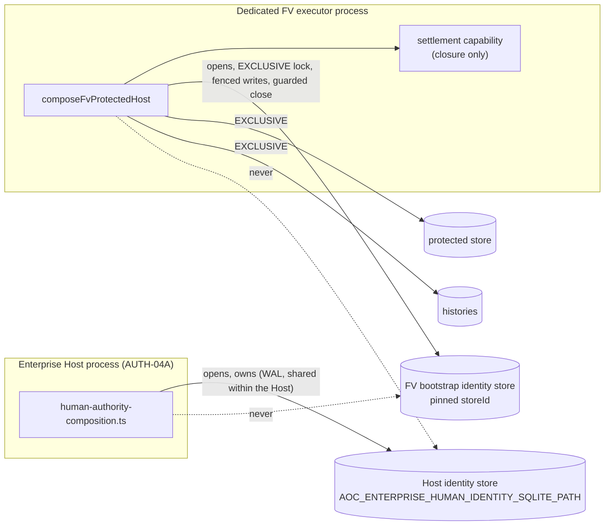

# FV-P4C-2B3C-3 — Single AUTH-03 identity ownership and fenced settlement

**Status: internal and non-operational. Not production-ready.**
- Nothing in the Host, scripts or deployment reaches the FV composition or the dedicated executor.
- The production executor entry composes nothing.
- Bootstrap execution stays disabled: there is no trusted status source (B6).

This increment closes B3C-1's activation blocker **M2**: the AUTH-03 identity store was used by the FV
executor without being owned or locked by it, while AUTH-04A could open the same kind of store in the Host.

## 1. Verified inventory (main `2e32eb15`)

| Where | What it does with an AUTH-03 identity store |
|---|---|
| `composition/human-authority-composition.ts` (AUTH-04A, in the Host) | Opens the Host store (`AOC_ENTERPRISE_HUMAN_IDENTITY_SQLITE_PATH`, default `.data/human-identity.sqlite`) with `openSqliteHumanIdentityStore`: WAL, `synchronous=FULL`, a `busy_timeout`, **no exclusive locking**, optionally CORE-07-anchored. It builds `createHumanIdentityService` and the CORE-05 decision channel, and drains and closes the store at Host shutdown. |
| `human-identity/sqlite-human-identity-store.ts` | The store. Appends are serialized in-process (a promise `tail`). Across connections, every append re-verifies the signed head inside its transaction and requires `UPDATE … WHERE sequence = ?` to change one row, so concurrent writers fail closed rather than fork the chain. Decision and ceremony challenges are separate, unchained tables. |
| `human-identity/service.ts` | `createHumanIdentityServiceWithBootstrapSettlement` issues the service and its `settlementCapability`, bound to a private instance in module-private `WeakMap`s. `recordBootstrapAuthoritySettlement` checks that capability first, then `checkSettlement`, inside the append guard. `revokeBootstrapSettlementCapability` and `isBootstrapSettlementCapabilityOf` work over the same `WeakMap`s. |
| `sovereign-status-history/protected-host-composition.ts` (B3B, as merged) | Issued the settlement pair over an identity store **handed to it already open**, so the caller decided which file and how it was opened. Its boundary checked FV authority (`settlementGuard`) before handing the settlement to AUTH-03's **async** append. |
| B3C-1 test harness | Opened the identity store as an ordinary shared WAL store and handed it in. |

**Who can do what today:**
- **Issue** bootstrap challenges (`beginBootstrapAuthorityDecision`): any holder of a service over the store.
- **Consume** decisions (`authorizeBootstrapAuthorityDecision`): the same.
- **Settle:** only the holder of that service instance's live capability.
- **Revoke the capability:** `revokeBootstrapSettlementCapability`, called at the FV composition's close.

Structurally, nothing in the Host calls the bootstrap methods (pinned by the B2 structure test). The
**physical** store, however, was not exclusively owned. A second process (a Host, another executor, a tool)
could open the same file, issue challenges, consume decisions or append rows. The chain re-verification
stops a fork, but **not a competing owner**.

## 2. Alternatives

| | A. AUTH-04A owns the store; FV reaches it over a channel | B. A dedicated identity-service process | C. Reuse existing infrastructure | **D. Domain-separated store, owned by the FV executor (selected)** |
|---|---|---|---|---|
| **Ownership** | The Host; FV is a remote client | The new process | — (nothing exclusive exists) | AUTH-04A owns the Host store; **the executor exclusively owns its own bootstrap identity store** |
| **Settlement fencing against FV lock loss** | The Host would have to confirm, atomically with its write, that the *requesting* executor still holds its POSIX locks. Possible only by reading `/proc/locks` for a peer PID that it must authenticate (no `SO_PEERCRED` in Node without native code). Two processes, no common transaction. | Same problem, plus a third process. | — | **Same process, same synchronous transaction.** The fence runs inside the identity store's own write transaction: identity lock, protected-store lock and executor authority. |
| **Capability custody** | It must cross a process boundary as a token, or the Host must hold it. | It must cross IPC. | — | It never leaves the executor's closure. |
| **IPC** | New, authenticated, replay-protected | New, authenticated, replay-protected | — | **None** |
| **Write serialization** | Host only | Service only | — | Executor only (the exclusive lock refuses every other connection) |
| **Impact on AUTH-04A** | New private interface and lifecycle | Migration | — | **None**: AUTH-04A does not pass the new option |
| **Crash consistency** | Uncertain-commit handling across a channel (lost replies, retries) | Same | — | One local SQLite transaction; recovery by evidence (B3B) |
| **B3C-2 backup** | Host-side | A new owner to register | — | One more executor-owned file under the existing contract |
| **Cost** | High, with a cross-process TOCTOU that is hard to close | Highest | — | Small. FV operators enrol passkeys in the executor's store (a registration ceremony), separately from their Host credentials. |

**Why D.** It is the only option in which the settlement write and the authority check share a transaction
in one process. Under A or B, the B3B residual (a check, then an asynchronous write elsewhere) would become
a cross-process race that this increment cannot close safely. D needs no IPC, transfers nothing, and
leaves AUTH-04A unchanged. Its cost is a separate enrolment of FV operators, which is the deliberate
separation of a bootstrap-authority domain from the Host's day-to-day identity.

## 3. Ownership model (implemented)

### The composition (`protected-host-composition.ts`)
- **`identity` is configuration, not a store:** `{ storePath, storeId, authenticity, freshness?, relyingParty, operatorIds }`. A handed-in `store` is refused (`OPTIONS_INVALID`).
- **The identity file is a protected FV file:**
  - it passes `checkProtectedFile` (owner-only, canonical, no links), otherwise `PATH_REFUSED`;
  - it is never the protected store or a history, by name or by `dev:ino`, otherwise `OPTIONS_INVALID`.
- **Order:** the protected store is acquired first (a refused second executor never touches the identity
  store). Then the identity store is opened with the new `exclusive` option. Then the histories.
- **Pinned:** the store's `storeId` must equal the configured, registered id, and the organization must
  match. Another store at the path is refused (`IDENTITY_REFUSED`), even when signed by the same deployment
  key: AUTH-04A's store, a copy or a replacement. The pin is checked inside the store too, right after it
  is verified and **before** any open-time write (key re-signing) or CORE-07 contact (review L2), and again
  by the composition.
- **No CORE-07 enrollment from here** (review M1): `identity.freshness` is a boundary and the FV domain
  only, and an `enrollment` is refused (`OPTIONS_INVALID`).
- **Its own freshness domain** (CORE-07-FV-WITNESS, `CORE07_FV_INDEPENDENT_FRESHNESS_DOMAINS.md`):
  `identity.freshness` must name `stateKind: 'fv-bootstrap-identity-state'`, the FV store's own CORE-07
  slot, never the Host's `human-identity-state`. A missing or other domain is `OPTIONS_INVALID`.
- **The identity lock is executor authority** (review L3): once the store is open, `authority()` confirms
  the identity store's lock together with the protected store's, so losing either one marks the composition
  `executor-lost`.
- **Held by another process** (a previous executor still alive): `EXECUTOR_HELD`, which is retryable. The
  dedicated executor's supervisor backs off.
- **Close order:** capability revoked; inventory; identity store (guarded); protected store. Every error
  path after the identity store was opened closes it.

### The store (`sqlite-human-identity-store.ts`, opt-in `exclusive`)
- `locking_mode = EXCLUSIVE` and `busy_timeout = 0` before the first access, and the lock taken at once
  (`BEGIN EXCLUSIVE; COMMIT`), so no peer's SHARED lock can deadlock the acquisition.
- **Every write calls `beforeWrite` synchronously first:** the genesis, key re-signing at open, every
  chained append, ceremony challenges and decision challenges. A refusal records nothing.
  - A chained append is fenced twice: once **before** the CORE-07 witness is asked to prepare (review L1:
    lost authority never leaves a prepared witness head behind), and again as the first statement
    **inside** its write transaction.
- The connection closes only through the owner's guarded `closer`. B3B's `exclusiveCloser` retains a
  connection whose lock is lost, and the exit guard and the dedicated executor's fail-stop end the process
  before any closing checkpoint.
- **AUTH-04A passes nothing,** so its behaviour is byte-for-byte unchanged.

### The fence the composition supplies
`checkProtectedFile(identityPath) === undefined && confirmExclusivelyHeld([identityPath]) && authority()`,
where `authority()` confirms the protected store's lock and latches `executor-lost`.

## 4. Settlement trust model

These are different things, and none implies another:

| Concept | Where it comes from |
|---|---|
| A **signed human authorization** | The AUTH-03 passkey assertion over a bootstrap-authority contract (namespace, binding digest, role, operator, nonce, expiry), consumed once in the executor's own store. |
| **Permission to attempt** a bootstrap | Both decisions consumed, plus CORE-05 Kernel-Authority standing (requester and approver: independent humans), plus executor authority. |
| **Evidence of a commit** | The receiver history's own bootstrap evidence record (same request id and binding), read by the executor that holds that history. |
| A **trusted current status** | The issuer-currentness source (B6), absent. |
| A **durable, correct settlement** | A `decision_outcome` row in the executor's own store, appended only by the live capability's holder, after `checkSettlement` (exact binding, the other role's counterpart, no contradiction), **fenced in the same transaction**. |

**Binding** reuses the authentic AUTH-03 contract fields. A settlement names:
- the commitment of the consumed decision (which fixes the store, the namespace, the binding digest, the role and the operator);
- the counterpart commitment;
- the FV request id;
- the evidence digest, the history revision and the status;
- the outcome.

Cross-store replay is impossible: a commitment exists only in the store that issued its challenge, and the
executor reads only its pinned store. Cross-namespace replay, contradiction and duplicates are refused by
`checkSettlement` (AUTH-03's tests); an identical repeat is `unchanged`.

**Uncertain evidence never becomes `bootstrap-not-committed`.** That rule is inherited from B3B: a pending
intent without evidence stays unresolved.

## 5. The lost-authority race

**The B3B residual.** In B3B, `settlementGuard` confirmed authority synchronously, then AUTH-03's append
ran asynchronously (planning, then signing, then the CORE-07 witness, then the local transaction). Lock loss
in that window could let one settlement through.

**Now.** The last check is **inside** the write transaction:
1. FV verifies its lock (`settlementGuard`).
2. FV hands the settlement to AUTH-03: it is planned, signed and possibly witnessed.
3. FV loses its lock.
4. *A replacement executor begins.*
   - If the stale process still holds the **identity** store, the replacement cannot open it at all
     (`EXECUTOR_HELD`): it cannot issue, consume or settle anything. There is one owner.
   - If the stale process lost the identity lock too, step 5 refuses.
5. The local commit runs `beforeWrite` first, in the same synchronous transaction. The identity lock or the
   protected lock is not confirmed, so the transaction rolls back and nothing is recorded.
   - Under CORE-07, the witness transition fails closed (pending at the witness, as for any failed local
     commit).
   - The reconciler maps the failure to `unresolved SETTLEMENT_FAILED`.

**What still holds.** A settlement committed **before** the loss stays, and is still justified by
immutable evidence. Lock loss is never treated as absence of commitment: B3B's I2 tests settle
`bootstrap-committed` at restart from evidence written by an executor that then lost its lock.

**The remaining window.** It is between the fence's last kernel read and the SQLite write, in the same
synchronous JavaScript turn on the main thread. Only another thread of the same process could close a
descriptor in it, and the dedicated executor runs nothing else. This is the same bound as every B3B fence.

**Demonstrated:**
- *"the B3B residual, closed"*: the lock is dropped right after `settlementGuard` passes, and 0 settlements
  are written. With the in-transaction fence removed, a settlement is written (mutant killed).
- *"the identity store's lock lost"*: no challenge is issued, nothing is consumed, nothing is settled.

## 6. Crash and recovery

There is no cross-process message in this design, so the owner and the executor are one process. The
prompt's scenarios map as follows:

| # | Scenario | Behaviour |
|---|---|---|
| 1–4 | The owner crashes before receipt, after receipt, after validation, or after commit with the reply lost | One process, one SQLite transaction. A crash before the commit records nothing. After it, the row is durable. Recovery reads the store and the history evidence (B3B crash matrix, including `consumed:n` and `beforeConsume:n`, still green). |
| 5 | The executor crashes after "sending" | Same as 1–4. |
| 6 | Lock lost before the owner commits | Refused in the transaction (§5). |
| 7 | A new executor while an old one is pending | Refused while the old one holds the identity store (`EXECUTOR_HELD`). After it, the old one's writes are fenced. Tested: B3B "an old process that lost every lock but its identity store's still blocks a takeover", and B3C-1 "a stale executor … blocks every takeover". |
| 8 | Duplicate after restart | `unchanged` (AUTH-03 idempotence). |
| 9 | Replay under another namespace | Refused (the binding is in the commitment; AUTH-03 tests). |
| 10 | Same request, contradictory outcome | Refused (`checkSettlement`). |
| 11 | Identity-store rollback | Refused at open **when CORE-07 freshness is composed** (tested with a real witness). Without freshness, an older signed copy verifies: freshness is an activation requirement. |
| 12 | Identity-store replacement | Refused by the `storeId` pin (tested). |
| 13 | Owner restart with unresolved work | Unsettled decisions are re-read from the store, and intents resolved from evidence (B3B). |
| 14 | Simultaneous AUTH-04A and FV activity | Different files, different owners, both working at once (tested). |
| 15 | Shutdown during a settlement | B3C-1's stop awaits in-flight work, then performs a guarded close. A lost lock is fail-stopped. |

## 7. Restart and revocation
- **The capability** is revoked at the composition's close and on every error path. It exists only for one
  composition's lifetime, in its closure.
- **The identity store's lock** is released only by a guarded close (lock confirmed held). Otherwise the
  connection is retained and the process fail-stops.
- **The supervisor and the status channel** carry no identity operation (structure test).

## 8. AUTH-04A compatibility
- No change to `human-authority-composition.ts`, its schema, routes or behaviour.
- The store's new option is opt-in; AUTH-04A passes nothing.
- The AUTH-02, AUTH-03, AUTH-04 and CORE-05 consumer suites are unchanged and green.
- **Operational consequence:** an FV operator enrols a passkey in the FV bootstrap identity store
  separately, through a registration ceremony. Revoking a Host credential does **not** revoke an FV one.
- **The cross-cutting control** is Kernel-Authority standing (CORE-05's standing port, checked on every
  bootstrap): revoking an operator's standing stops FV approvals in both. The FV enrolment and revocation
  ceremonies are B3C-2 / operations work.

## 9. PROD-02 implications
- The persistence contract now lists the **bootstrap identity store as executor-owned** (`bootstrap-identity-store`).
- AUTH-04A's Host store is listed as **never opened by the executor**.
- The Host store keeps its existing PROD-02 registration.
- The FV identity store follows the same executor-mediated or cold snapshot rule as the other FV files (B3C-2).
- A restored FV identity store must be re-pinned (store id) and re-anchored at CORE-07 through the
  operator ceremony. Restoring it never re-enables a consumed challenge, because consumption is chained.

## 10. Security review, tests and mutants

**Independent review.** It was done by an AI agent of the same model family, which reconstructed the
threat model from the code and reproduced its findings. **It is not a human review.**

| Finding | Severity | Resolution |
|---|---|---|
| **M1:** CORE-07's `human-identity-state` slot is one per organization, not namespaced. An FV store created against AUTH-04A's witness inherits AUTH-04A's store id (`genesisStoreId`), which defeats the pin, and each owner's appends would then make the other refuse at open as a rollback. Reproduced. | Medium (High once activated) | **Mitigated fail-closed; activation blocker.** The composition never enrolls a witness slot. A store not created under that witness fails closed against it, and AUTH-04A's store keeps working (tested with a real witness). Giving the FV store its own slot needs a CORE-07 change (a namespaced kind) or a separate witness. CORE-07 is out of scope here, so this is a **prerequisite for activation**, together with an FV registration ceremony that never creates the FV store under the Host's witness. |
| **L1:** a fence refused after the witness `prepare` left the witness pending recovery | Low | Fixed: a fence before `prepare` too |
| **L2:** open-time writes and witness `establish` ran before the pin check | Low | Fixed: the pin is checked in the store, before either |
| **L3:** losing only the identity lock did not change readiness | Low | Fixed: the identity lock is part of executor authority |
| **Info:** `heldByAnotherProcess` counted any byte-range lock | Info | Fixed: SQLite's SHARED range only |
| **Info:** the identity open has no retry loop, unlike the protected store | Info | Accepted: availability only. Two executors are serialized at the protected store first, and a transient refusal is `IDENTITY_REFUSED`. |

**Publication review (PR #255).** A second, read-only AI review of the published diff (same model family,
not a human):

| Finding | Severity | Resolution |
|---|---|---|
| The M1 refusal checked the caller's `identity.freshness` object, then passed that same object to the store. A Proxy hiding `enrollment`, or an `enrollment` added after the synchronous checks, reached the store, which could then bind the organization's one unbound `human-identity-state` slot to the FV store. Reproduced; reachable only by the trusted composition root. | Low (defence in depth) | Fixed in two layers: the composition reads its `identity` option once into a frozen snapshot and passes the store a new `{ boundary }`; the store refuses `exclusive` together with `enrollment` (`HUMAN_IDENTITY_CONFIGURATION_INVALID`). Covered by an e2e test (Proxy, late mutation, and the Host still binding the slot at genesis) and by structure assertions. |
| `identity.storeId` was read three times, so a getter could return different values | Info | Fixed by the same snapshot |
| `journal_mode`/`synchronous` pragmas and the guarded close's WAL checkpoint run before the store-id pin, under the exclusive lock. A misconfigured path naming AUTH-04A's file while AUTH-04A is down would checkpoint its committed WAL frames before refusing. No data changes. | Info | Accepted: no logical change, and the path is trusted configuration |
| A store held only by a non-exclusive reader reports `IDENTITY_REFUSED`, not the retryable `EXECUTOR_HELD` | Info | Accepted: availability only |
| The FV identity store has no rollback detection while M1 stands | Info | Part of the M1 activation blocker |

**What the review verified holds:** no capability leak; all five write paths fenced; the
exclusive-lock ordering; no `-shm` file; the guarded close; separate files by path and `dev:ino`; AUTH-04A
unchanged; no production reachability; stale executors cannot write.

**Tests and mutants:** see the CHANGELOG entry and the increment report for the exact counts:
- `tests/fv-p4c2b3c3-identity-ownership.e2e.test.mjs`: real processes and a real CORE-07 witness;
- `src/enterprise/__tests__/fv-p4c2b3c3-identity-ownership-structure.test.ts`;
- the updated B3B and B3C-1 suites;
- targeted mutants of every new guard.

## 11. Closed and still open

**Closed in B3C-3:**
- The ownership ambiguity of the FV identity store (B3C-1's M2): one exclusive owner, pinned by path and
  store id, never shared with AUTH-04A.
- B3B's settlement check-then-write gap, within the supported synchronous single-threaded execution model:
  the authority check now runs inside the identity store's own write transaction.

**Closed by CORE-07-FV-WITNESS** (a separate increment, `CORE07_FV_INDEPENDENT_FRESHNESS_DOMAINS.md`):
- The FV-specific CORE-07 freshness anchor (M1): the FV store has its own domain,
  `fv-bootstrap-identity-state`, at the API, persistence and verification levels.

**Still open (each blocks operational activation):**
- ~~The FV registration ceremony that creates the FV store and anchors its genesis in that domain at the
  deployment's witness~~: **implemented, non-operational, by FV-P4C-2B3C-2A1** (`FV_IDENTITY_REGISTRATION_AND_OPERATOR_LIFECYCLE.md`). Activation still
  needs a production registration issuer and the composition's `registration` gate made mandatory.
- The FV credential enrolment and revocation ceremonies (B3C-2A2 and B3C-2A3, designed in `FV_IDENTITY_REGISTRATION_AND_OPERATOR_LIFECYCLE.md`, not
  implemented). Revoking a Host credential does not revoke an FV
  credential.
- B3C-2 backup and restore.
- Operational process and filesystem isolation.
- B6 (a trusted issuer-currentness source) and FV-P4D (whole-system rollback).

## 12. Residual limitations
- **Not atomic between threads:** the fence and the write are atomic only on the main thread; another
  thread of the process could still close a descriptor (§5). The dedicated executor runs nothing else.
- **Rollback without freshness:** an older signed copy of the FV identity store verifies, so CORE-07
  freshness (in the FV domain) must be composed before activation.
- **CORE-07 slot sharing (review M1): closed by CORE-07-FV-WITNESS.** The FV store anchors in its own
  domain, `fv-bootstrap-identity-state`. Both domains still trust the same witness when they share one;
  coordinated restoration of the witness with the stores stays undetectable (FV-P4D).
- **Separate enrolment:** FV operators' passkeys are separate from their Host credentials. The ceremonies
  are B3C-2 / operations; Kernel standing is the shared control.
- **Same-user or root writer:** outside the trust boundary. A raw write breaks the signed chain, and the
  store is then refused at open.
- **Whole-system rollback:** FV-P4D. A status source: B6.
- **Not production-ready. Operational activation: NO-GO.**
