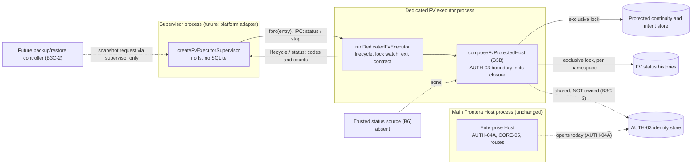

# FV-P4C-2B3C-1 — Dedicated FV executor and supervised lifecycle

**Status: internal and non-operational. Not production-ready.**
- Nothing in the Host, its scripts, its deployment files, its Dockerfile or its package starts the
  executor or its supervisor. Structure tests pin this.
- The production entry composes nothing: it reports `FAILED` / `DEPENDENCIES_UNAVAILABLE` and holds
  nothing.
- Bootstrap execution stays disabled. There is no bootstrap command, and no status source (B6).

This increment builds on FV-P4C-2B3B (`FV_PROTECTED_HOST_COMPOSITION.md`). It resolves the
dedicated-process prerequisite that B3B recorded: B3B's fail-stop must not run next to unrelated workloads.

## 1. Why dedicated isolation is mandatory

The protected composition's authority is SQLite's exclusive lock, a POSIX record lock. Such a lock
belongs to the **whole process**:
- **Any in-process open-and-close drops it.** If any code in the process opens and closes one of the
  executor's files, the lock is gone: a backup job, a log shipper or a health probe would do it.
- **Lock loss forces SIGKILL.** A process that lost its lock must not close or exit normally. A closing
  or exit checkpoint would write into files another executor now owns (B3B C1). So it ends by `SIGKILL`,
  which would also kill every unrelated service sharing the process.

The executor therefore runs **alone in its own OS process**. It is started and observed only by its
supervisor, over the IPC channel that the supervisor created. A fatal FV executor failure ends that
process only.

## 2. Process architecture

| Component | Owns | Never does |
|---|---|---|
| Main Host | its own stores (and today the AUTH-03 identity store, through AUTH-04A) | open, close or probe an FV executor file; import the executor |
| Supervisor | the executor child process, the restart policy | open, stat or copy an executor file; load `fs` or SQLite; read a status from disk |
| Executor | its protected store, its histories, their locks, its AUTH-03 boundary and capability, its lifecycle | run other work; accept code or modules; expose handles, secrets or paths |
| Status source (B6) | — (absent) | — |
| Backup controller (B3C-2) | — (deferred) | open an active executor file (§9) |

## 3. Modules (all in `src/enterprise/sovereign-status-history/`)

| File | Role |
|---|---|
| `dedicated-executor-protocol.ts` | IPC protocol, lifecycle states and transition relation, reason codes, command parser. Data only, with no runtime import. |
| `dedicated-executor.ts` | The executor runtime, `runDedicatedFvExecutor`: preflight refusals, lifecycle, lock watch, termination contract, IPC handling. |
| `dedicated-executor-main.ts` | The production entry. Inactive by construction (`compose: undefined`); its one argument is the protected store's absolute path. |
| `dedicated-executor-supervisor.ts` | The supervision contract (`decideAfterExit`, pure) and a Node child-process adapter (`createFvExecutorSupervisor`). |
| `executor-persistence-contract.ts` | The ownership and backup contract for PROD-02 / B3C-2. Declarative only. |
| `executor-exclusivity.ts` | B3B, plus `exclusiveConnectionCount()` and `exclusiveConnectionsSafe()`. |

`tests/fv-p4c2b3c1-executor-entry.mjs` is a **test-only** entry. It composes the B3B synthetic world: a
synthetic identity, temporary databases and no status source, with injectable faults.

## 4. The executor process

### Preflight refusals
These happen before anything is opened; the process then reports `FAILED` and holds nothing:

| Reason | Condition |
|---|---|
| `PLATFORM_UNSUPPORTED` | Not Linux, or not the main thread (a worker is refused). |
| `NOT_A_DEDICATED_PROCESS` | There is no supervisor IPC channel, so it never runs in its caller's process. Also refused when the process already does other work: a listening or connected socket, or its own `uncaughtException`, `unhandledRejection`, `SIGTERM`, `SIGINT`, `message` or `disconnect` handler. This is a heuristic (review L1); real isolation is the deployment's job (§12). |
| `ALREADY_RUNNING_IN_PROCESS` | The process already holds, or has held, executor state. |
| `OPTIONS_INVALID` | No protected store path, or a bad watch interval. |
| `DEPENDENCIES_UNAVAILABLE` | No composition function: the production entry. |

**Inputs.** No environment variable is read. No module is loaded by name, and there is no plugin
loader. The supervisor starts the child with `env: {}`, `execArgv: ['--disable-sigusr1']` and no stdio
other than IPC:
- No inherited `NODE_OPTIONS`, `--require`, `--import` or `--inspect`.
- No inspector on `SIGUSR1` (review M1). Otherwise any process of the same user could attach and run
  code inside the executor.

## 5. Lifecycle state machine

The relation (`FV_EXECUTOR_TRANSITIONS`) is closed and frozen; nothing else is a transition.

| From | To | Trigger | Observable |
|---|---|---|---|
| `CREATED` | `PREFLIGHT` | runtime starts | lifecycle event |
| `PREFLIGHT` | `ACQUIRING_EXCLUSIVITY` | a composition function exists | event |
| `PREFLIGHT` | `FAILED` | `DEPENDENCIES_UNAVAILABLE` | event; parked |
| `ACQUIRING_EXCLUSIVITY` | `RECOVERING` | `composeFvProtectedHost` returned (B3B steps 1–8: filesystem policy, exclusive acquisition, epoch, history assessment, intent resolution by evidence, AUTH-03 custody) | event |
| `ACQUIRING_EXCLUSIVITY` | `FAILED` | a composition refusal (§6) | event; exit 75 (`EXECUTOR_HELD`), or parked |
| `RECOVERING` | `READY_INACTIVE` / `DEGRADED` / `QUARANTINED` | the one startup reconciliation finished; the composition readiness is `ready` / `degraded` / `unavailable` | event, and `lastReconciliation` in the status |
| `READY_INACTIVE` → `DEGRADED` → `QUARANTINED` | worse only | the lock watch observes a worse readiness | event |
| any running state | `EXECUTOR_AUTHORITY_LOST` | the lock watch or a stop finds the protected-store lock unconfirmed | event, then `SIGKILL` |
| any non-terminal state | `STOPPING` | a `stop` command, `SIGTERM`, `SIGINT` or a supervisor disconnect | event |
| `STOPPING` | `STOPPED` | in-flight work has finished and a guarded close released every lock | event; exit 0 |
| any non-terminal state | `FAILED` | an uncaught exception or unhandled rejection | event; guarded close; exit 70 |

`VERIFYING_PERSISTENCE` is not a separate state. B3B's composition verifies persistence and acquires
exclusivity in one call, so the two are not separately observable. Both are reported as `ACQUIRING_EXCLUSIVITY`.

What the states do **not** mean:
- **`READY_INACTIVE` is not a permission to bootstrap.** The executor has no bootstrap command, and the
  status reports `bootstrapExecution: 'disabled'`.
- **`QUARANTINED` and `DEGRADED` never improve in place,** through a timer or a poll. Recovery is a new
  process, with a new epoch, after the operator has acted.
- **`FAILED` says nothing about any bootstrap**, and in particular not that one did not commit. Pending
  intents stay in the protected store, and the next start resolves them by evidence only.
- **`EXECUTOR_AUTHORITY_LOST` is terminal.** Authority is regained only by a new process that acquires
  it afresh.

## 6. Supervision contract and restart policy

`decideAfterExit(observation, recentRestarts, now, policy)` is pure. A platform adapter applies it.

| Observation | Decision | Why |
|---|---|---|
| Requested stop, clean (`STOPPED` or parked `FAILED`, exit 0) | `stopped` | normal stop |
| Requested stop, unclean (a signal, or `AUTHORITY_LOST_DURING_SHUTDOWN`) | **blocked** `UNCLEAN_STOP` | something touched the files, or the stop hung: the operator looks first (review L3) |
| Reported non-retryable reason: `PATH_REFUSED`, `PROTECTED_STORE_REFUSED`, `CUSTODY_REFUSED`, `OPTIONS_INVALID`, `PLATFORM_UNSUPPORTED`, `NOT_A_DEDICATED_PROCESS`, `DEPENDENCIES_UNAVAILABLE`, `COMPOSITION_FAILED` | **blocked** | a restart would repeat it. The executor also *parks*: it stays alive, `FAILED` and inactive, so even a naive `restart: always` policy cannot storm. |
| Exit 78 with no report | **blocked** `REFUSED_TO_RUN` | refused before it could report |
| Clean exit the supervisor did not request (an outside `SIGTERM` or `SIGINT`) | **blocked** `UNEXPLAINED_CLEAN_EXIT` | do not fight whoever stopped it |
| Crash, a signal, `EXECUTOR_AUTHORITY_LOST`, or `EXECUTOR_HELD` (exit 75) | restart after `base·2^(n−1)` ms, at most `maxDelayMs` | transient; the old holder may still be dying |
| More than `maxRestarts` within `windowMs` | **blocked** `RESTART_LIMIT` | no restart storm |

**Policy validation** (review L2):
- `maxRestarts` is from 0 to 100.
- `windowMs`, `baseDelayMs` and `maxDelayMs` are from 1 to 2³¹−1, with `base ≤ max`.
- Defaults: 3 restarts per 10 min, backoff from 1 s to 60 s.

**What blocking means.** A block is cleared only by `acknowledgeBlock()`, an explicit operator call;
never by a timer. The operator sees why readiness was refused from:
- the supervisor snapshot: `blockedReason`, plus `lastExit` (code, signal, last state, last reason);
- the executor's status while it is parked (`lastReason`).
Diagnostics are codes only, and the child's stderr is not captured.

**Other guarantees:**
- **Duplicate instances.** One supervisor never runs two executors (`ALREADY_RUNNING`). Across
  supervisors, the protected-store lock refuses the second (`EXECUTOR_HELD`), which backs off and then
  blocks.
- **Startup is not bootstrap.** Starting proves nothing about a bootstrap, and a restart clears no intent.
- **Supervisor death.** If the supervisor dies, the IPC channel disconnects and the executor stops
  cleanly. It never holds the locks unsupervised.
- **Stale state.** After an exit, the supervisor reports no live executor state. The last report
  survives only in `lastExit`, so a dead executor can never look `READY` during backoff.

**Platform adapters.**
- **Tests:** the Node adapter in this module.
- **Production (to be chosen at activation):** Frontera already runs the reference executor as its own
  Compose container (`deploy/authority-pilot/compose.executor.yaml`, with `init: true` and
  `restart: unless-stopped`). An FV executor container would follow that pattern, with:
  - its own volume for its files;
  - `stop_grace_period` at least the stop timeout;
  - the parked-`FAILED` behaviour providing the non-retryable block that Docker's restart policy cannot
    express.
- **systemd** would map to:
  - `Restart=on-failure`;
  - `RestartPreventExitStatus=78`;
  - `StartLimitBurst` / `StartLimitIntervalSec`;
  - `KillMode=process`.

No deployment file is added in this increment.

## 7. Shutdown and fail-stop

**Normal stop:**
1. `STOPPING`; the lock watch stops.
2. New commands are refused (`STOPPING`); `status` is still answered.
3. In-flight work (composition or the startup reconciliation) is **awaited, never abandoned**. The
   supervisor bounds the wait: it sends `SIGTERM` after `stopTimeoutMs` and `SIGKILL` after twice that.
   `SIGKILL` is always safe here.
4. The protected-store lock and every exclusive connection are confirmed held.
5. `host.close()`: the capability is revoked, and the inventory and protected store are closed through
   B3B's guarded closer.
6. Every exclusive connection is confirmed closed.
7. `STOPPED` is reported, the event is flushed, IPC disconnects, and the process exits 0.

**Lock lost at any point** (watch, stop or fatal): no close, no checkpoint, no repair. The intents stay as
they are. `EXECUTOR_AUTHORITY_LOST` is reported, then the process ends by `SIGKILL`.

**Termination contract in the dedicated process.** It is stronger than B3B's single `exit` listener:
- `process.exit` is wrapped. Any caller's exit (a dependency's, or one called from inside an `exit`
  listener) first checks `exclusiveConnectionsSafe()`, and `SIGKILL`s if that fails.
- A fail-stop `exit` listener is **prepended**, so it runs before any listener registered earlier (for
  example one that would itself exit again).
- Every exit path the runtime controls checks first.

**The B3B exit-listener edge.** B3B's residual was an earlier `exit` listener calling `process.exit()`
again, pre-empting the guard. It is **closed for the dedicated process and demonstrated**:
- The test harness registers such a listener before the executor starts. It exits through a
  `process.exit` cached before the wrapper.
- After a silent lock drop, the process still ends by `SIGKILL`, not with the listener's exit code.
- Targeted mutants show that the prepended listener is what kills it (§13).

It is **not** proven against code that prepends its own listener *after* the executor starts. No such
code runs in the dedicated process, which loads only its entry. The independent review confirmed
experimentally that `process.exit`, `process.reallyExit` and `process.abort` do **not** checkpoint an
exclusive WAL; only a natural exit or `close()` does, and both are guarded.

## 8. Status and IPC interface

IPC is the `fork` channel the supervisor created (JSON serialization). It is not a socket, not a port and
not an HTTP route.

**Commands** (supervisor → executor) are exactly
`{ protocol: 'frontera.fv-executor-ipc/1', type: 'status' | 'stop', id }`:
- an exact key set, a plain-object prototype, an `id` matching `^[A-Za-z0-9_-]{1,64}$`;
- at most 512 bytes serialized;
- anything else is rejected as `MALFORMED`, `OVERSIZED` or `COMMAND_UNKNOWN`. That includes `bootstrap`,
  `reconcile`, `exec`, `sql` and `snapshot`.

**Events** (executor → supervisor):
- `lifecycle`: `instanceId`, `state`, `reason`, `at`;
- `status`;
- `rejected`.

The supervisor validates each status payload's exact key set and types before passing it on
(review L4).

**Status fields:**
- `instanceId`, `pid`, `state`, `startedAt`;
- `readiness`, `bootstrapExecution`, `epoch`;
- configured, admitted and quarantined namespace counts;
- the pending-intent count;
- `protectedStoreLock` (`not-acquired` / `held` / `lost` / `released`);
- `lastReconciliation` (`at`, `outcome`, `entries`, `unresolved`);
- `lastReason`;
- `protectedStoreSchema`.

A status contains no secret, key, capability, handle, SQL interface, private record, evidence payload
or path. A status request is answered from the executor's memory, so it opens nothing.

## 9. PROD-02 integration contract (B3C-2 preparation; `executor-persistence-contract.ts`)

**Current PROD-02 behaviour.** The registry (`scripts/portability/store-registry.mjs`) is a static list.
Live backup opens each registered file read-only in the backup CLI's own process, and runs SQLite's
online backup API.
- Against an executor-held file from another process, that is **refused** while the file is locked.
- Inside the executor's process, it would **drop** the lock.

So neither is allowed, and the registry names no FV store today (a structure test pins this).

| Question | Answer |
|---|---|
| Who owns each database? | The executor owns the protected store (records, intent journal, epoch) and every history, with their `-wal`. **The AUTH-03 identity store is not owned** (see below). |
| How is a consistent snapshot requested? | **Executor-mediated:** the supervisor asks; the executor confirms its locks, fences, and runs SQLite's backup API from its own held connection into a configured output directory, reporting schema identity, epoch, counts and SHA-256. Or **cold:** stop the executor (`STOPPED`), keep the supervisor stopped, copy, then start. Both are **deferred to B3C-2**. |
| When may a database be read? | By the executor at any time; by anyone else only when the executor is `STOPPED` and its supervisor is held stopped. |
| Where may backup output go? | A directory configured for the backup controller, outside the executor's data directory, never overlapping an executor file. |
| How is snapshot integrity verified? | PROD-02's own checks on the copy (integrity check, schema identity, checksums), plus the FV continuity record matching the copied history. |
| What is never allowed while the executor runs? | Opening, probing, copying or checksumming an executor file or its `-wal` from inside the executor's process; opening it from another process in a retry loop; byte-copying a live file; deleting, renaming or replacing a file; restoring over it. |
| What about restore? | It is never promoted automatically. A restored set starts quarantined until the operator ceremony (B3C-2). A whole-system rollback remains undetectable without FV-P4D. |

**The identity store is not owned (review M2).** The executor's composition uses the AUTH-03 identity
store, but does **not** own or lock it. Any process of the same user can open it and issue
bootstrap-authority challenges for the identities the executor relies on. The contract names it under
`notOwned` as an **activation blocker until B3C-3**.

## 10. AUTH-03 identity lifecycle (plan for B3C-3)

**The two lifecycles today:**
- **AUTH-04A** (`composition/human-authority-composition.ts`, in the Host):
  - opens the identity store `AOC_ENTERPRISE_HUMAN_IDENTITY_SQLITE_PATH` in WAL mode, without exclusive
    locking;
  - builds the Host's human identity service and the CORE-05 decision channel over it;
  - drains and closes it at Host shutdown.
- **B3B's composition** issues its own `createHumanIdentityServiceWithBootstrapSettlement` pair over an
  identity store it is **handed**. It verifies custody (`isBootstrapSettlementCapabilityOf`, a private
  `WeakMap` per service instance) and revokes the capability at close.

**Store identity.** `human_identity_meta.store_id` and `organization_id`, plus the CORE-07 witness slot
`human-identity-state`. Appends re-verify the head inside a transaction, so two concurrent writers make
each other fail closed rather than fork the chain.

**Plan:**
- **The exclusive owner of the bootstrap-settlement capability is the dedicated executor.** It must be
  issued in that process only, and never cross IPC. Signing keys are never copied to the supervisor or
  the status channel: the store holds only a bound signer function, and the executor would hold its own.
- **Who may request bootstrap challenges** (`beginBootstrapAuthorityDecision`): only the executor's
  composition. The Host's AUTH-04A service must not offer that method for FV namespaces.
- **Who may settle consumed decisions:** only the executor's reconciler (the capability's holder).
- **Preventing double ownership.** Either:
  - **(a)** a dedicated FV identity store owned and locked by the executor, with its operators enrolled
    through a ceremony; or
  - **(b)** AUTH-04A remains the store's owner, and the executor reaches it through a narrow,
    authenticated interface that exposes only the bootstrap-decision ceremony and settlement.

  B3C-3 chooses one. Until then the production entry composes nothing, and activation is NO-GO.
- AUTH-04A's behaviour is unchanged by this increment.

## 11. Recovery and quarantine

These are inherited from B3B and exercised through the process boundary:
- **A pending intent without evidence** keeps its namespace quarantined across any number of restarts.
  Its decisions stay unresolved, even past the grace bound.
- **Committed evidence** completes its intent at the next start, and the decisions settle.
- **A corrupt, missing or other-namespace history** quarantines only that namespace. A missing history is
  never recreated, and a record is never re-anchored.
- **No intent is cleared** automatically, and no restore is promoted automatically.

## 12. Platform restrictions and trust limits

- **Linux only, main thread only.** Network filesystems are unsupported.
- **A same-user filesystem writer is outside current protection.** POSIX advisory locks do not stop a raw
  write. The damage is detected and quarantined at the next start (test 27), but not while running.
- **The "dedicated process" check is a heuristic.** Isolation itself (its own container or unit, its own
  volume, nothing else running in it) is a deployment requirement for activation, and is not implemented.
- **Visible arguments.** The protected store's path is visible in the executor's argv
  (`/proc/<pid>/cmdline`). It never crosses IPC.
- **Not atomic.** The settlement guard and the AUTH-03 write are not atomic (B3B I3).
- **Whole-system rollback** detection is FV-P4D's.

## 13. Security review and test evidence

**Independent review.** The review was done by an AI agent of the same model family, from the code only,
with reproductions. **It is not a human review.**

| Finding | Severity | Resolution |
|---|---|---|
| M1: `SIGUSR1` opened an unauthenticated inspector, so a same-user process could execute code in the executor | Medium | Fixed: `--disable-sigusr1`; e2e and structure tests |
| M2: the AUTH-03 identity store is not executor-owned, and the contract omitted it | Medium | Recorded: `notOwned`, activation blocker, B3C-3 (§9, §10) |
| L1: an IPC channel alone passed the dedicated-process check | Low | Mitigated: foreign sockets and handlers are refused; it is a heuristic (§12) |
| L2: a policy could storm or overflow a timer | Low | Fixed: validation |
| L3: an unclean requested stop looked like a normal stop | Low | Fixed: `UNCLEAN_STOP` block |
| L4: status payloads were passed on unvalidated | Low | Fixed: exact keys and types |
| L5: `COMPOSITION_FAILED` is non-retryable | Low | Intended: fail-safe, needs the operator |
| Info: `failStop` and `fatal` set their state outside the relation, immediately before `SIGKILL` or exit | Info | Accepted: cosmetic |

**Found during implementation.** After an exit, the supervisor kept reporting the dead executor's last
state (for example `READY_INACTIVE`) through the backoff. Fixed: the state is cleared on exit and kept in
`lastExit` only.

**Tests:**
- `tests/fv-p4c2b3c1-dedicated-executor.e2e.test.mjs`: 36 tests with real processes.
- `src/enterprise/__tests__/fv-p4c2b3c1-dedicated-executor-structure.test.ts`: 6 structure tests.
- **Targeted mutants**, run on the compiled code in an isolated copy, each against only the tests that must
  kill it, with a bounded timeout. Every file was restored and hash-verified.
  - **Killed:** the prepended exit guard; the lock watch; the IPC-child check; the dedicated-process check;
    parking on non-retryable reasons; stop on disconnect; unknown commands; the size bound; stale
    supervisor state; the SIGUSR1 inspector; an inherited environment; duplicate start; the restart limit;
    the unclean-stop block; status validation.
  - **Survived alone, by design (redundant layers):**
    - The `process.exit` wrapper is covered by the prepended listener. Both removed together: killed.
    - The close-time lock check, the retained-connection check and the exit-time check, alone or two
      together, are covered by the remaining one. All three removed: killed.

## 14. Remaining dependencies

- **B3C-2:**
  - PROD-02 registration;
  - executor-mediated or cold snapshot, and restore into quarantine;
  - operator ceremonies for quarantined intents and lost executors.
- **B3C-3:** a single owner of the AUTH-03 identity store and the bootstrap-settlement capability (§10).
- **Deployment isolation:** its own container or unit and volume, and the supervisor's platform adapter.
- **B6:** a trusted issuer-currentness source.
- **FV-P4D:** an independent continuity witness.
- **FV-P5:** document-use enforcement.

**Operational activation: NO-GO.**
