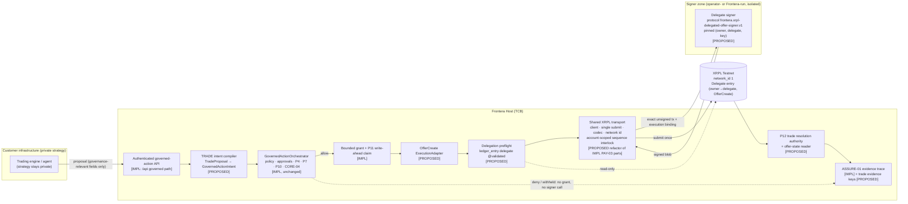

# TRADE-00 — Governed Delegated Trading: Architecture & Feasibility Audit

> **Frontera is not a trading engine.** It is the independent authority layer
> that decides what an automated trading engine may do. XLS-75 defines what the
> XRPL lets a delegate sign. Frontera defines the narrower policy conditions
> under which its protected execution path will authorize that delegated action.

- Status: **audit only.** No functional code, contract, signer protocol, test,
  dependency or configuration was changed. No wallet was created, no key was
  used and no transaction was submitted.
- Milestone: TRADE-00. Track: TRADE (Governed Delegated Trading).
- Date of audit: 2026-10-12. Network observations: 2026-10-12 22:45–22:53 UTC.
- Verdict: **CONDITIONAL GO** (§20).

Notation used throughout:

- **[IMPL]** — exists in this repository at the baseline commit, verified in code.
- **[PROPOSED]** — does not exist; a design proposal of this audit.
- **[VERIFIED-NET]** — observed by a read-only query against a public XRPL node.
- **[SPEC]** / **[SRC]** — stated by the XLS-75 specification / read in rippled
  source at tag `3.4.1`.
- **[UNVERIFIED]** — could not be established during the audit.

---

## 1. Executive Summary

1. **The protocol gate is open.** `PermissionDelegationV1_1` is **enabled on XRPL
   Testnet** (network ID 1, rippled 3.4.1) [VERIFIED-NET]. It is also enabled on
   Devnet and, as of 2026-10-08 (ledger 107524865), on Mainnet. In rippled 3.4.1,
   `OfferCreate` is explicitly `Delegation::Delegable`; its permission value is 8 [SRC].
   The original `PermissionDelegation` amendment was withdrawn after a
   fee-charging vulnerability and is not enabled anywhere [VERIFIED-NET].
2. **Delegated OfferCreate has the right shape for Frontera.**
   - The delegate signs and pays the fee. The owner's `Sequence` is consumed, and the
     Offer belongs to the owner [SRC][SPEC].
   - Permission is checked when the transaction is applied, against the current ledger.
     It fails with a retriable `terNO_DELEGATE_PERMISSION`, and no fee is charged [SRC].
3. **The installed `xrpl@5.3.0` supports everything needed.** Its binary-codec
   definitions match Testnet's `server_definitions` exactly, so no SDK upgrade is
   required.
4. **CORE can be reused unchanged.** OfferCreate becomes a governed action class through
   the same host-data extension points PAY used: governance configuration, parameter
   dimensions, profiles, financial classification, an `ExecutionAdapter` route and a
   P12 resolution authority. No change to the governance core is required.
   - Several trading controls cannot be enforced by CORE alone: notional value,
     reference-price deviation, live exposure, active-order count and price floors.
     They need TRADE-specific code and/or authoritative external data (§9).
5. **The XRPL submission architecture must be refactored before live execution, not
   before TRADE-01.** The PAY XRPL rail is Payment-only by design and by test. Its signer
   protocol rejects a delegated transaction in four places (§5.3). Its durable
   submission interlock is keyed by (owner account, Sequence). A trading adapter that
   shares an owner account with the Payment rail would otherwise contend for the same
   owner Sequence.
   - **Recommendation (Option C, §6.2):** extract a formally shared, transaction-neutral
     XRPL transport (client, single submit site, codec, network identity, account-scoped
     sequence interlock).
   - Keep a closed Payment adapter and add a separate closed OfferCreate adapter.
   - Give TRADE a separate delegate signer protocol.
   - Do this through an ADR in TRADE-04, with PAY's structural tests carried over
     rather than loosened.
6. **PAY-06 can continue independently.** It does not touch the XRPL rail. Conflicts are
   limited to sequential registries, counts and documentation, so TRADE should take its
   CORE-07 slot, EP number and SEC-INV range after PAY-06 merges (§17).
7. **TRADE-01 can safely begin now.** It covers the pure domain contracts and has no XRPL
   transport, no Host wiring and no shared-registry edits.

---

## 2. Repository Baseline and Commit References

| Item | Value |
|---|---|
| Repository | `Republika-Network/Frontera` |
| Worktree | `/mnt/c/Users/Usuario/source/Republika-Network/Frontera-trade` (dedicated TRADE worktree, confirmed with `git worktree list`) |
| Branch | `feat/trade-00-xls75-audit`, tracking `origin/main` |
| HEAD at audit start | `a14922fbfc221dfd7bb20f05e9b3f3cbd0511e45` (`feat: add PAY-05 settlement and receipts (#180)`), equal to `main` |
| Working tree at start | clean (`git status --short --branch` printed only the branch line) |
| Node.js | v22.23.1 |
| TypeScript | 5.9.3 |
| XRPL SDK | `xrpl` 5.3.0 (exact pin, `package.json`); `ripple-binary-codec` 2.11.0 |
| PAY-06 | `feat/pay-06-lightning-rail` @ `4718e58`, merge-base with main `a14922f`; read only through `git diff`/`git show` |
| Website | `Republika-Network/frontera-web`: `origin/main` @ `f48ffc8` (`feat: add governed payment interactive demo (#31)`); audited read-only in the `frontera-web-governed-payment` worktree, which is at that commit |

Validation commands in this repository (`package.json` scripts):
- `npm run typecheck` (`tsc -b`) and `npm run lint` (Node16-import check, architecture
  lint, public-surface lint).
- `npm test`: build, then `node --test` over `dist/src/**/*.test.js` and
  `tests/**/*.test.mjs`, then workspace tests.
- `npm run validate:release`: the full gate.

Live XRPL suites run only when an environment flag is set: `FRONTERA_XRPL_TESTNET_SMOKE=1`
for `pay02-xrpl-testnet-smoke.test.ts` and `FRONTERA_XRPL_TESTNET_PAY03=1` for
`pay03-xrpl-testnet-production.test.ts`.

Worktrees shown as `prunable` (Windows paths under WSL) were left untouched.

---

## 3. Existing Frontera Capabilities

### 3.1 Governance spine [IMPL]

The `GovernedActionOrchestrator` (`src/enterprise/governed-action/orchestrator.ts`;
`govern()` from l.745) runs these steps in order:

1. Identity binding and closed intent validation (l.747–750).
2. Server-side `requestId` (l.755).
3. LAND-01 reconsideration (l.768–783).
4. Kernel evaluation and Governance Store commit with re-read (l.787–796).
5. Deny or indeterminate exits here (l.823).
6. Replay detection on the execution id (l.836–841).
7. CORE-05 approval gate (l.850–869).
8. P4 emergency-control admission (l.911–918).
9. Grant terms (l.920).
10. CORE-04 obligations re-read (l.929–938).
11. Issuance with P10 and CTRL-02 withholding (l.956–999).
12. Grant/decision consistency (l.1001).
13. Authorization evidence (l.1008).
14. Exercise assessment (l.1016).
15. Approval re-check (l.1028–1034).
16. P11 prepare, then P12 bind, then the write-ahead claim, then exercise, then the
    adapter (l.1036–1130).

The orchestrator has **no action-class registration API.** Action classes enter only as
trusted host data:
- `GovernanceConfiguration {parameterDimensions, actionClasses, resourceClasses,
  profiles, reservedContextKeys}` (`src/enterprise/governance-profile/contracts.ts:139-152`).
- The `monetary.actionClassifier`.
- An `ExecutionAdapter` plus an `action → adapterId` route
  (`src/enterprise/host/enterprise-host.ts:77,129-149`).

| Capability | Where | Notes for TRADE |
|---|---|---|
| Closed governed-action envelope | `src/enterprise/governed-action/contracts.ts:66-108` | One optional `amount {value,currency}`; typed `parameters`; `expectedGovernanceProfile` is a pin, never a selector |
| Typed parameters | `src/features/governed-parameter-runtime/domain/parameter-value.ts:30` (`boolean`/`integer`/`token`), `parameter-bound.ts:33` (`exact`/`maximum`) | No decimal type and no `minimum` bound |
| Governance Profiles | `src/enterprise/governance-profile/` | Identity `<id>@<version>#<digest>`, signed into the grant scope |
| Policy predicates | `src/features/domain-policy-pack-runtime/domain/policy-pack-condition.ts` | Over `parameter`, `contextFact`, `restrictiveFact`, `amount`, `actionClass`; ordered comparison and `in`, no arithmetic |
| Bounded grants | `src/features/grant-runtime/domain/bounded-grant.ts:53-106` | Ed25519-signed (SEC-INV-123). Immutable. **No usage counter, by design** (l.42–51); consumption lives in P7 |
| Kernel-Authority lineage | `src/enterprise/kernel-authority/contracts.ts:224-271` | `authority-grant`/`delegation-grant` with actions, resource scopes, `expiresAt`, monetary `constraints`, `parameterBounds`; re-resolved at commit and at exercise |
| Trusted Context Boundary (CORE-04) | `trusted-context` sources with `attests [{factClass,maxAgeSeconds}]` | Context digest is bound into the grant; decision `validUntil` caps grant expiry (SEC-INV-136…139) |
| Durable approvals (CORE-05) | profile `approval` | Bound to the committed decision and re-checked before the claim (SEC-INV-143…146) |
| P7 capacity | `src/features/exercise-control-runtime/` | `spending_limit` buckets, `amount` or `count`, atomic `BEGIN IMMEDIATE` admission (SEC-INV-071). A settled reservation consumes forever |
| P9/P10 money | `src/features/monetary-runtime/domain/canonical-decimal.ts:37-60`; `src/enterprise/kernel-authority/financial-authority-resolver.ts` | Canonical decimal text compared with BigInt; add, subtract and compare only; no FX (SEC-INV-091) |
| P11 outcomes / P12 reconciliation | `src/features/execution-runtime/`, `src/enterprise/execution-reconciliation/` | Write-ahead claim, at most one adapter invocation per execution id (SEC-INV-077/108); unconfirmed is never retried (SEC-INV-108/120) |
| CORE-07 freshness | `src/enterprise/authority-state-freshness/checkpoint.ts` | Witness-anchored state slots; the XRPL interlock is anchored |
| Revocation / emergency stop | CTRL-01 grant revocation; P4 `emergency-control-port.ts:43` scopes | Effective at the next exercise, **not** on the ledger |
| Evidence | ASSURE-01 `GET /api/evidence/traces/{requestId}` (`src/enterprise/api/evidence-contract.ts:82,92`) | Unified authority-to-outcome trace |
| Organization isolation | `servedOrganizationId`, `orchestrator.ts:747-758` | One organization per Host |

### 3.2 PAY as the vertical template [IMPL]

`ADR-PAYMENTS-AS-A-GOVERNED-VERTICAL.md` and
`src/features/payment-runtime/domain/payment-governance.ts` show how PAY plugged in:

1. A vertical intent compiles down to the generic envelope.
2. Parameter dimensions are exported data.
3. The action is listed as financial.
4. The effect is an ordinary `ExecutionAdapter`
   (`services/payment-rail-execution-adapter.ts`).
5. Ceilings come from Kernel-Authority constraints.
6. Composition lives only in edges: `src/enterprise/xrpl-payment-rail/`,
   `payment-protocol-ingress/` and `payment-settlement/`.

`payment-runtime-boundaries.test.ts:84-101` fences these edges.

### 3.3 XRPL infrastructure [IMPL] — PAY-02/03/05

| File | Role | Payment-specific? |
|---|---|---|
| `rails/xrpl/xrpl-sdk-client.ts` | The only `new Client(` and the only `command:'submit'` (`fail_hard:true`) | Generic except the `autofill` type |
| `rails/xrpl/xrpl-codec.ts` | `signedPaymentMatches` (field-set closure plus `encodeForSigning` equality plus hash); `signedByPinnedKey` (no multisig, cryptographic verify) | Generic logic, Payment typing |
| `rails/xrpl/xrpl-result-normalizer.ts` | `readSubmission` (only `tem*` definitive), `readAutofill` (only Sequence/Fee may change), `readLookup` | `readLookup` is Payment-specific (`delivered_amount`) |
| `rails/xrpl/xrpl-rlusd-rail.ts` | Network check, restart quarantine, LLS, autofill, fee ceiling, per-account serialization, interlock, sign → verify → reserve → submit once → finality | Mixed lifecycle and Payment semantics |
| `rails/xrpl/xrpl-submission-interlock.ts` + `src/enterprise/xrpl-payment-rail/sqlite-xrpl-submission-interlock.ts` | Durable forward-only `submitting → unconfirmed → settled`; blocks by (account, sequence); witness-anchored; no delete | Generic concept, Payment `amount` columns, scope `{railId, networkId}` |
| `rails/xrpl/xrpl-config.ts` | Network required; mainnet requires `allowMainnet:true`; wss only; known-host cross-check | Asset and source accounts are Payment-shaped |
| `src/enterprise/xrpl-payment-rail/signer-protocol.ts` | `frontera.external-xrpl-transaction-signer.v1`, one operation `sign-xrpl-payment` | Payment-only (`parsePreparedXrplPayment`, l.120–139) |
| `external-xrpl-signer.ts`, `signer-http-transport.ts` | Pinned identity handshake (no TOFU), fresh request id, bearer token, loopback-or-https, no retry | Payment-only |
| `reference/reference-xrpl-signer-service.ts` | Key file 0600, loopback bind, single account | Signs for its own address only |
| `xrpl-finality.ts`, `xrpl-finality-authority.ts`, `xrpl-resolution-authority.ts` | PAY-05 finality, P12 resolution | Payment-specific lookups |
| Host guard: `host-configuration.ts:167-172`; `enterprise-host.ts:213-219` | The Host refuses to start if any `*XRPL*SEED/SECRET/PRIVATE/MNEMONIC/WALLET` variable is present | Generic custody guard |

Structural fences that TRADE must respect:
- `rails/xrpl/tests/xrpl-rail-boundaries.test.ts`:
  - l.78: the exact list of SDK importers.
  - l.104: exactly one `new Client(` and one submit literal repo-wide.
  - l.114: submit ordering.
  - l.133: no retry vocabulary.
  - **l.140: "the rail constructs Payment only — no OfferCreate …".**
  - l.148: Flags 0, no partial payment.
  - l.156: no custody vocabulary.
  - l.170: one `await sign(`.
- `src/enterprise/__tests__/pay03-xrpl-production-structure.test.ts`:
  - l.58: one `createXrplSdkClient` caller.
  - l.84–95: custody rules.
  - l.111: exactly one signer operation and two paths.
  - l.118: no retry in the transport.
  - l.144: no DELETE/DROP in the interlock.
- `no-bypass-effect-paths.test.ts` and `NO_BYPASS_AUTHORITY_CONTROLLED_EXECUTION.md`
  EP-069/EP-070 (l.174–175): "one closed Payment shape … no other transaction type".

### 3.4 Commercial website [IMPL] (`frontera-web`, read-only)

The site is a Vite 8 + React 19 single-page app with a static prerender
(`scripts/prerender.mjs`), deployed on Vercel (`vercel.json` rewrites). It has **no
backend, API route or server function.**

**`/demo/governed-payment`:**
- Route constants: `src/landing/enterprise/governed-payment-demo/route.ts`.
- Page: `GovernedPaymentDemoPage.tsx`.
- Pure reducer: `model.ts`, with steps `request → blocked → approve → reconsider →
  authorized → execute → confirmed → receipt` plus a locked ceiling test.
- Synthetic fixture: `fixture.ts`, using `demo:wallet/...` identifiers.
- Display components: `moments.tsx`, `Receipt.tsx`, `Stepper.tsx`, `Walkthrough.tsx`,
  `AuthorityCeilingTest.tsx`, `parts.tsx`.
- All text: `copy.ts`. It includes the disclosures "Every step on this page is simulated.
  Nothing is signed, nothing is submitted, and no payment network or ledger is contacted."

**Isolation is enforced in two overlapping layers:**
1. `eslint.config.js` (≈l.27–65) uses `no-restricted-imports` (xrpl, ripple-*, Node
   built-ins, adapters/ports) and `no-restricted-globals` (fetch, XHR, WebSocket, storage).
2. `governed-payment-demo/boundary.test.ts` scans every source in the folder for:
   - network calls, dynamic import and `/api/` paths;
   - env access and seed/PEM/r-address/tx-hash shapes;
   - signing vocabulary.
   The page test also refuses "Testnet|Mainnet|tesSUCCESS|ledger index|transaction hash"
   in rendered text.

Branding comes from `src/landing/enterprise/brand.ts`: jade `#1F9D7A` / `#0B5548` and
graphite/stone surfaces.

---

## 4. XLS-75 Specification and Testnet Status

### 4.1 Status matrix

The audit separates five kinds of evidence:

| Kind | Finding | Source |
|---|---|---|
| Specification | XLS-75 `status: Final`, updated 2026-09-25 (commit `7b89b23`, 2026-09-29) | github.com/XRPLF/XRPL-Standards/tree/master/XLS-0075-permission-delegation |
| Amendment history | `PermissionDelegation` (2.5.0) → withdrawn (`Supported::no`, 2.6.1, PR #5805) after a vulnerability; `fixDelegateV1_1` (3.0.0, never enabled); **`PermissionDelegationV1_1`** added in 3.2.0 (PR #5825), `Supported::Yes` from 3.3.0, `VoteBehavior::DefaultNo` | rippled `features.macro` per tag; https://xrpl.org/blog/2025/vulnerabilitydisclosurereport-bug-sep2025 |
| Activation per network | Testnet: **enabled**. Devnet: enabled. Mainnet: enabled 2026-10-08 (ledger 107524865, EnableAmendment tx `478284066BA0B83CC35CA1174F667F43D9577782F221440AFCC5541788F25A77`) | `feature` RPC [VERIFIED-NET]; mainnet date per xrpscan API plus `tx` lookup by the research pass |
| SDK support | xrpl.js ≥ 4.3.0; installed 5.3.0 has `DelegateSet`, common `Delegate`, `ledger_entry.delegate`; codec definitions equal Testnet `server_definitions` | `node_modules/xrpl`, `node_modules/ripple-binary-codec` (read-only) |
| Observed ledger behaviour | **None.** No delegated OfferCreate was observed. A bounded `ledger_data type:delegate` scan of Testnet found no Delegate objects | read-only scan, incomplete (marker remained) |

The xrpl.org documentation pages still carry `status: not_enabled` in their frontmatter.
That lags behind the activation observed on the network.

### 4.2 Read-only network verification [VERIFIED-NET]

The checks used `server_info`, `feature` and `server_definitions` over JSON-RPC POST.

| Network | Endpoint | network_id | Build | Validated ledger (time) | `PermissionDelegationV1_1` | `fixCleanup3_4_0` |
|---|---|---|---|---|---|---|
| Testnet | `https://s.altnet.rippletest.net:51234` (cross-checked `testnet.xrpl-labs.com`) | 1 | 3.4.1 | 21489931 (2026-10-12T22:53Z) | enabled, supported | **not enabled** |
| Devnet | `https://s.devnet.rippletest.net:51234` | 2 | 3.4.1 | 6073273 (22:45Z) | enabled | enabled |
| Mainnet | `https://s1.ripple.com:51234` (Clio) / xrplcluster.com | 0 | 3.4.1 | 107615610 (22:53Z) | enabled; the original `PermissionDelegation` is `enabled=false, supported=false` | not enabled |

Testnet `server_definitions` contains:
- `TRANSACTION_TYPES.DelegateSet = 64` and `OfferCreate = 7`;
- `LEDGER_ENTRY_TYPES.Delegate = 131`;
- `TRANSACTION_RESULTS.terNO_DELEGATE_PERMISSION = -85`.

Testnet resets periodically, so these observations are point-in-time.

### 4.3 Answers to the protocol questions

The [SRC] references below are to rippled tag `3.4.1`.

1. **Enabled on Testnet?** Yes [VERIFIED-NET].
2. **Endpoint and network ID:** `s.altnet.rippletest.net:51234`, network_id 1, build 3.4.1.
3. **What can be delegated?**
   - Transaction-type permissions: PermissionValue = TxType + 1, range 1..65536, value 0
     refused. They apply to every type marked `Delegable` in `transactions.macro`.
   - Twelve hard-coded granular permissions (65537–65548): TrustlineAuthorize/Freeze/
     Unfreeze, AccountDomainSet/EmailHashSet/MessageKeySet/TransferRateSet/TickSizeSet,
     PaymentMint/Burn and MPTokenIssuanceLock/Unlock.
   - **Not delegable:** AccountSet (as a full type), SetRegularKey, SignerListSet,
     AccountDelete, DelegateSet, Vault*, Batch (the wrapper), Loan*/LoanBroker*,
     ConfidentialMPTConvert, SponsorshipTransfer and the pseudo-transactions.
4. **Is OfferCreate supported?** Yes. `TRANSACTION(ttOFFER_CREATE, 7, OfferCreate,
   ({.delegable = Delegation::Delegable, …}))` [SRC], so PermissionValue = 8. OfferCancel
   is also delegable (value 9). **There is no granular OfferCreate permission**: the
   ledger cannot restrict pair, amount, price or flags. That narrowing is exactly
   Frontera's job.
5. **DelegateSet:** `{TransactionType:"DelegateSet", Account:<owner>,
   Authorize:<delegate>, Permissions:[{Permission:{PermissionValue:"OfferCreate"}}]}`.
   - At most 10 permissions (`kPermissionMaxSize`); more gives `temARRAY_TOO_LARGE`.
   - A non-empty list **replaces** the whole set; it does not merge.
   - Errors: `temMALFORMED` (self, duplicates, non-delegable value), `tecNO_TARGET`
     (delegate missing), `tecPSEUDO_ACCOUNT`.
6. **Ledger representation:** `ltDELEGATE` (0x0083).
   - Fields: `Account`, `Authorize`, `Permissions`, `OwnerNode`, `PreviousTxnID`,
     `PreviousTxnLgrSeq`, plus an optional `DestinationNode` (the entry is also linked
     from the delegate's directory).
   - Keylet: `SHA-512Half(0x0045 ‖ AccountID(owner) ‖ AccountID(delegate))`. The research
     pass reproduced the documented example index offline.
   - The **owner** pays one owner-reserve increment.
7. **Query and verify:** `ledger_entry {delegate:{account,authorize},
   ledger_index:"validated"}` (Testnet accepts the request form and returns
   `entryNotFound` for a non-existent pair), or `account_objects {account:owner,
   type:"delegate"}`.
8. **Revocation:** `DelegateSet` with `Permissions: []` deletes the entry and frees the
   reserve. An empty list with no entry gives `tecNO_ENTRY`. A partial revoke is a resend
   of the reduced list.
9. **Delegated transaction format:** an ordinary OfferCreate with `Account` = owner and
   `Delegate` = delegate address.
   - `Delegate` is a common signing field (AccountID, nth 12), so it is covered by the
     signature.
   - `Delegate == Account` gives `temBAD_SIGNER`.
10. **Who signs?** The delegate: master key, regular key, or the delegate's own signer
    list. `checkSign` uses `sfDelegate` when present [SRC].
11. **Who pays the fee?** The delegate (`getFeePayer` uses `tx.getInitiator()`) [SRC][SPEC].
12. **Who owns the Offer?** The owner (`Account`). It sits in the owner's directory and
    counts toward the owner's OwnerCount and reserve.
13. **Sequence numbers:** the **owner's** `Sequence` (or `TicketSequence`) is checked and
    consumed. The delegate's is untouched [SRC][SPEC]. xrpl.js `autofill` reads
    `account_info` of `tx.Account`, which is correct for delegation.
14. **Insufficient state:**
    - Delegate cannot cover the fee: standard fee-payer failure against the delegate's
      balance (exact code **[UNVERIFIED]**, probably `terINSUF_FEE_B`).
    - Owner below the offer reserve: `tecINSUF_RESERVE_OFFER` (OfferCreate.cpp L892–899).
      This is fee-charging, so the fee comes from the **delegate**.
    - Missing permission: `terNO_DELEGATE_PERMISSION`.
    - Amendment off: `temDISABLED`.
15. **When is permission checked?** In `preclaim`, in the order `checkSeqProxy →
    checkPriorTxAndLastLedger → checkSponsor → invokeCheckPermission → checkSign →
    checkFee`, against the current view each time the transaction is applied (open
    ledger and consensus) [SRC]. There is no sign-time check.
16. **After revocation:** any not-yet-applied delegated transaction fails with
    `terNO_DELEGATE_PERMISSION`. It is not included and no fee is charged.
17. **Can a signed but unsubmitted transaction run after revocation?** Not while revoked.
    **But it becomes executable again if the permission is re-granted before its
    `LastLedgerSequence`**, as long as the owner's `Sequence` has not advanced. A `ter`
    result also means a node may hold and retry it. Mitigations: short
    `LastLedgerSequence`, never re-grant while authorized blobs are outstanding, and
    consume or let expire the owner Sequence before declaring an authorization dead
    (§12, §13).
18. **Other restrictions:**
    - No self-delegation; the delegate must exist and must not be a pseudo-account.
    - **Delegated transactions are never queued** (`telCAN_NOT_QUEUE`; TxQ "Disallow
      delegated transactions from being queued", PR #7640), so a fee spike rejects
      rather than queues.
    - Sponsor combined with Delegate gives `temINVALID`.
    - New transaction types stay non-delegable until integrated.
    - Advisory: do not delegate `PaymentBurn` until `fixCleanup3_4_0` is enabled (not
      enabled on Testnet or Mainnet). This is irrelevant to OfferCreate but must be in
      the TRADE policy denylist.
19. **Does `xrpl@5.3.0` support it?** Yes (§5).
20. **Upgrade needed?** No (§5).

---

## 5. SDK Compatibility

| Check | Result |
|---|---|
| `xrpl` version | 5.3.0, the current npm `latest` |
| First version with XLS-75 | 4.3.0 (2025-06-09, HISTORY.md) |
| `DelegateSet` model | `node_modules/xrpl/dist/npm/models/transactions/delegateSet.{js,d.ts}`: max 10, duplicate check, partial non-delegable list |
| `Delegate` common field | `models/transactions/common.d.ts:74` `Delegate?: Account` |
| Codec | `ripple-binary-codec` 2.11.0 `definitions.json` has `Delegate` (field and ledger type 131), `DelegateSet` 64, `PermissionValue`; identical to Testnet `server_definitions` (diffed by the research pass) |
| Offline round-trip | A `DelegateSet` naming OfferCreate/OfferCancel/TrustlineAuthorize encodes, decodes and passes `validate`; numeric 8 decodes to `"OfferCreate"`. No keys were used |

**Gaps and risks** (none blocking):
- The client-side non-delegable list is incomplete (Vault/Loan/ConfidentialMPTConvert/
  SponsorshipTransfer). Client validation must never be treated as policy.
- The `Delegate` ledger TypeScript type lacks `DestinationNode`; this is typing only.
- `PermissionValue` is typed as a string only.
- `validate()` acceptance of `Delegate` on OfferCreate is **[UNVERIFIED]** offline; to be
  covered by a TRADE-02 unit test.

Upgrading would be a lockfile change with a regression surface across the qualified
PAY-02/03/05 path. It is not needed.

---

## 6. Proposed Governed Trading Architecture

### 6.1 Component architecture (Diagram A)



### 6.2 XRPL submission architecture: options evaluated

| Criterion (from repository evidence) | A: Distinct trading adapter + extracted shared transport | B: Generalized submission boundary with Payment and OfferCreate adapters | **C (recommended): A's separation + B's single sequence authority** |
|---|---|---|---|
| One `new Client(` / one submit site (`xrpl-rail-boundaries.test.ts:104`) | Kept: transport extracted | Kept | Kept |
| PAY "Payment only" invariant (`:140`, EP-069/070) | Untouched for PAY; the new directory escapes the fence unless duplicated | Must become an allowlist `{Payment, OfferCreate}`: **weakens a qualified invariant** | PAY adapter keeps a closed Payment shape and its test; a sibling fence states "TRADE adapter constructs OfferCreate only" |
| Owner-Sequence contention (`sqlite-xrpl-submission-interlock.ts:42-45`, keyed by account+sequence within `{railId,networkId}`) | **Broken** if two interlocks serve one owner account | Solved: one interlock | Solved: one interlock keyed `{networkId, account}`, shared by both adapters; or, for the PoC, disjoint accounts enforced at composition |
| Signer surface | Separate protocol (good) | Tagged union or second operation in one protocol: broader signer | Separate, narrowly typed delegate signer protocol; PAY signer unchanged |
| Regression risk to qualified PAY-02/03/05 | Low–medium (transport move) | High (ordering-marker tests, interlock schema, readAutofill) | Medium, concentrated in one ADR-governed extraction with PAY tests carried over unchanged in meaning |

**Recommendation: C.** The PAY XRPL rail keeps its closed Payment shape, its signer
protocol and every existing structural assertion, re-anchored to the new file layout
without loosening. A new transaction-neutral `xrpl-transport` module owns four things:
- the SDK client and the only submit call;
- the codec (`signedTransactionMatches`, `signedByPinnedKey`);
- network identity and the restart quarantine;
- the **account-scoped** submission interlock.

Both the Payment adapter and the OfferCreate adapter sit on top of it and supply closed,
type-specific builders, parsers and lookups.

**PoC simplification.** The interlock refactor is the riskiest step. TRADE-04 may first
ship with a dedicated TRADE interlock scope, plus a Host composition check that refuses
start-up if any TRADE owner account is also a PAY source account. That keeps
cross-adapter Sequence contention impossible by construction. The shared interlock then
follows before multi-vertical use of one account.

### 6.3 Where TRADE code lives [PROPOSED]

- **Rail-free domain:** `src/features/trade-runtime/`. It holds the domain contracts, the
  intent compiler, the policy profile data and the adapter port. It must not import
  `xrpl`, and CORE must not import it.
- **XRPL-specific rail:** `src/features/trade-runtime/rails/xrpl/`. It reaches the
  network only through `xrpl-transport`.
- **Composition edges:** `src/enterprise/xrpl-trade-rail/`. These are the delegate signer
  client, the interlock binding and the P12 authority.

This mirrors the PAY layering and its boundary tests.

---

## 7. Existing Components to Reuse (unchanged)

| Component | Path | Responsibility in TRADE |
|---|---|---|
| Orchestrator | `src/enterprise/governed-action/orchestrator.ts` | Entire decision → grant → claim → adapter pipeline |
| Envelope | `src/enterprise/governed-action/contracts.ts` | Target of the TradeProposal compiler |
| Governance configuration and profiles | `src/enterprise/governance-profile/` | `xrpl-offer-create` action class, `trading_account` resource class, TRADE profile |
| Parameter runtime | `src/features/governed-parameter-runtime/` | `exact` order dimensions; `maximum` only for monotone integers |
| Policy packs | `src/features/domain-policy-pack-runtime/` | Pair and issuer allowlists, price bounds against attested facts |
| Trusted context | CORE-04 sources | Reference-price band, delegation fact, active-order count |
| Approvals | CORE-05 | Optional human approval above thresholds |
| P4 emergency control | `emergency-control-port.ts` | Halt new submissions per organization, adapter or resource |
| P7 | `src/features/exercise-control-runtime/` | Conservative per-account submitted-volume and count limits |
| P9/P10 | `src/features/monetary-runtime/`, `src/enterprise/kernel-authority/` | Per-order and windowed ceilings on the governed (TakerGets) leg |
| Grants | `src/features/grant-runtime/` | Signed, expiring, scope-bound authority |
| P11/P12 | `src/features/execution-runtime/`, `src/enterprise/execution-reconciliation/` | Single invocation, no blind retry, reconciliation |
| CORE-07 | `src/enterprise/authority-state-freshness/` | Rollback detection for any new TRADE durable store |
| ASSURE-01 | `src/enterprise/api/evidence-contract.ts` | Authority-to-outcome trace |
| XRPL client, codec, normalizer, quarantine, interlock | `src/features/payment-runtime/rails/xrpl/*`, `src/enterprise/xrpl-payment-rail/sqlite-xrpl-submission-interlock.ts` | Reused **after** extraction into `xrpl-transport` (TRADE-04 ADR); never imported directly from payment-runtime (`payment-runtime-boundaries.test.ts:92-99` forbids it) |
| Signer HTTP transport pattern and reference signer pattern | `src/enterprise/xrpl-payment-rail/signer-http-transport.ts`, `reference/` | Template for the delegate signer (pinning, bearer, loopback, size caps, no retry) |
| Host custody guard | `host-configuration.ts:167-172` | Already refuses XRPL seed-like env vars; extend the pattern to TRADE variables |

---

## 8. Components That Must Be Developed [PROPOSED]

```
src/features/trade-runtime/
  domain/
    trade-proposal.ts            # closed TradeProposal contract + validator
    trade-amount.ts              # XRPL amount (drops | IOU canonical decimal), no floats
    trade-price.ts               # limit price as exact rational (num/den BigInt), canonical text
    trade-governance.ts          # compileTradeIntent → GovernedActionIntent; TRADE_PARAMETER_DIMENSIONS
    trade-execution-state.ts     # state model (§12)
    delegation-proof.ts          # DelegationObservation contract (§10)
  services/
    trade-execution-adapter.ts   # ExecutionAdapter bridge (validated action → rail)
  rails/xrpl/
    xrpl-offer-builder.ts        # closed OfferCreate (+Delegate) builder
    xrpl-offer-rail.ts           # preflight → prepare → sign → verify → reserve → submit once → finality
    xrpl-offer-lookup.ts         # AffectedNodes → offer outcome (created/partial/filled/killed)
    xrpl-delegation-reader.ts    # ledger_entry delegate @validated
  tests/
    trade-runtime-boundaries.test.ts
    xrpl-offer-rail-boundaries.test.ts
src/features/xrpl-transport/     # extracted, transaction-neutral (TRADE-04 ADR)
src/enterprise/xrpl-trade-rail/
  delegated-signer-protocol.ts   # frontera.xrpl-delegated-offer-signer.v1
  external-delegated-signer.ts
  host-composition.ts / host-configuration.ts
  xrpl-trade-resolution-authority.ts
  reference/reference-delegated-signer-service.ts
scripts/run-reference-xrpl-delegated-signer.mjs
src/enterprise/__tests__/trade0x-*.test.ts
docs/architecture/ADR-TRADE-GOVERNED-DELEGATED-TRADING.md
docs/architecture/ADR-XRPL-SHARED-TRANSPORT.md
docs/integrations/trade/*
```

---

## 9. Trading Domain and Policy Model

### 9.1 TradeProposal [PROPOSED]

The proposal is closed: unknown fields are refused. Monetary values are canonical decimal
strings or BigInt integers only, never JavaScript numbers.

| Field | Meaning | Governed as |
|---|---|---|
| `organizationId` | Tenant | Bound by Host identity (`servedOrganizationId`), never caller-chosen |
| `requestId` | Server-derived | Orchestrator (l.755) |
| `idempotencyKey` | Business-operation identity from the engine | Envelope `idempotencyKey` |
| `network` | `xrpl-testnet` (network_id 1) | `exact` token dimension plus rail config pin |
| `ownerAccount` | XRPL `Account`; the Offer owner | Envelope `resource` (`trading_account` class) |
| `delegateAccount` | XRPL `Delegate`; signer and fee payer | `exact` token dimension plus signer pin |
| `pair` | `BASE/QUOTE` with issuers (`XRP` or `CUR.rIssuer`) | `exact` token dimension; allowlisted by policy |
| `side` | `sell-base` / `buy-base` | `exact` token |
| `takerGets` | **What the owner gives up** (sold asset and amount) | Envelope `amount` (P9/P10 apply); `exact` |
| `takerPays` | **What the owner wants to receive** | `exact` token (canonical decimal text) |
| `limitPrice` | Derived, never free: `takerPays/takerGets` as an exact rational in a normalized direction | `exact` token; policy compares it to attested bands |
| `flags` | Closed subset: `tfPassive`, `tfImmediateOrCancel`, `tfFillOrKill`, `tfSell` | `exact` token (canonical flag set) |
| `expiration` | OfferCreate `Expiration` (Ripple epoch) ≤ grant `notAfter`-derived bound | Adapter-enforced |
| `validity` | Requested execution window | Capped by grant expiry and LLS |
| `marketContext` | Engine's view of the market | **Untrusted.** Recorded as evidence only, never a policy input |

The XRPL semantics are deliberate. `TakerGets` is what the offer creator (the owner)
gives, and `TakerPays` is what the owner receives. The TRADE compiler derives `side` and
`limitPrice` from the two amounts and refuses a proposal whose stated side or price
disagrees with them.

XRP is carried as an integer drop string. IOU values are canonical decimal text with the
issuer namespaced (`xrpl:USD/rIssuer`, as in SEC-INV-090).

### 9.2 Trading Policy Profile — control classification

| Control | Classification | How |
|---|---|---|
| Approved trading pairs | **Existing infrastructure + config** (small TRADE compile step) | `pair` token dimension and policy `parameter in [...]` |
| Approved issuers | **Existing infrastructure + config** | Issuer-namespaced asset ids in the P9 registry, plus an issuer token dimension |
| Max amount per order | **Existing CORE** (governed leg) | P10 `max_amount` on the lineage (`issuance-core.ts:290-312`). The counter-leg is bounded only by `exact` binding plus a price band |
| Max notional exposure (reference unit) | **New TRADE + external data** | CORE has no FX and no multiplication. Requires an attested notional fact or a TRADE-computed value checked against an attested price band |
| Aggregate exposure | **Partially CORE (P7) + new TRADE + external data** | P7 `spending_limit` gives conservative submitted-volume windows only. Net open exposure needs ledger-attested offer state |
| Absolute limit-price bounds | **Existing infrastructure + new TRADE normalization** | Policy ordered comparison over a canonical-decimal price; direction normalized so "worse" is always "greater". Floors need that normalization because there is no `minimum` bound |
| Trusted reference-price deviation | **External data + new TRADE source** | A CORE-04 source must attest `price.lower`/`price.upper` bands with a short `maxAgeSeconds`. CORE cannot compute ±x%. Whether a decimal-text parameter reaches the BigInt comparison path unrefused is **[UNVERIFIED]**; it is the first TRADE-03 test |
| Max active orders | **New TRADE + external data** | Live count from `account_offers`/owner directory attested via CORE-04. A P7 `count` only counts submissions |
| Delegation authorization | **Existing CORE (Frontera lineage) + new TRADE (ledger proof)** | Kernel-Authority delegation grants for the agent, plus the §10 ledger proof |
| Policy expiration | **Existing CORE** | Mandatory grant expiry (1–3600 s); lineage `expiresAt`; profile versioning |
| Approval requirements | **Existing CORE / config** | CORE-05 profile `approval` |
| Emergency trading halt | **Existing CORE for new submissions; new TRADE for resting offers** | P4 halts admission and exercise. Cancelling resting offers needs a governed `OfferCancel` action class (deferred, §18) |

Limit-price enforcement is not slippage protection. A limit price only bounds the worst
execution rate that is acceptable. It says nothing about whether the rate is fair
relative to the market at the moment the transaction is applied. A deviation check needs
a trusted reference price, and it still has a TOCTOU window equal to `maxAgeSeconds`
plus the ledgers until `LastLedgerSequence`.

Prices and market facts supplied by the trading engine are never treated as verified.

**Source of truth for exposure and active orders.** The XRPL ledger, at a *validated*
ledger index, is the authority on resting offers (owner directory or `account_offers`)
and fills (transaction metadata `AffectedNodes`). Frontera's P7 ledger is the authority
on what Frontera *authorized*. TRADE must reconcile the two and never let the engine's
own book state stand in for either.

### 9.3 Authorization binding

The existing grant semantics suffice for an **order-per-request** model when TRADE
follows the binding rules in the table.

| Property | Binding |
|---|---|
| Exact proposal / canonical transaction parameters | Every OfferCreate field is an `exact` dimension. The adapter rebuilds the transaction from the grant-bound values only, and the codec checks field-set closure plus `encodeForSigning` equality against the prepared transaction |
| Owner and delegate | Owner = `resource`; delegate = `exact` dimension plus signer pin triple |
| Network | `exact` dimension plus rail config `networkId` plus `server_info.network_id` check |
| Policy version | The profile reference is signed into the grant. **Policy-pack version is not bound to the grant** [gap, §19] |
| Trusted context | `contextDigest` is in the signed grant source; decision `validUntil` caps expiry |
| Expiry | Grant `expiresAt` ≥ OfferCreate `LastLedgerSequence` horizon ≥ `Expiration` |
| Single use | The P11 write-ahead claim on `executionId = H(requestId, decisionId)` gives one adapter invocation. The grant itself is reusable until expiry by design; TRADE adds a P7 `count = 1` per execution where needed and keeps grant lifetime ≤ 60 s |

**TOCTOU risks.**
- Context age.
- Decision-to-apply ledger drift.
- Revocation on the ledger between preflight and apply.
- Owner Sequence contention.
- Engine-side book state.
- Resting offers outliving grants.

Mitigations are in §12–13.

---

## 10. Delegation Verification Design [PROPOSED]

The `DelegationObservation` record contains:
- `networkId`, `ledgerIndex` (validated), `ledgerHash` and `closeTime`;
- `owner` and `delegate`;
- the delegate entry `index` (keylet), the `permissions` array and `PreviousTxnID`;
- `observedAt`.

The reader may only use `ledger_entry {delegate:{account,authorize}}` at
`ledger_index:"validated"`, reached through the network-checked transport.

| Fact | When checked | Why |
|---|---|---|
| Owner and delegate addresses | At compile (exact dimensions) and at signer pin | Static binding |
| Network identity | At boot and before every preparation (`server_info.network_id`) | Existing PAY-03 pattern |
| `OfferCreate` (value 8) ∈ Permissions | As a CORE-04 attested fact at decision time **and** re-read immediately before signing | The ledger is authoritative; a stale fact must not reach the signer |
| Freshness | `maxAgeSeconds` ≤ 10 s for the pre-sign read | Bounds the window |
| Revocation | The pre-sign re-read and `terNO_DELEGATE_PERMISSION` handling | The ledger re-checks at apply anyway |

The preflight is defence in depth, not a guarantee, because the ledger checks again at
apply time. `terNO_DELEGATE_PERMISSION` is therefore a first-class P11 outcome.

---

## 11. Signing and Custody Architecture

**The existing signer cannot be reused unchanged** (§3.3). It is refused at:
- `signer-protocol.ts:121`: exact Payment field set; `Delegate` is unknown;
- `signer-protocol.ts:147`: transaction `Account` must equal the request account;
- `external-xrpl-signer.ts:155,170`: the same account equality;
- the reference signer's `request.account !== wallet.classicAddress` check.

Loosening those checks would weaken PAY's qualified protocol.

**Proposal: a separate, narrowly typed protocol,
`frontera.xrpl-delegated-offer-signer.v1`.**
- Single operation `sign-xrpl-delegated-offer`, on its own path.
- Identity advertises `delegations: [{owner, delegate, signingPublicKey}]`. The Host pins
  the triple exactly, with no TOFU.
- The request carries:
  - the exact closed unsigned OfferCreate (`Account`=owner, `Delegate`=delegate, closed
    flag subset, `Sequence`, `Fee`, `LastLedgerSequence`, optional `Expiration`);
  - the `executionId` and the grant id/digest, for signer-side audit logging;
  - a fresh 32-byte request id.
- The signer must:
  - re-parse with a closed parser;
  - refuse `Account === Delegate`, unknown fields, `Fee` above its own ceiling and LLS
    beyond its own horizon;
  - sign with the delegate key only;
  - never connect to the network.
- The Host verifies:
  - closure plus `encodeForSigning` equality (generalized `signedTransactionMatches`);
  - `SigningPubKey` equals the pinned delegate key, with no `Signers`;
  - the signature;
  - the hash.

**Trust boundaries.**
- **TB-T1: Customer engine ↔ Frontera.** An authenticated, organization-scoped API that
  submits proposals only and never touches keys.
- **TB-T2: Frontera Host ↔ Delegate signer.** The pinned protocol. The signer is
  reachable only from the Host (loopback or mTLS/bearer); there is no public endpoint.
- **TB-T3: Frontera ↔ XRPL.** Read and submit through the single transport.
- **Owner key.** Used only by the owner, out of band, for `DelegateSet`. Frontera never
  receives it.

**Commercial model.** The operator runs the signer (their key, their infrastructure)
against Frontera's protocol. For the Testnet PoC, a Frontera reference signer holds a
disposable delegate key in a 0600 file outside the Host process, mirroring PAY-03's
reference signer. The Host custody guard is extended to refuse TRADE seed-like
environment variables.

**A policy ALLOW does not authorize arbitrary signing.** The signer is reachable only
from the adapter, after the P11 claim, with a transaction rebuilt from grant-bound
values.

**Failure cases.**
- Signer failure: nothing is submitted, and P11 records `failed (signer)`.
- Replay: a fresh request id, single submit per execution id, and an LLS horizon.

---

## 12. XRPL Submission and Reconciliation

### 12.1 Execution sequence (Diagram B)

```mermaid
sequenceDiagram
  autonumber
  participant TE as Trading engine
  participant F as Frontera (orchestrator) [IMPL]
  participant A as OfferCreate adapter [PROPOSED]
  participant L as XRPL Testnet
  participant S as Delegate signer [PROPOSED]
  participant E as Evidence (ASSURE-01) [IMPL]

  TE->>F: TradeProposal (owner, delegate, pair, TakerGets, TakerPays, flags, idempotencyKey)
  F->>F: compile → envelope; policy, P4, P7, P10, CORE-04 facts (price band, delegation)
  alt denied / approval-required / withheld
    F->>E: decision record (no grant)
    F-->>TE: DENIED / WITHHELD — no signer call, no submission
  else allowed
    F->>F: issue bounded grant (exact params, ≤60 s), P11 write-ahead claim
    F->>A: exercise(executionId, grant-bound action)
    A->>L: server_info (network_id = 1), ledger_entry delegate @validated
    alt no OfferCreate permission
      A-->>F: not-completed (DELEGATION_ABSENT) — nothing signed
    else delegation present
      A->>L: autofill Sequence/Fee from owner Account (only these may change)
      A->>A: interlock.blocking(owner, Sequence)?
      A->>S: sign(exact unsigned OfferCreate, executionId)
      S-->>A: signed blob + hash
      A->>A: verify closure, encodeForSigning equality, pinned delegate key, hash
      A->>A: interlock.reserve (durable, before submit)
      A->>L: submit once (fail_hard)
      L-->>A: provisional result
      A->>L: tx lookup until validated or LLS passed
      L-->>A: validated meta (AffectedNodes)
      A-->>F: outcome: created / partially-filled / filled / killed / rejected / unconfirmed
      F->>E: authority → decision → grant → tx hash → ledger index → offer state
    end
  end
  F-->>TE: status + evidence trace id
```

### 12.2 State model

The **initial (TRADE-04/05) state model** has these states:

| State | Meaning |
|---|---|
| `proposed` | Proposal received |
| `denied` | Policy said no |
| `withheld` | Approval pending, ceiling hit or P4 halt |
| `authorized` | Grant issued and claimed |
| `signed` | Transient; not durable alone |
| `submitted` | Interlock reserved, submit attempted |
| `validated` | Terminal for the **transaction** |
| `uncertain` | Pending P12 reconciliation |

A `validated` transaction is further split by its effect, read from metadata:
- `offer-created` (resting on the book);
- `partially-filled` (crossed some, rest resting);
- `filled` (fully crossed; no Offer node created);
- `killed` (IOC/FOK with nothing or nothing complete);
- `rejected` (`tec*`).

**Deferred to TRADE-07+:** live tracking of a resting offer afterwards (`later-filled`,
`cancelled`, `expired`). That needs an offer-state reader keyed by (owner, `Sequence`)
and a governed `OfferCancel`.

A `tesSUCCESS` OfferCreate is **not** proof of a fill, and a validated transaction is
**not** satisfaction of the engine's economic intent. Evidence must state exactly which
of the effects above the metadata shows.

### 12.3 Failure handling

| Case | Handling |
|---|---|
| Duplicate request, repeated idempotency key | Orchestrator replay detection; same execution id gives the same outcome; never re-signed (`EXECUTION_PREVIOUSLY_SUBMITTED` pattern) |
| Concurrent proposals on one owner | Per-account serialization plus durable interlock on (network, owner, Sequence); P7 atomic admission for limits |
| Sequence contention with PAY | §6.2: disjoint accounts (PoC) or shared account-scoped interlock |
| Signing error | Nothing submitted; `failed` |
| Submit timeout or uncertain | `uncertain` → P12; **no resubmission**; resolution by `tx` lookup with `searched_all` plus validated index ≥ LLS |
| Process restart | Existing restart quarantine (`xrpl-rlusd-rail.ts:197-218`) generalized in the transport |
| Stale database restore | CORE-07 witness anchoring of the TRADE interlock slot |
| `terNO_DELEGATE_PERMISSION` / `telCAN_NOT_QUEUE` | Provisional. Wait to LLS and then resolve. **Never re-sign with a new Sequence while the old one could still apply** |
| Revocation between decision and submit | The ledger refuses (`ter`). Outcome `not-completed` after the LLS passes. A re-grant before the LLS could revive the blob, so the LLS offset must be small (≤ 20 ledgers) and re-grant procedures must wait out outstanding horizons |
| Partial fills and exposure | P7 conservatively consumes the full authorized amount. Net exposure release on cancel or expiry needs ledger-attested reconciliation (deferred) |

---

## 13. Security Boundaries and Threat Model

### 13.1 Proposed TRADE invariants

| ID | Invariant | Existing enforcement that helps | New tests required |
|---|---|---|---|
| SEC-TRADE-01 | No OfferCreate without an accepted Frontera grant | SEC-INV-011/013 (`no-bypass-effect-paths.test.ts`, `execution-exercise.test.ts`); adapter registry routing | TRADE no-bypass row (EP-072 after PAY-06); structural test that the OfferCreate builder is reachable only from the adapter |
| SEC-TRADE-02 | No parameter mutation after authorization | CORE-03 `exact` bounds (SEC-INV-129…135); P11 attempt digest (SEC-INV-102/183); codec closure plus `encodeForSigning` equality | Tampering suite: amount, price, account, delegate, pair, flags, network |
| SEC-TRADE-03 | No use of delegation beyond its ledger permission | **Ledger-enforced** (`terNO_DELEGATE_PERMISSION`) | Preflight test; closed-parser test refusing non-OfferCreate types |
| SEC-TRADE-04 | No execution with stale or revoked authority | CORE-07 (SEC-INV-164…176); grant revocation at exercise (SEC-INV-013/186) | Pre-sign delegation re-read test; revoked-grant and revoked-delegation scenarios |
| SEC-TRADE-05 | No Host custody of trading keys | `xrpl-rail-boundaries.test.ts:156`; Host env guard (`host-configuration.ts:167-172`); `pay03-xrpl-production-structure.test.ts:84-95` | Same fences for TRADE directories; no `Wallet`/`fromSeed` outside the reference signer |
| SEC-TRADE-06 | No blind retries | SEC-INV-108/120; `xrpl-rail-boundaries.test.ts:133`; interlock forward-only triggers | Same fences on the TRADE rail; restart/timeout scenario |
| SEC-TRADE-07 | No exposure bypass through concurrency | P7 atomic admission (SEC-INV-071, `exercise-control-concurrency.test.ts`) | Concurrent-proposal race on one owner and one bucket |
| SEC-TRADE-08 | No cross-organization leakage | Single-organization Host; org-scoped stores | Two-org fixture refusing a foreign owner account |
| SEC-TRADE-09 | No mainnet from the Testnet configuration | `xrpl-config.ts:248-253` (`allowMainnet`); network-id check at boot and per preparation; known-host cross-check | TRADE config refuses `allowMainnet` entirely in TRADE-05 |
| SEC-TRADE-10 | No public website access to signing or submission | Website lint plus `boundary.test.ts` (frontera-web) | Same fences for `governed-trading-demo/` |
| SEC-TRADE-11 | No second XRPL submission pathway | `xrpl-rail-boundaries.test.ts:104` (one submit, one Client repo-wide) | Must stay true after the transport extraction; the test moves, it is not relaxed |
| SEC-TRADE-12 | No fabricated evidence or unsupported finality | PAY-05 finality discipline; P12 "absence is never evidence" | Evidence must cite tx hash, validated ledger index and hash, and metadata-derived offer effect; structural test that "filled" requires metadata |

### 13.2 Principal threats

1. Engine supplies a fake market price. Mitigation: `marketContext` is evidence only;
   bands come from a trusted source.
2. Revoke/re-grant replay of a signed blob. Mitigation: short LLS, interlock, and
   operational rules for re-grant.
3. Owner-Sequence race between PAY and TRADE. Mitigation: §6.2.
4. Compromised delegate signer. Mitigations:
   - the blast radius is bounded by ledger permission (OfferCreate only) and by the
     delegate's own XRP for fees;
   - an attacker could still place arbitrary offers from the owner's balance, so a
     **TRADE-specific risk acceptance** is required: XLS-75 has no per-amount ledger
     limits;
   - pair-specific trust lines on the owner help, and so does a dedicated low-balance
     trading owner account.
5. Delegated transactions are never queued (`telCAN_NOT_QUEUE`). A fee spike causes
   rejection, which must be handled as provisional, never retried blindly.
6. `PaymentBurn` mint bug before `fixCleanup3_4_0`. The TRADE delegation policy must
   refuse to request any permission other than OfferCreate (and later OfferCancel).

Threat-model entries go into `THREAT_MODEL_V1.md` as the section after PAY-06's §7.32.

---

## 14. Testnet Qualification Plan (design only — not executed)

The common configuration is:
- Testnet, `network_id` 1, wss endpoint;
- `allowMainnet` absent;
- disposable accounts funded by the faucet **in TRADE-05 only**;
- a reference delegate signer on loopback;
- Host-guarded environment;
- a gated test flag `FRONTERA_XRPL_TESTNET_TRADE05=1`.

The accounts are:
- **O** (owner);
- **D** (delegate, funded only for fees);
- **I** (optional issuer of a test IOU);
- **C** (optional counterparty for crossing).

| Scenario | Preconditions and accounts | Inputs | Expected decision | Signer | Network effect | Evidence | Acceptance | Cleanup / limits |
|---|---|---|---|---|---|---|---|---|
| **A: Delegation** | O and D funded; O trust line to I if an IOU is used | O signs `DelegateSet{Authorize:D, Permissions:[OfferCreate]}` with O's own tooling, out of band | n/a (owner action) | Not invoked | Delegate entry created; O OwnerCount +1 | tx hash, validated ledger, `ledger_entry` delegate JSON, keylet recomputed | Entry permissions are exactly `[OfferCreate]` | Revoke in E. A Testnet reset removes everything |
| **B: Policy denial** | A done; profile max per order X | Proposal with TakerGets > X | DENIED (`FINANCIAL_AUTHORITY_CEILING_EXCEEDED` or policy) | **Zero calls** (asserted with a counting signer) | None (O Sequence unchanged) | Decision record, ASSURE-01 trace | No grant, no claim, no submit | None |
| **C: Governed execution** | A done; C optionally rests a crossing offer | Allowed proposal within the band | ALLOW, grant ≤ 60 s | One call | Validated OfferCreate; `Account`=O, `Delegate`=D; fee from D; O Sequence +1 | Full trace: proposal → decision → grant → unsigned tx digest → signed hash → validated ledger index and hash → metadata offer effect | Independent `tx` lookup matches; fee debited from D, not O; offer effect classified from metadata | Cancel resting offer with O's key (or deferred governed OfferCancel) |
| **D: Parameter tampering** | C setup | After the grant, mutate amount, price, account, delegate, pair or flags (adapter-level fault injection and signer returning altered blob) | Grant-bound mismatch | Not invoked, or response refused | None | Refusal reason codes | Every mutation refused before submit | None |
| **E: Revocation** | A done | O sends `DelegateSet{Permissions:[]}`; then a new proposal | Decision may ALLOW on stale context, but the pre-sign re-read refuses | Not invoked | None (entry deleted) | Ledger proof of deletion; refusal record | No signed transaction produced after revocation is observed | An optional variant submits a pre-revocation blob to show `terNO_DELEGATE_PERMISSION` |
| **F: Failure recovery** | C setup | Inject transport timeout after submit, and process kill after `reserve` | ALLOW | One call | At most one OfferCreate for O's Sequence | Interlock record, P12 resolution, tx lookup | Restart quarantine blocks signing; P12 resolves to confirmed or not; no second submit | Same as C |

**Limitations.**
- Testnet liquidity is thin, so crossing needs C.
- Testnet resets.
- Public-node rate limits.
- No mainnet claim follows from Testnet results.

---

## 15. Commercial Integration Model

**Recommended MVP surface: a narrowly scoped authenticated API plus a thin typed SDK
wrapper.**
- The API is the existing governed-action HTTP path, with a TRADE proposal schema and
  evidence/status retrieval through ASSURE-01.
- The execution boundary (adapter plus delegate signer) is operated in one of two modes:
  - by Frontera, with the customer's delegate signer protocol endpoint;
  - or by the customer, where Frontera returns a grant and the customer's executor must
    present it. This variant needs a verifiable-grant API that does not exist today and
    is deferred.

Embeddable adapters and asynchronous connectors are deferred.

| Frontera must see (for governance) | Stays private in the engine |
|---|---|
| Owner and delegate addresses, pair and issuers, TakerGets, TakerPays, flags, expiration, idempotency key | Strategy, signals, models, order-generation logic, inventory targets, other venues |
| Optional engine-declared context (stored as untrusted evidence) | Internal risk models |

**Preliminary assessment.**
- **Integration complexity:** moderate. The engine maps its order to a proposal and
  handles three outcomes: ALLOW-executed, DENIED and UNCERTAIN.
- **Installation:** HTTPS client; optional signer service if the customer self-hosts the
  delegate key.
- **Configuration:** owner and delegate accounts, delegation setup, profile thresholds,
  allowed pairs and issuers, a trusted price source.
- **Custody dependency:** the customer creates the delegation with the owner key; the
  delegate key sits in the customer's signer or a Frontera-operated isolated signer.
- **Productization gaps:** multi-org Host, trusted price-feed source, offer lifecycle
  tracking, OfferCancel, customer-hosted execution verification.
- **Operational dependencies:** XRPL node availability, price source, signer uptime.

No demand, pricing or delivery commitments are implied.

---

## 16. Website Demonstration Architecture

**Route:** `/demo/governed-trading`, a new sibling module
`src/landing/enterprise/governed-trading-demo/`. It is wired in three places: `App.tsx`,
`scripts/prerender.mjs` and `vercel.json` (before the SPA fallback). The governed-payment
demo stays untouched.

**Mode 1: Guided Simulation** (first).
- A pure reducer: proposal → policy check → (deny branch: price outside band) → grant →
  delegate signs → validated → offer resting/filled → evidence.
- Synthetic `demo:` identifiers and rehearsal disclosures as in PAY.
- Reuse `parts.tsx`, `Stepper`, and a parameterized `Walkthrough`.
- The ESLint `files` globs and a copy of `boundary.test.ts` **must be extended to the new
  folder before any component lands.** Today they cover only the payment folder.

**Mode 2: Verified Testnet Evidence** (after TRADE-05).
- A **read-only, static** display of a frozen evidence bundle from the TRADE-05 runs:
  tx hashes, validated ledger indices, explorer links, Frontera trace excerpts.
- Shipped as a build-time JSON fixture, so the page itself still makes no network calls.
- An optional "verify yourself" link opens a public explorer in a new tab.
- Copy must state precisely: "Testnet", what was verified and when, and that Testnet
  resets.

**Live execution** (deferred, TRADE-07+). Only behind a separate authenticated backend
that is not part of the static site:
- operator-initiated only, with a Testnet-only signer holding a capped, faucet-funded
  delegate;
- rate-limited, with no visitor-supplied parameters beyond preset scenarios;
- never a signer or Host credential in the browser.

---

## 17. PAY-06 Conflict and Dependency Matrix

PAY-06 (`4718e58`, 52 files, +7206/−26) **does not modify any XRPL file.** It adds
`@noble/curves` 2.4.0 to `package.json`/lockfile.

| Area | PAY-06 change | Classification |
|---|---|---|
| New `trade-runtime`, TRADE edges, TRADE tests | None | No conflict expected |
| `rails/xrpl`, `xrpl-payment-rail` | None (its tests forbid XRPL↔Lightning imports, `pay06-lightning-structure.test.ts:142-143`) | No conflict expected |
| `PaymentRail`, P11/P12 signatures, PAY-05 finality | Pinned by `pay06-lightning-structure.test.ts` ≈l.86–98 | Shared dependency; changing them requires architectural coordination |
| CORE-07 slots `checkpoint.ts:65` | Adds `'payment-initiation-reservations'`; `pay06-lightning-structure.test.ts:101-104` pins the exact list end | **Requires architectural coordination** / defer: add the TRADE slot after PAY-06 merges and loosen that regex as PAY-05's was |
| `scripts/portability/store-registry.mjs:419` | New excluded store entry | Potential merge conflict (trivial) |
| `no-bypass-effect-paths.test.ts`, `NO_BYPASS…md` | EP-071, "10 of 71", seventh outbound source | **Must be deferred until PAY-06 merges** (TRADE takes EP-072) |
| `payment-runtime-boundaries.test.ts:84-95` `COMPOSITION_EDGES` | Adds the Lightning edge | Potential merge conflict if TRADE touches it (C avoids it by extracting the transport) |
| `execution-outcome-boundaries.test.ts:143` | Lightning P11 holder | Potential merge conflict (adjacent) |
| CORE vocabulary scan (`pay06-lightning-structure.test.ts:60-80`) | Bans Lightning words in CORE | Shared dependency (trivial) |
| `FRONTERA-MASTER-PLAN.md` (l.14, 269, 326, 1684, 1984), `SECURITY_INVARIANTS.md` (§4.27, SEC-INV-263–274), `THREAT_MODEL_V1.md` §7.32, CORE-06 doc, `CHANGELOG.md`, ADR CORE-07 §2.20 | Edited | Potential merge conflict plus sequential IDs: TRADE uses §4.28 / SEC-INV-275+ / §7.33 / §2.21 after rebase |
| `package.json` / lockfile | `@noble/curves` | Shared dependency (TRADE adds none) |
| tsconfig / build / lint scripts | None | No conflict expected |

**Rebasing strategy.**
1. Keep TRADE-01 to new files only; no shared registry, count or Master Plan edits.
2. After PAY-06 merges, `git fetch` and rebase the TRADE branch onto the new `main` in
   the TRADE worktree only. Never merge PAY-06 into TRADE.
3. Allocate EP-072, SEC-INV-275+ and the next CORE-07 slot only on top of merged PAY-06.
4. Loosen `pay06-lightning-structure.test.ts:103` the way PAY-05 loosened its regex,
   without weakening its intent.

---

## 18. Recommended Milestone Sequence

The proposed sequence is kept, with three changes:
1. The **XRPL transport extraction** gets its own ADR at the start of TRADE-04.
2. **Delegation lifecycle (TRADE-02)** is read-only and has no owner tooling inside the
   Host.
3. **Governed OfferCancel** is added to TRADE-07.

| Milestone | Objective | Depends on | Main files | Reuses | New | Tests / security gates | Exit criteria | Parallel with PAY? | Needs latest main? | Complexity |
|---|---|---|---|---|---|---|---|---|---|---|
| **TRADE-01** Canonical domain and contracts | Closed `TradeProposal`, amounts, rational price, compiler to envelope, dimensions, state model | TRADE-00 review | `src/features/trade-runtime/domain/*`, tests, ADR-TRADE | Envelope, parameter runtime, canonical decimal | Pure domain | Closed-parser fuzz; no-float test; TakerGets/TakerPays direction tests; `trade-runtime-boundaries.test.ts` (no `xrpl`, no CORE import of TRADE) | Typecheck, lint and the full suite green; zero shared-file edits | Yes | No (current main fine) | Moderate |
| **TRADE-02** Delegation lifecycle and ledger verification | `DelegationObservation`, keylet, reader over a read-only port, fake-ledger tests | 01 | `trade-runtime/rails/xrpl/xrpl-delegation-reader.ts`, `delegation-proof.ts` | Normalizer patterns | Read-only reader | Fake-ledger tests; xrpl `validate()` with `Delegate` on OfferCreate test; keylet vectors | Reader proves or refuses; no submit path | Yes | No | Low–moderate |
| **TRADE-03** Policy integration | Profile, policy pack, CORE-04 sources (price band, delegation fact), P7/P10 config | 01, 02 | `trade-runtime/domain/trade-governance.ts`, `src/enterprise/trade-*` composition | Orchestrator, CORE-03/04/05, P7, P10 | Price-band source contract | Host tests with the canonical-decimal parameter comparison (**first resolve the §9.2 [UNVERIFIED] item**); deny/withhold matrix | B-type denials provable on the composed Host | Yes | Prefer after PAY-06 (Host composition proximity) | Moderate–high |
| **TRADE-04** Secure delegated signer and execution boundary | ADR-XRPL-SHARED-TRANSPORT; extraction; OfferCreate adapter; delegate signer protocol; reference signer; P12 authority; interlock scope | 01–03, **PAY-06 merged** | `src/features/xrpl-transport/`, `trade-runtime/rails/xrpl/*`, `src/enterprise/xrpl-trade-rail/*` | PAY-03 codec, interlock, quarantine, transport pattern | Signer protocol, offer lookup | All PAY XRPL structural tests still pass with unchanged meaning; new TRADE fences; no-bypass EP-072; CORE-07 slot; fake-ledger end-to-end | Fake-ledger C/D/F scenarios pass; PAY-02/03/05 suites pass unmodified in intent | No (touches shared XRPL and registries) | **Yes** | High |
| **TRADE-05** Real Testnet qualification | Scenarios A–F live | 04; explicit authorization for wallet creation and Testnet writes | `src/enterprise/__tests__/trade05-xrpl-testnet.test.ts` (gated), evidence bundle | PAY-03 live-suite pattern | Evidence exporter | Gated suite; evidence independently re-verified by `tx` lookup | A–F accepted per §14 | Yes (separate flag) | Yes | Moderate |
| **TRADE-06** Commercial demo (frontera-web) | Mode 1, then Mode 2 static evidence | 01 (Mode 1), 05 (Mode 2) | `frontera-web/src/landing/enterprise/governed-trading-demo/*` | Payment demo parts | Trading reducer and copy | Extended ESLint globs plus boundary test **first** | Isolation tests green; payment demo unchanged | Yes | Website `origin/main` | Moderate |
| **TRADE-07** Hardening and design-partner readiness | Governed OfferCancel, offer lifecycle tracking, net-exposure reconciliation, threat-model addendum, customer-hosted signer guide | 05 | — | P12 | Offer-state reader | Adversarial and race suites | Design-partner checklist | Partly | Yes | High |

TRADE-01 and TRADE-02 can run in parallel with PAY-07/08. TRADE-04 should wait for PAY-06
to merge.

**Alternative sequence considered.** Doing TRADE-04's transport extraction first would
de-risk the hardest change earlier, but it would collide with PAY-06's registries and
with the PAY-07 multi-rail work. The proposed order isolates that risk until PAY-06
lands.

---

## 19. Known Gaps and Open Questions

1. **No observed delegated OfferCreate on any ledger.** Behaviour is established from
   rippled 3.4.1 source and the Final spec, not from execution. TRADE-05 is the proof.
2. Fee-insufficiency result code for the delegate: [UNVERIFIED].
3. Whether a canonical-decimal **token** parameter reaches the BigInt ordered comparison
   unrefused by the pack validator (`INVALID_MONETARY_THRESHOLD`): [UNVERIFIED].
4. Policy-pack id/version is not bound into the grant. Decide whether TRADE needs it
   (likely yes for evidence), which would require a CORE-level ADR. That is the only
   candidate CORE change identified, and it is optional.
5. Two-leg money: only TakerGets is P9/P10-governed. The counter-leg is bounded via exact
   binding plus a price band; there is no FX.
6. P7 cannot key buckets by pair or issuer (`ExerciseControlQuery` carries no
   parameters), and the shipped Host composes P7 with `policy: () => []`.
7. Trusted price source: none exists. Choose a provider, attestation format and
   `maxAgeSeconds`.
8. Re-grant-revives-blob hazard: operational rule versus a technical control. Option:
   consume the owner Sequence with a no-op before re-grant.
9. A resting offer outlives the grant, revocation and halt. OfferCancel is TRADE-07.
10. Compromised delegate can place any offer from the owner's balance (no ledger amount
    limits). This needs explicit customer risk acceptance and account-design guidance.
11. Documentation drift found:
    - `NO_BYPASS…md:460` says "`createXrplSdkClient` is called by no production source",
      which is stale since PAY-03.
    - `FRONTERA-MASTER-PLAN.md:266` cites `orchestrator.ts:547` for grant expiry; the
      check is at `grant-exercise-assessment.ts:134-136`.
    - Not fixed in TRADE-00, which is out of scope.
12. Website: the Inter font may not be applied (Tailwind v4 without `@config`). This is
    inferred and unrelated.
13. Testnet activation date of `PermissionDelegationV1_1` is not determined. The current
    enabled state is verified.

---

## 20. Final Feasibility Verdict

### **CONDITIONAL GO**

The protocol, SDK and governance core support governed delegated OfferCreate. No
verified blocker exists. Live execution is conditional on:

1. TRADE-04 delivering a separate, narrowly typed delegate signer protocol and an
   ADR-governed XRPL transport extraction that keeps every PAY XRPL invariant (one submit
   site, closed Payment shape) and solves owner-Sequence coordination, at least by
   enforcing disjoint accounts.
2. A trusted reference-price source before any deviation or notional control is claimed.
3. Resolution of the §19 items 3 and 8 before TRADE-03 and TRADE-05 respectively.
4. PAY-06 merging before TRADE takes shared registry, count and ID allocations.
5. Explicit authorization for TRADE-05 Testnet wallet creation and writes.

**Explicit answers:**

- **Is delegated OfferCreate currently feasible on the intended Testnet?** Yes, on the
  protocol evidence. `PermissionDelegationV1_1` is enabled on Testnet (network_id 1,
  rippled 3.4.1; verified 2026-10-12T22:53Z), and OfferCreate is delegable. It is not
  yet demonstrated by execution.
- **Can the existing Frontera CORE be reused unchanged?** Yes. All TRADE needs fit the
  existing host-data extension points. An optional policy-pack-version binding is the
  only candidate CORE change, deferred to an ADR.
- **Does the XRPL submission architecture need refactoring?** Yes, for live execution
  (Option C), but not for TRADE-01..03.
- **Can PAY-06 continue independently?** Yes.
- **Can TRADE-01 safely begin?** Yes. It touches new files only.
- **Next most important engineering action:** TRADE-01. Define the closed `TradeProposal`
  and the OfferCreate canonical contracts (TakerGets/TakerPays direction, exact rational
  price, no floats) and their compiler to `GovernedActionIntent`, with a TRADE boundary
  test. In parallel, a small spike resolves §19 item 3 (decimal-token ordered comparison
  in policy packs).
