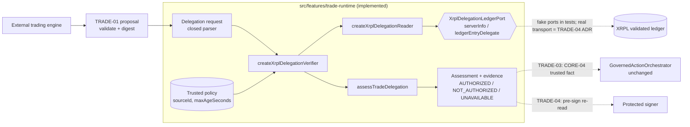
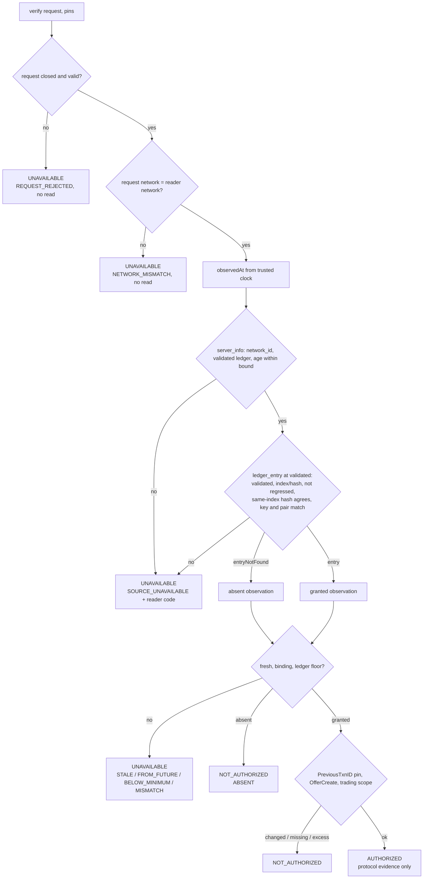

# TRADE-02 — XLS-75 Delegation Verification

> **Frontera never creates, changes or revokes a delegation — it only proves
> one.** A read-only reader observes the owner's XLS-75 `Delegate` entry at a
> validated ledger; a pure verifier decides whether that observation proves
> that the delegate may submit OfferCreate for the owner, now. The answer is
> exactly one of `AUTHORIZED`, `NOT_AUTHORIZED` or `UNAVAILABLE` — and
> `AUTHORIZED` is protocol evidence, never a Frontera approval, grant or
> permission to sign.

## 1. Executive summary

- **Implemented (pure, offline-tested):** the observation contract and verifier,
  the closed verification request, the trusted policy, the three-way
  assessment with digested evidence, and a reliance check for later consumers.
- **Implemented (read-only rail, fake-port tested):** a reader over a
  two-method port (`server_info`, validated Delegate `ledger_entry`) and a
  verifier that owns that reader.
- **Not composed:** no production module supplies a real port. A real network
  transport is a new XRPL network path and is gated to TRADE-04's
  ADR-XRPL-SHARED-TRANSPORT (§21). Nothing in this milestone opens a network
  connection.
- **Live Testnet (read-only, scratch harness, not committed):** the production
  reader and verifier ran unmodified over a throw-away `fetch` port. Validated
  absence, the ledger key, network-identity refusal, request refusal and outage
  handling behaved as specified (§19).
- **`LIVE_POSITIVE_DELEGATION: PENDING`** — no public Testnet Delegate entry
  granting OfferCreate was found within a bounded search; none was created
  (§20).
- No signing, submission, wallet, key, `DelegateSet`, SDK import, grant,
  governance decision or PAY change.

## 2. Baseline and commits

| | |
| --- | --- |
| Branch | `feat/trade-02-xls75-delegation-verifier` |
| TRADE-00 audit | `bdcd256` |
| TRADE-01 contracts and compiler | `b8ae3a0` |
| TRADE-02 preflight (boundary reconciliation) | `f56bd2a` |
| TRADE-02 observation, verifier, read-only reader | `f1871e2` |
| TRADE-02 assessment contract, rail verifier, hardening, live qualification | follow-up commit on top of `f1871e2` |

Unchanged throughout: CORE, PAY-02 rail and SDK importer list, PAY-03 signer
protocol and interlocks, PAY-04 ingress, PAY-05, PAY-06, registries,
NO_BYPASS inventories, configuration, `package.json`, `package-lock.json`,
website.

## 3. Implemented components

| File | Role | Since |
| --- | --- | --- |
| `domain/trade-delegation.ts` | Observation contract and closed parser; `Delegate` entry key; permission canonicalisation; ordered verifier; verifier evidence. Pure. | `f1871e2` |
| `domain/trade-delegation-assessment.ts` | Closed request; trusted policy; three-way assessment; facts and record digests; reliance check. Pure. | follow-up |
| `domain/trade-grammar.ts` | + `tradeAccountIdOf` (20-byte account id of a valid classic address). | `f1871e2` |
| `domain/trade-canonical.ts` | + `canonicalTradeJson` — export of TRADE-01's existing canonical serializer; behaviour unchanged. | follow-up |
| `rails/xrpl/xrpl-delegation-reader.ts` | `XrplDelegationLedgerPort` (two read methods) and `createXrplDelegationReader`. | `f1871e2`; hardened in follow-up |
| `rails/xrpl/xrpl-delegation-verifier.ts` | `createXrplDelegationVerifier`: request → owned reader → assessment. | follow-up |
| `rails/xrpl/index.ts` | Rail barrel. **Not** re-exported by the TRADE root barrel. | `f1871e2` |

All paths are under `src/features/trade-runtime/`.

### 3.1 Diagram A — delegation verification architecture

Solid: implemented. Dashed: proposed, not implemented.



## 4. Protocol evidence

| Fact | Evidence | Status |
| --- | --- | --- |
| `PermissionDelegationV1_1` enabled on Testnet | `feature` on `s.altnet.rippletest.net:51234`, 2026-10-13: `{"enabled":true,"name":"PermissionDelegationV1_1","supported":true}` (id `0F48FF56…540B`); the original `PermissionDelegation` is `badFeature` there | VERIFIED-NET |
| Testnet identity | `server_info`: `network_id: 1`, build `3.4.1`, `server_state: full`, validated ledger 21508215 | VERIFIED-NET |
| `Delegate` entry schema | xrpl.org *Delegate* page (§5) | VERIFIED-DOC |
| Permission value = transaction type + 1 | xrpl.org *Permission Values* ("add 1 when specifying a transaction type"); `ripple-binary-codec@2.11.0` `xrpl-definitions-base.js` (`value + 1`) | VERIFIED-DOC, VERIFIED-SDK |
| OfferCreate: transaction type **7**, permission value **8**; OfferCancel 8 / **9**; DelegateSet 64 / 65 (not delegable) | `definitions.json` `TRANSACTION_TYPES`; a codec round trip of a Delegate entry with `OfferCreate` and `TrustlineAuthorize` serialises `PermissionValue` as `8` and `65537` | VERIFIED-SDK |
| JSON `PermissionValue` is "String or Number"; the server writes the name when it knows it, the number otherwise; names are case-sensitive | xrpl.org *Permission Values* | VERIFIED-DOC |
| `ledger_entry` Delegate request is `{"delegate":{"account","authorize"}}` | Not documented on the xrpl.org `ledger_entry` page. Live: the correct shape returns `entryNotFound` for the key; `{"delegate":{"owner":…}}` returns `malformedRequest` "Missing field 'account'." | VERIFIED-NET |
| Validated absence shape | Live (§19, L1): `error: entryNotFound`, `error_code: 98`, `index`, `ledger_hash`, `ledger_index`, `validated: true` | VERIFIED-NET |
| Ledger key derivation | §7: xrpl.org example index, and the **server's own** `index` for the same pair on Testnet | VERIFIED-DOC, VERIFIED-NET |
| SDK | `xrpl@5.3.0` `validate()` accepts OfferCreate with `Delegate` and refuses `Delegate == Account` (offline, `f1871e2`, not committed — §21) | VERIFIED-SDK (offline) |

References: xrpl.org *Delegate* ledger entry, *DelegateSet*, *Permission
Values*, *ledger_entry*, *account_objects*, *ledger* (read 2026-10-13).

A successful SDK type check, or a successful key derivation, says nothing about
whether a delegation exists on-chain; only a validated ledger read does.

## 5. Delegate ledger entry

| Field | JSON | Required | Reader treatment |
| --- | --- | --- | --- |
| `LedgerEntryType` | `"Delegate"` | yes | must equal `Delegate` |
| `Account` | address | yes | must equal the requested **owner** |
| `Authorize` | address | yes | must equal the requested **delegate** |
| `Permissions` | array, 1–10 | yes | each item exactly `{Permission:{PermissionValue}}`; canonicalised; duplicates refused |
| `OwnerNode` | hex UInt64 | yes | 1–16 hex digits |
| `DestinationNode` | hex UInt64 | no | 1–16 hex digits when present |
| `PreviousTxnID` | hex UInt256 | yes | 64 hex; recorded |
| `PreviousTxnLgrSeq` | UInt32 | yes | ≤ the ledger read from; recorded |
| `Flags` | 0 | (common) | must be 0 |
| `index` | hex | (JSON) | must equal the computed key, both in the node and in the response |

Any other field is a shape the reader does not know: `RESPONSE_MALFORMED`, never
a silent override.

## 6. Permission mapping

| JSON value | Canonical | Meaning |
| --- | --- | --- |
| `"OfferCreate"` or `8` | `OfferCreate` | the required permission |
| `"OfferCancel"` or `9` | `OfferCancel` | tolerated by the trading scope |
| `7` | `value:7` | **not** OfferCreate — 7 is OfferCreate's *transaction type*, and as a permission value it means another transaction type; reported, never read as OfferCreate |
| other names (`Payment`, `TrustlineAuthorize`, …) | the name | reported; outside the trading scope |
| other numbers | `value:<n>` | reported; never interpreted |
| `"offercreate"`, `"value:8"`, objects, duplicates | — | refused (case-sensitive; non-canonical; malformed) |

Two separate readings are recorded (`permissionReading`):

- **protocol fact** `offerCreateGranted` — the entry carries `OfferCreate`;
- **application policy** `withinTradingScope` — it carries nothing beyond
  `OfferCreate`/`OfferCancel` (TRADE-00 §13.2: a trading delegate that may also
  pay or burn is outside the accepted blast radius).

Only both together are `AUTHORIZED`. An entry with `OfferCreate` and `Payment`
is `NOT_AUTHORIZED / DELEGATION_PERMISSION_EXCESS`, with
`offerCreateGranted: true` reported faithfully.

## 7. Ledger lookup and keylet

**Selected method: direct lookup** — `ledger_entry` with
`{delegate:{account: owner, authorize: delegate}, ledger_index: 'validated'}`.
There is exactly one Delegate entry per ordered (owner, delegate) pair, so a
validated `entryNotFound` at that key is authoritative absence. No enumeration
(`account_objects`) is implemented, so no pagination code exists and the
pagination tests (D05–D11) do not apply. A future enumeration must not infer
absence from an empty page.

`tradeDelegateEntryIndex(owner, delegate)` =
SHA-512Half(`0x0045` ‖ AccountID(owner) ‖ AccountID(delegate)), 64 upper-case
hex. The key is used to check the response, not to choose what to read: the
server derives its own key from the two accounts.

Known-answer evidence:

- xrpl.org example `rG8uoRH9uA6AJ6NRj8P4cJG1HNfYcnMPrt` →
  `r9GAKojMTyexqvy8DXFWYq63Mod5k5wnkT` =
  `749D3DCDF9F032DDDB8AC49641BACBFDD398C4B6C231C4AB325B7755962329A2`
  (committed test vector, D04);
- **Testnet's own `ledger_entry` returned the same `index`** for that pair
  (2026-10-13), and our key for the inverted pair
  (`B9470049…7FB248`) matched the server's too (§19, L2);
- offline, 5000 random pairs against the SDK's `sha512Half` and
  `ripple-address-codec`: 0 mismatches (`f1871e2`, scratch).

Directional; `undefined` for malformed or reserved addresses (D03).

## 8. Request and result contracts

### 8.1 Request — `frontera.trade-delegation-request.v1`

Exactly: `schema`, `organizationId`, `proposalDigest` (TRADE-01
`tradeProposalDigest`), `network` (a TRADE network; Mainnet unrepresentable),
`ownerAccount`, `delegateAccount` (valid, non-reserved, distinct), `permission`
(`OfferCreate`). Read once as data; getters never run.
`tradeDelegationRequestFor(proposal, digest)` builds it from an accepted
proposal.

Refused by class, values never read:

| Undeclared field | Violation |
| --- | --- |
| `seed`, `privateKey`, `…Secret`, `password`, … | `SECRET_PROPERTY_REFUSED` |
| `tx_json`, `tx_blob`, `TransactionType`, `Permissions`, `Account`, … | `RAW_TRANSACTION_REFUSED` |
| `delegationVerified`, `delegationProof`, `permissionGranted`, `trustedContext`, `ledgerEvidence`, `observation`, `status`, `grant`, … | `TRUSTED_FACT_CLAIM_REFUSED` |
| `endpoint`, `rpcUrl`, `sourceId`, `maxAgeSeconds`, `freshness`, … | `SOURCE_SELECTION_REFUSED` |
| anything else | `UNDECLARED_PROPERTY` |

### 8.2 Policy (trusted configuration)

`{ sourceId, maxAgeSeconds }`: an identifier (never an endpoint) and 1–60 s.
Refused, never clamped. Fixed when the verifier is created; no request field
can reach it.

### 8.3 Assessment — `frontera.trade-delegation-assessment.v1`

| Status | Means | Reasons |
| --- | --- | --- |
| `AUTHORIZED` | A fresh, validated, correctly bound observation shows `OfferCreate` within the trading scope | `DELEGATION_VERIFIED` |
| `NOT_AUTHORIZED` | A fresh, validated, correctly bound observation **proves** the delegation absent or insufficient | `DELEGATION_ABSENT`, `_PERMISSION_MISSING`, `_PERMISSION_EXCESS`, `_CHANGED` |
| `UNAVAILABLE` | No trustworthy conclusion | `DELEGATION_REQUEST_REJECTED`, `_SOURCE_UNAVAILABLE` (+ reader code), `_CONTEXT_INVALID`, `_OBSERVATION_MALFORMED`, `_NETWORK_MISMATCH`, `_OWNER_MISMATCH`, `_DELEGATE_MISMATCH`, `_LEDGER_BELOW_MINIMUM`, `_OBSERVATION_FROM_FUTURE`, `_OBSERVATION_STALE` |

`UNAVAILABLE` is never collapsed into `NOT_AUTHORIZED`; neither is ever a
positive answer. A stale absence is `UNAVAILABLE`, not `NOT_AUTHORIZED`.

## 9. Read-only reader port

```ts
interface XrplDelegationLedgerPort {
  serverInfo(): Promise<unknown>;
  ledgerEntryDelegate(request: { delegate: { account; authorize }; ledger_index: 'validated' }): Promise<unknown>;
}
```

The port resolves with the JSON-RPC `result` (error results included) and
rejects only when the server could not be asked. It has no method that could
sign, submit, autofill, or send an arbitrary command; the request type admits
only the validated ledger. Timeouts and response-size limits belong to the
port implementation (the scratch harness used 15 s and 1 MB); the reader
treats any rejection as `LEDGER_UNREACHABLE`, makes one attempt, never retries
and never reads the error.

`createXrplDelegationVerifier({ port, network, clock, maxValidatedLedgerAgeSeconds, policy })`
creates and owns its reader; its one method is
`verify(request: unknown, pins?)`. It cannot be handed an observation, a
verdict, a source or a bound, and it remembers nothing between calls.

## 10. Validated ledger snapshot

1. Parse the request (rejected → `UNAVAILABLE`, **no read**); a request for
   another network than the reader's → `UNAVAILABLE`, **no read**.
2. Take `observedAt` from the trusted clock **before** asking anything.
3. `server_info`: exactly the configured `network_id`; a validated ledger with
   `seq`, `hash` and `age`; `age ≤ maxValidatedLedgerAgeSeconds`.
4. `ledger_entry` at `validated`: must say `validated: true` and give
   `ledger_index` and `ledger_hash` — for a found entry and for
   `entryNotFound` alike.
5. The entry's ledger must not be older than step 3's (`LEDGER_REGRESSED`), and
   if it is the same index it must have the same hash
   (`LEDGER_HASH_CONFLICT`, added in the follow-up).
6. A found entry must be the pair's (§5); an absence that names a key must name
   the pair's key (`ENTRY_MISMATCH`, added in the follow-up).
7. The observation records the `ledger_entry` ledger's index and hash — the
   ledger the facts were read from — and passes the same closed parser every
   consumer uses.

### 10.1 Diagram B — verification sequence



The open or closed ledger is never asked; nothing is synthesised: a missing
hash or validation flag is `UNAVAILABLE`.

## 11. Freshness and revocation

- **Bounded twice:** the node's validated ledger must be ≤ 60 s old (configured),
  and the observation must be ≤ `policy.maxAgeSeconds` old when assessed — and
  again whenever the record is relied on.
- **Revocation** shows as a validated `entryNotFound` (`NOT_AUTHORIZED`) or a
  reduced permission set (`PERMISSION_MISSING`).
- **No replay past a revocation:** `pins.minimumValidatedLedgerIndex` refuses an
  observation older than a ledger the caller has seen.
- **Revoke-and-re-grant:** `pins.expectedPreviousTxnId` refuses a changed
  entry (`DELEGATION_CHANGED`).
- **No cache:** every `verify` reads the ledger; an outage after a positive
  result is `UNAVAILABLE` (test E05).
- **Clock:** injected. A clock stepping backwards between observation and
  assessment fails closed (`OBSERVATION_FROM_FUTURE`) — observed once live on
  this WSL2 host (§19). Local time bounds staleness; it never replaces the
  ledger sequence.

**Time-of-check/time-of-use.** TRADE-02 cannot guarantee that a delegation
verified now will still exist when a later transaction is executed. TRADE-04
must re-verify immediately before protected signing, pinned to the
decision-time `PreviousTxnID` and ledger, and must treat the ledger's own
apply-time check (`terNO_DELEGATE_PERMISSION`) as the final word. No cached
positive result may become a signing permission.

## 12. Error and result classification

Reader failures (`XRPL_DELEGATION_READ_FAILURES`), all → `UNAVAILABLE /
DELEGATION_SOURCE_UNAVAILABLE` with the code as a diagnostic:
`REQUEST_INVALID`, `CLOCK_INVALID`, `LEDGER_UNREACHABLE`,
`RESPONSE_MALFORMED`, `NETWORK_MISMATCH`, `NO_VALIDATED_LEDGER`,
`VALIDATED_LEDGER_TOO_OLD`, `NOT_VALIDATED`, `LEDGER_REGRESSED`,
`LEDGER_HASH_CONFLICT` (new), `ENTRY_MISMATCH`, `LEDGER_ERROR`.

Verifier refusals map as in §8.3. A reader code that is not a plain
upper-case identifier is recorded as `UNRECOGNISED`, so no transport text
(addresses, messages) ever enters a record.

## 13. Evidence format

```text
{ schema, status, reason,
  request:           { schema, organizationId, proposalDigest, network, ownerAccount, delegateAccount, permission }   (absent if rejected)
  requestViolation?: why the request was rejected
  source:            { sourceId }                                                   (trusted configuration)
  facts?:            { network, networkId, owner, delegate, entryIndex,
                       validatedLedgerIndex, validatedLedgerHash, state,
                       permissions?, previousTxnId?, previousTxnLedgerIndex? }       (objective ledger facts)
  factsDigest?:      sha256 over facts                                               (stable across re-reads)
  permissionReading?:{ offerCreateGranted, withinTradingScope }                      (derived)
  timing?:           { observedAt, assessedAt, maxAgeSeconds }                       (local metadata)
  digest:            sha256 over everything above
  diagnostic?:       { readFailure }                                                 (transport; not digested) }
```

- Facts are recorded only for an intact observation of exactly the requested
  network, owner and delegate.
- `factsDigest` = sha256(`frontera.trade-delegation-facts-digest.v1` ‖ canonical
  facts): the same ledger state gives the same digest however often, and from
  whichever node, it is read (live: L1 and L3 from two operators gave the same
  `factsDigest`).
- `digest` = sha256(`frontera.trade-delegation-assessment-digest.v1` ‖ canonical
  record without `digest`/`diagnostic`).
- Both are integrity and correlation primitives. **They are not XRPL
  signatures and do not prove consensus**; the facts are as reported by the
  configured node.
- `checkTradeDelegationReliance(record, {proposal, proposalDigest, at, policy})`
  recomputes both digests and requires `AUTHORIZED`, the same organization,
  proposal, network, owner, delegate and source, and an age within the
  tighter of the policy in force and the recorded bound — every time.

## 14. Trust boundaries

| Input | Trusted? | Where it comes from |
| --- | --- | --- |
| Request | **No** — applicant shaped, parsed closed | trading engine / TRADE proposal |
| Policy (`sourceId`, `maxAgeSeconds`), port, network, ledger-age bound | Yes — configuration | Host composition (future) |
| Clock | Yes — injected | Host composition (future) |
| Pins | Yes — execution side | TRADE-04 (future) |
| Observation | Produced only by the owned reader | never a parameter of `verify` |
| Ledger responses | **Trusted node assumption** | the one configured endpoint |

**Initial trust model:** the configured RPC node is trusted to report the
validated ledger honestly. The reader checks internal consistency (network
id, validation flag, index/hash agreement, key and pair) but performs no
independent consensus proof (no validator-signature or state-proof check). A
lying node could forge a `validated: true` response; mitigations are
operator choice of node and, later, cross-checking two operators (live L1/L3
already agree on ledger and facts digest) — TRADE-04/07.

## 15. Governance integration seam (proposed, not implemented)

TRADE-02 adds no governance path. The proposed TRADE-03 mapping through
CORE-04, without changing generic governance:

| Assessment field | CORE-04 use |
| --- | --- |
| `status === 'AUTHORIZED'` and `reason` | fact class e.g. `trade.delegation.offercreate` (boolean), material to the trading profile |
| `facts.network`, `owner`, `delegate` | must equal the intent's `tradeNetwork`, owner, `tradeDelegateAccount` dimensions |
| `facts.validatedLedgerIndex`, `previousTxnId` | recorded as the reading reference; become TRADE-04's pins |
| `timing.observedAt`, `policy.maxAgeSeconds` | the reading time; the source's `maxAgeSeconds` for that fact class |
| `digest` | the reading's reference digest (`provenance: 'reference-digest'`) |
| `source.sourceId` | a CORE-04 source of trust class `authoritative`, scoped to the Host's organization |

The applicant can never supply these: TRADE-01 reserves `delegation`,
`delegationVerified`, `delegationProof`, `ledgerPermission` as context keys
and refuses delegation claims in proposals, and the request here refuses them
again. Admitting the fact requires a TRADE composition edge
(`TRADE_COMPOSITION_EDGES`, pinned empty) — an explicit TRADE-03 review item.

`AUTHORIZED` is one input. Execution still separately requires a valid trade,
an accepted governance profile, trusted market and risk context, a policy
ALLOW, a valid bounded grant, a fresh pre-sign delegation re-read and
protected signer authorization. TRADE-02 issues no grant.

## 16. Security invariants (TRADE-local)

| Id | Invariant | Enforced by |
| --- | --- | --- |
| TRADE-02-SEC-01 | No signing | rail fence (`sign*(`), TRADE-01 custody, trade-vertical (4) |
| SEC-02 | No submission | rail fence, two-method port, trade-vertical (5), PAY-02 single submit site |
| SEC-03 | No seeds or keys | rail fence, TRADE-01 custody, trade-vertical (6); request refuses secret-shaped fields |
| SEC-04 | No applicant delegation claims | request `TRUSTED_FACT_CLAIM_REFUSED`; `verify` takes no observation; TRADE-01 reserved keys |
| SEC-05 | No owner/delegate inversion | directional key; `Account`/`Authorize` checks; inverted request and entry tests |
| SEC-06 | No wrong-network authorization | `server_info.network_id`; observation network; request network ≠ reader → no read |
| SEC-07 | No positive from an unvalidated ledger | `validated: true` required for found and absent |
| SEC-08 | No positive from stale evidence | node age bound; observation age bound; reliance re-check |
| SEC-09 | No false absence from incomplete pagination | no enumeration exists; absence only from a validated keyed `entryNotFound` |
| SEC-10 | No unknown permission as OfferCreate | canonicalisation; `7`, `value:8`, case variants refused |
| SEC-11 | No second governance engine | trade-vertical (3); TRADE-01 no-execution-path; no decide/evaluate/grant code |
| SEC-12 | No second XRPL submission path | PAY-02 single submit request; no-bypass inventories; rail fences |
| SEC-13 | PAY-03 Payment-only signing unchanged | trade-vertical (8); no PAY-03 file touched |
| SEC-14 | No uncontrolled SDK import | trade-vertical (7) incl. tests; PAY-02 exact importer list unchanged |
| SEC-15 | No permanent authority from cache | verifier holds no state (fence + E05 test); reliance re-checks age |
| SEC-16 | No fabricated provenance | missing hash/flag → `UNAVAILABLE`; digests recomputed; tamper tests |
| SEC-17 | No cross-organization confusion | request and reliance bind organization and proposal digest |
| SEC-18 | No public arbitrary RPC proxy | two fixed methods; request refuses endpoints; rail not composed |

## 17. Threat model (adversarial review)

| Attack | Mitigation | Test | Residual | Later |
| --- | --- | --- | --- | --- |
| Owner/delegate inversion | directional key; pair checks | B02/B03/B10, D03, live L2 | — | — |
| Wrong-network substitution | network id; request/reader network | B11/B12, C11, live L4/L5 | — | — |
| Fake "validated" response | flag + hash + index required | C06/C07 | a lying trusted node | TRADE-04/07: second-operator cross-check |
| Hash/index inconsistency across reads | regression and same-index hash checks | C08/C09 | — | — |
| Permission-value confusion (7 vs 8, numeric vs name) | canonicalisation | A04, B04–B07 | — | — |
| Extra permissions (pay/burn) | trading-scope policy | A09 | — | — |
| Stale evidence / replay of old "granted" | age bounds; ledger floor pin | E04, E01–E03, SEC-15 | TOCTOU window to signing | TRADE-04 pre-sign re-read |
| Revoke-and-re-grant | `PreviousTxnID` pin | E01–E03 | — | TRADE-04 pins it |
| Cached authorization reuse | no cache; reliance re-check | E05, rail fence | a consumer ignoring reliance | TRADE-03/04 must call it |
| Client-chosen RPC endpoint or bound | closed request; trusted policy | request tests, E07 | — | — |
| Incomplete pagination | no enumeration | — | — | any future enumeration |
| Cross-organization substitution | org + proposal binding | F05 | — | — |
| Signing-capable import / second submit path | structural fences | G01–G09 | — | TRADE-04 ADR |
| Backward wall-clock step | fails closed | E08, live L3 | spurious `UNAVAILABLE` | TRADE-04: monotonic-anchored clock |
| Tampered stored record | digests recomputed | SEC-16 | digests are not signatures | — |

## 18. Deterministic test results

Matrix ids (A–G) are in the test names.

| Suite | Tests | Covers |
| --- | --- | --- |
| `tests/trade-delegation-assessment.test.ts` (new) | 24 | A01–A10, B01–B12, request closure, E01–E08, F01–F06, SEC-15/16/17 |
| `rails/xrpl/tests/xrpl-delegation-verifier.test.ts` (new) | 17 | D01–D04, A04, C01–C12, request/network short-circuit, E01–E05/E08, configuration |
| `rails/xrpl/tests/xrpl-delegation-reader-boundaries.test.ts` | 7 (+1) | G01–G03, G08, SEC-15/16/18: verifier owns its reader, no cache, no observation input |
| `tests/trade-delegation.test.ts` | 14 | key vector, canonicalisation, malformed observations, refusal matrix |
| `rails/xrpl/tests/xrpl-delegation-reader.test.ts` | 14 | reader shapes and failures |
| TRADE-01 (`trade-proposal`, `trade-governance`, policy spike, `trade-runtime-boundaries`) | 61 | G10, F06 |
| `trade-vertical-structure`, `pay04-payment-protocol-structure` | 30 | G04–G07, G09 |

Mutation checks (scratch, files restored byte-for-byte): stale counted as
proof of absence → 2 failures; hash-conflict check removed → 1; a `Map` cache
in the verifier → 1; reliance age check removed → 1.

| Check | Result |
| --- | --- |
| Focused (11 TRADE + structural suites) | 167/167 |
| `typecheck` / `build` / `lint` / `check:release-coherence` | pass |
| Structural, boundary, PAY-02…06, NO_BYPASS, TRADE (79 suites) | 1382/1382, 0 skipped |
| Full root suite / workspaces | §18.1 |

### 18.1 Broader regression

| Check | Result |
| --- | --- |
| Full root suite (`npm run test:root`, one run, load average 15–27 from other worktrees) | 10406 tests: 10392 pass, **1 fail**, 9 skipped, 4 todo — **not green** |
| The one failure | `prod02-stale-restore-host` (PROD-02 stale-backup drill): an HTTP `503 !== 200` at line 71, ~10 s in, at peak load |
| Its re-runs, in isolation (load ~7) | 3/3 pass (2/2 each) |
| Workspaces (`npm run test:workspaces`) | 1103/1103 pass, 243 suites, 0 skipped |

Classification of the failure: **unverified intermittent, consistent with
load** — not a confirmed defect. The file, and the Host, portability and
authority code it drives, are unchanged since `b8ae3a0`; TRADE is not composed
anywhere (`TRADE_COMPOSITION_EDGES = []`), so TRADE-02 code cannot run in it. It
joins the preflight's launcher timeouts (preflight §5.4) as an environmental
qualification risk. The 9 skips are pre-existing opt-in tests; the 4 todos
are the pre-existing PROD-01 F1 SQLite classification item.

## 19. Read-only live Testnet findings (2026-10-13)

Scratch harness (not committed): the compiled production verifier over a
`fetch` JSON-RPC port, 15 s timeout per call, 1 MB response cap, no retry. No
wallet, key, funding or transaction.

| # | Case | Endpoint | Result |
| --- | --- | --- | --- |
| L1 | xrpl.org example pair | `s.altnet.rippletest.net:51234` | `NOT_AUTHORIZED / DELEGATION_ABSENT`, validated ledger 21508550 `E201F34F…2E1B`, key `749D3DCD…29A2` |
| L2 | inverted pair | same | `NOT_AUTHORIZED / DELEGATION_ABSENT`, key `B9470049…7FB248` (server's index matched) |
| L3 | example pair, second operator | `testnet.xrpl-labs.com` | first run `UNAVAILABLE / OBSERVATION_FROM_FUTURE` (wall clock stepped back during the read — fails closed); 3/3 reruns `NOT_AUTHORIZED / DELEGATION_ABSENT` at 21508556. Same ledger and **same `factsDigest`** as L1 when read at 21508550 |
| L4 | Devnet node configured as Testnet | `s.devnet.rippletest.net:51234` | `UNAVAILABLE / SOURCE_UNAVAILABLE / NETWORK_MISMATCH` |
| L5 | Devnet request to a Testnet verifier | — | `UNAVAILABLE / NETWORK_MISMATCH`, no read |
| L6 | request with `delegationVerified: true` | — | `UNAVAILABLE / DELEGATION_REQUEST_REJECTED`, no read |
| L7 | unreachable endpoint | `127.0.0.1:9` | `UNAVAILABLE / SOURCE_UNAVAILABLE / LEDGER_UNREACHABLE` |

Raw probes (curl, same day): `server_info` (network 1, build 3.4.1, validated
21508215, age 3 s); `feature PermissionDelegationV1_1` enabled; `ledger_entry`
absence shape and `malformedRequest` for a wrong parameter shape (§4).

## 20. Unverified live-positive conditions

**`LIVE_POSITIVE_DELEGATION: PENDING`.** A bounded `ledger_data
type=delegate` scan of Testnet (15 pages of 200, one pinned validated ledger
`D0A1A2FE…EDCE`) covered about 3.5 % of the key space and found no Delegate
entries; a full scan (~400 pages) is not a reasonable load on a public node.
No `DelegateSet` was created to manufacture one. The positive path — found
entry → `AUTHORIZED` — is verified only against protocol-faithful fixtures
built from the xrpl.org entry shape and the codec; it has **not** been seen
against a real Testnet entry. Closing this needs either a known public
delegation or an owner-run `DelegateSet` (outside Frontera, separately
authorized), then one read.

## 21. Architectural changes requiring future approval

| Item | Why it is gated | Needed by |
| --- | --- | --- |
| A real port over a network transport | A new XRPL network path. Any `fetch`/WebSocket/SDK in TRADE fails trade-vertical (5)/(7) and TRADE-01 boundaries by design. TRADE-00 §6.2/§18 put it on ADR-XRPL-SHARED-TRANSPORT with a NO_BYPASS effect-path row. | TRADE-04 |
| A TRADE composition edge (`src/enterprise/xrpl-trade-rail/` or a CORE-04 source) | `TRADE_COMPOSITION_EDGES = []` is pinned. | TRADE-03 (source) / TRADE-04 (rail) |
| An SDK `validate()` test with `Delegate` on OfferCreate | Would add a TRADE test to PAY-02's exact importer list. Run offline instead. | Review |
| Delegation as a CORE-04 fact class | Policy integration (§15). | TRADE-03 |
| Pre-sign re-read wiring | Execution boundary (§11). | TRADE-04 |

No shared boundary was modified in TRADE-02. The only test changes are the
TRADE-local rail fence (three files instead of two, plus the verifier
assertions) and, in `f1871e2`, the one rail-to-domain import edge.

## 22. TRADE-03 prerequisites

- Approve the TRADE composition edge for a CORE-04 delegation source.
- Define the fact class and its `maxAgeSeconds` (≤ the policy's) on the trading
  profile; map per §15; a source supplying assessments must call
  `checkTradeDelegationReliance` (or re-verify) rather than trust a stored record.
- Resolve TRADE-00 §9.2's canonical-decimal comparison item (unrelated to
  delegation, first TRADE-03 test).
- Until TRADE-04, TRADE-03 composes the verifier over a fake or Host-provided
  port; it must not add a transport.

## 23. TRADE-04 execution-time requirements

- Re-verify immediately before protected signing (policy ≤ 10 s, TRADE-00 §10),
  with `pins.minimumValidatedLedgerIndex` and `pins.expectedPreviousTxnId`
  from the decision-time assessment; anything but `AUTHORIZED` stops.
- Supply the real port through the shared-transport ADR: fixed endpoint from
  configuration, finite timeouts, response-size cap, no retry, read-only
  methods only, plus a NO_BYPASS row.
- Use a monotonic-anchored clock (wall origin advanced by `performance.now()`,
  as the preflight's SQLite fix) so host time steps do not cause spurious
  `UNAVAILABLE`.
- Treat `terNO_DELEGATE_PERMISSION` at apply time as the authoritative final
  outcome; a prior `AUTHORIZED` never overrides it.
- Consider a second-operator cross-check of the validated ledger hash for the
  pre-sign read.
- Close `LIVE_POSITIVE_DELEGATION` before any live execution qualification.
