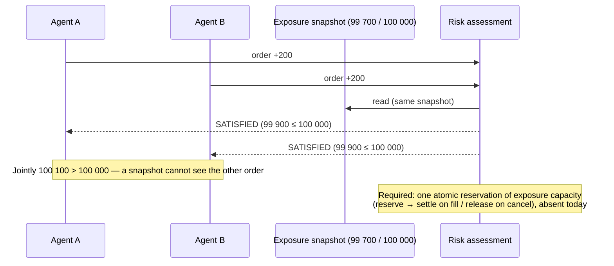
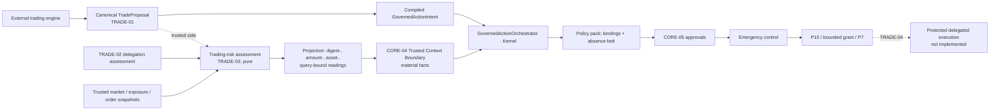
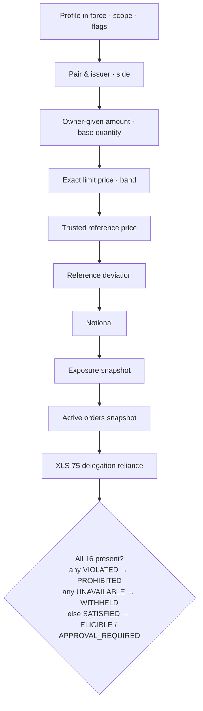

# TRADE-03 — Granular Trading Governance, Risk Policy Enforcement & Trusted Context Integration

> **A trading-risk assessment is a prerequisite, never a decision.** TRADE-03
> establishes whether one proposed OfferCreate satisfies the owner's granular
> risk constraints, from trusted inputs only, and seals the answer as
> evidence. The existing Governance Core alone decides. The facts reach it as
> **material** context through the Trusted Context Boundary (CORE-04), so a
> missing, stale, conflicting or untrusted fact denies before policy runs.

## 1. Executive summary

- **Implemented (pure domain, `src/features/trade-runtime/policy/`):**
  - a strict, versioned, sealed `TradingRiskProfile`;
  - exact BigInt rational arithmetic for prices, deviation and notional;
  - closed, sealed trusted-snapshot contracts for market reference,
    exposure and active orders;
  - a sixteen-control assessment producing sealed
    `TradingRiskAssessmentEvidence`;
  - a consumer-side reliance check;
  - the projection of reliable evidence onto CORE-04 fact readings, bound to
    the proposal digest, the governed amount and asset, and the Kernel's own
    query.
- **Composed through one approved edge (K1, §31).**
  `src/enterprise/trade-risk-context/` is a CORE-04 trusted-context provider
  with an in-process ingress. It is the single entry in
  `TRADE_COMPOSITION_EDGES`. The edge:
  - compiles the intent itself, for the bound customer identity;
  - attests a proposal at most once;
  - reads every source fresh through trusted ports;
  - binds **every** field of the compiled intent to the assessed proposal
    (§32).
- **Qualified through the unchanged Governance Core on the shipped Host.**
  - Every trading fact is a **material fact** of the trading Governance
    Profile.
  - 36 Host tests drive the real edge. Only its source ports are fakes.
  - They prove execution, substitution refusal for every bound field, replay,
    cross-principal and cross-organization isolation, fail-closed context,
    CORE-05, emergency control, P9 and P10.
- **Deferred:**
  - aggregate exposure and active-order enforcement (snapshot-advisory only;
    no atomic reservation exists);
  - real market, exposure and order sources;
  - real XRPL transport (TRADE-04).
- **New CORE findings (characterized, not changed):**
  - the policy layer is non-blocking for absent facts (§5);
  - the digest parameter alone does not bind the governed amount (§16.2);
  - P7's 64-byte amount-unit bound rejected P9 asset ids of 40-hex-digit
    issued currencies (§8.3). **Fixed by K2 (§33):** the bound is now 128, as
    in P9. This is a one-constant CORE change, and those trades now execute.
- No signing, submission, wallet, key, network client, HTTP route, grant path,
  approval engine or exposure store.
- The only CORE change is the K2 constant.

**Verdict: CONDITIONAL** (§36). The architecture is complete. Production
trusted sources and execution (TRADE-04/07) remain.

## 2. Baseline and branch

| | |
| --- | --- |
| Worktree | `Frontera-trade-03` |
| Branch | `feat/trade-03-governance-policies` |
| Base | `919c175` (PR #184, TRADE-00…02), equal to `origin/main` at start |
| PAY-06/07/08 | present in the base |

## 3. TRADE-01 / TRADE-02 dependencies

| Reused | Where |
| --- | --- |
| Closed proposal, derived terms, digest | `validateTradeProposal`, `tradeProposalDigest` |
| Canonical pair (XRP always the quote), side, exact quantity, limit price | `canonicalTradePair`, `TradeOrderTerms`, `TradePrice`, `compareTradePrices` |
| Asset identity (currency **and** issuer), P9 asset id | `tradeAssetsEqual`, `tradeAssetToken`, `tradeMonetaryAssetId` |
| Compiled intent and CORE-03 dimensions | `compileTradeProposal`, `TRADE_PARAMETER_DIMENSIONS`, `TRADE_RESERVED_CONTEXT_KEYS` |
| Closed-record reader and canonical JSON | `snapshotTradeRecord`, `canonicalTradeJson` |
| Delegation assessment, policy and reliance | `assessTradeDelegation`, `parseTradeDelegationPolicy`, `checkTradeDelegationReliance` |

There is no second price model, no second ledger-permission logic and no
second proposal grammar.

## 4. Existing Governance Core capabilities reused

| Capability | How TRADE-03 uses it |
| --- | --- |
| CORE-03 parameters | `tradeProposalDigest` (exact token) is the binding key |
| CORE-04 Trusted Context Boundary | six material fact classes, organization-scoped authoritative sources, freshness caps grant validity |
| Governance Profile | `materialFacts`, `approval`, `expectedGovernanceProfile` pin |
| Policy-pack runtime | binding rules (`valueFrom` equality), absence rule, `require_approval` |
| CORE-05 durable approvals | the profile's approval path; trading adds only a trigger fact |
| Emergency control | organization, actor (desk) and resource (owner account) scopes |
| P9 | asset registry, exact amount ingress |
| P10 | per-order ceilings and spending limits per asset |
| P7 | per-execution reservation (spending limits), unchanged |
| GovernedActionOrchestrator | the only decision and grant path |

## 5. Policy comparison characterization (Phase 1)

Pinned by `trade-policy-comparison-spike.test.ts` (TRADE-01) and
`trade03-core-characterization.test.ts`, and shown on the Host by
`trade03-governed-risk-host.test.ts`.

| # | Question | Finding |
| --- | --- | --- |
| 1 | Decimal comparison | Exact BigInt when **both** sides are canonical decimal text. Equality is `===` on text. |
| 2 | BigInt use | Ordered decimal predicates (P9 `amount`, `valueFrom` facts). Safe integers otherwise. |
| 3 | Mixed kinds | No match, never an error. |
| 4 | Missing fact | A `valueFrom` predicate does **not** match. `equals` does not. `not_equals`/`not_exists` against a literal **do**. A pack whose rules all miss is `not_applicable`, which is `allowed: true`. |
| 5 | CORE-04 required facts | Profile `materialFacts` become `required` requirements from an `authoritative` trust class. Unresolved, stale, conflicted, untrusted, source-not-authorized, provenance-invalid, time-invalid and malformed readings each deny. |
| 6 | Positive fact required? | Yes, but **only** as a material fact. Policy alone cannot demand presence except through negated literals or `not_exists`. |
| 7 | Stale / conflict | Stale is exclusive at the bound (CORE-04). A conflict means no winner. Both deny. |
| 8 | Freshness caps validity | Yes. The decision's `context.validUntil` is the earliest material staleness, and it caps the grant. The Host test shows ≤ 10 s, bounded by the delegation reading. |
| 9 | Source forgery | Not by the applicant: the query has no source field, asserted keys naming a fact class are refused, and sources are organization-scoped. The provider is trusted in-process code. |
| 10 | Profile version binding | Grant binds `id@version#digest`. The intent may pin `expectedGovernanceProfile`. |
| 11 | P9/P10 maximums | Equal to the ceiling passes. A different asset is incomparable and denies. A missing ceiling denies (`CEILING_MISSING`). |
| 12 | P7 concurrency | Atomic (`BEGIN IMMEDIATE`). Per-execution amount in the attempt's own unit. No cancel or fill release. |

**Kernel ordering detail, observed on the Host.** The context step narrows only
viable outcomes. When the absence rule has already denied in policy, the
reported reason is the policy's, while the committed record still lists the
unsatisfied material requirements. A second Host without absence-sensitive
rules proves that the material-fact gate alone denies, with the boundary's own
codes.

**Mandatory finding.** "Proceed only when every required trading-risk
condition is affirmatively established by trusted sources" is expressed with
three layers:

1. **Material facts.** The Kernel denies on absence, staleness, conflict and
   untrusted sources. This is the gate.
2. **Binding rules.** Each rule denies unless an admitted fact equals the
   request field (digest, amount, asset, delegation digest).
3. **Absence belt.** Deny if any fact is absent. This is defence in depth.

A deny-on-violation predicate alone is **never** relied on.

## 6. Trading-risk configuration

`TradingRiskProfile` (`trade-risk-profile.ts`, schema
`frontera.trading-risk-profile.v1`):

- **Identity:**
  - `organizationId`, `profileId`, `profileVersion`;
  - `status` (`active | suspended | retired`);
  - `effectiveFrom`/`expiresAt` (horizon ≤ 400 days);
  - `action`, `network`.
- **Scope:** `ownerAccounts`, `delegateAccounts`, `allowedFlags` (empty means
  none).
- **Operational:**
  - `factProvenance` (`operational-only | simulated-permitted`);
  - `assessmentMaxAgeSeconds` (≤ 300);
  - `delegation` (TRADE-02 policy);
  - `marketReference` (sources, conventions, age);
  - `exposure`;
  - `activeOrders`;
  - `approval` (sensitive owners and delegates).
- **Per pair:**
  - canonical `base`/`quote`, `sides`;
  - `maxBaseQuantity`;
  - `maxOwnerGiven` per side;
  - `minSellPrice` / `maxBuyPrice` (present exactly for allowed sides);
  - `priceBand`, `referenceDeviation`, `notional`;
  - `approval` triggers.

**Strict rules:**

- Closed records, read once; getters, symbols, prototype keys and class
  instances are refused.
- Limits are canonical **positive** decimal text: `"0"`, `"-1"`, `"10.50"`,
  `"1e3"` and numbers are refused, never repaired.
- Prices are positive integer rationals.
- Pairs must be canonical and unique.
- A dependent control without a market reference is refused.
- An approval threshold must be below its ceiling.

**Explicit disabling only.** These controls may be disabled, but only with
`{ mode: 'disabled', reason }`, and the evidence records them as `DISABLED:<reason>`:

- the side price bound;
- the price band;
- the reference;
- deviation;
- notional;
- exposure;
- active orders.

Pairs and issuers, owner and delegate scope, sides, flags, the owner-given
amount, the base quantity and delegation are **not disableable**.

**Sealed.** `digest` covers the canonical data form. A stored snapshot with a
mismatching digest is refused. The profile comes from trusted configuration;
a proposal can neither carry nor select it, because TRADE-01 refuses such
fields.

## 7. Pair and issuer control

`PAIR_APPROVED` uses `tradeAssetsEqual`, so an asset is its currency **and**
its issuer. When the same code comes from another issuer, the refusal is
`ISSUER_NOT_APPROVED`. `SIDE_APPROVED`, `OWNER_IN_SCOPE`, `DELEGATE_IN_SCOPE`,
`FLAGS_PERMITTED` and network (in `PROFILE_IN_FORCE`) are separate controls.

A reversed pair cannot be configured, because profile pairs must be in
canonical orientation, and a proposal's pair is always derived. On the Host,
P9 additionally refuses any asset not in the registry before a decision.

## 8. Monetary amount control

### 8.1 Four different limits

| Limit | Unit | Where |
| --- | --- | --- |
| Owner-given (`TakerGets`) | the given asset | risk control `OWNER_GIVEN_AMOUNT_MAXIMUM` **and** P10 `max_amount` |
| Base quantity | base asset | `BASE_QUANTITY_MAXIMUM` |
| Quote-denominated notional | named valuation asset | `NOTIONAL_MAXIMUM` |
| Aggregate exposure | named denomination | `EXPOSURE_CEILING` (snapshot-advisory) |

### 8.2 P9/P10 behaviour

TRADE-01 compiles `TakerGets` into the governed amount `{ value, unit: <network>:<asset> }`.

- P10 compares exactly per unit.
- A ceiling in another asset is incomparable (deny).
- A missing ceiling denies.
- Equality passes.

Scenario D proves the effect on the Host: a risk-`SATISFIED` order above the
owner's P10 ceiling is withheld with `FINANCIAL_AUTHORITY_CEILING_EXCEEDED`.
TRADE never widens authority. The grant's amount bound is the authority
ceiling; the exact amount is pinned by the digest and by the amount binding
(§16.2).

### 8.3 Finding — P7 amount-unit bound vs. hex currency codes

- `EXERCISE_CONTROL_UNIT_MAXIMUM_BYTES = 64`.
- `tradeMonetaryAssetId` for a 40-hex-digit currency is
  `xrp-ledger-testnet:<40 hex>/<issuer>`, which is about 94 bytes. P9 itself
  admits up to 128 bytes.
- Any P10 spending limit in that asset therefore makes the P7 snapshot
  invalid. The order is **allowed by the Kernel and withheld at exercise**
  (`EXERCISE_CONTROL_POLICY_INVALID`), with zero adapter calls. This is
  pinned on the Host.

It failed closed, but it made hex-coded tokens such as RLUSD's real code
unexecutable on the governed path. The exact id is 93 bytes. **Resolved by
K2 (§33).** The Host now executes a hex-coded trade.

## 9. Exact rational price control

- **Representation:** quote per base, a reduced `BigInt` fraction (TRADE-01
  `TradePrice`).
- **Comparison:** cross-multiplication only; there is no `Number`,
  `parseFloat`, `toFixed` or `Math.*` anywhere in TRADE production code, and
  the boundary test enforces that.
- **Meaning by side:** a **sell's** limit is the floor it accepts (`≥ minSellPrice`); a **buy's** is
  the ceiling it pays (`≤ maxBuyPrice`). `priceBand` applies to both sides.
- **Boundaries:** at the bound passes; one drop over or under fails.
- **Edge cases tested:** equivalent spellings (`38/20 = 19/10`), prices of
  10⁻⁸⁰ and of hundreds of digits, prices like 1/3, invalid denominators and
  non-positive prices.

## 10. Trusted market reference

`TrustedMarketPriceSnapshot` (`trade-market-reference.ts`) is closed and
sealed. It carries:

- schema, `sourceId`, `organizationId` (trust scope), network;
- `base`/`quote` assets with issuers, and the exact price;
- `convention` (`mid | bid | ask | consolidated`);
- `observedAt`, `maxAgeSeconds`, `sourceReference`;
- `provenance { kind: operational | simulated, method }`;
- `digest`.

`selectTradeReference` accepts a snapshot only when it is:

- intact;
- for exactly this pair, issuers included;
- for this organization and network;
- from an allowlisted source;
- of an allowed convention and admitted provenance;
- fresh under the stricter of its own bound and the profile's (inclusive, as
  in TRADE-02).

Two acceptable snapshots that disagree are a `CONFLICT`. An inverted-pair
snapshot is named `ORIENTATION_INVERTED` and is never inverted. A proposal's
`referenceContextId` changes nothing. **There is no market-data client.**
Tests use sealed fixture snapshots marked `simulated`.

## 11. Reference-price deviation

`deviationBasisPoints = |L − R| · 10⁴ / R`, exact. The limit is in whole basis
points (1–10 000), so equality at the threshold is deterministic.

The profile chooses a rule explicitly; there is no default:

- `symmetric` — either direction;
- `adverse` — a sell below the reference, or a buy above it.

**Recommended: `symmetric`.** It is the stricter superset: it also catches
stale or erroneous engine pricing in the owner-favourable direction, which
signals a malfunction even though it is not a loss.

Deviation is computed in canonical orientation (quote per base). Relative
deviation is not inversion-invariant, so the spec's example (0.50 → 0.51 USD
per XRP) is expressed as 2 → 2.04 XRP per token in the tests. A limit price
is not a realized execution price, and TRADE-03 guarantees no fill price.

## 12. Notional calculation

`notional = base quantity × trusted price(base → valuationAsset)`, exact.

- When the valuation asset is the base, no price is needed.
- A third asset needs exactly that cross reference.
- The trusted reference is used, never the applicant's limit price.
- A missing, stale, wrong-asset, wrong-issuer or zero-priced reference gives
  `UNAVAILABLE`.
- Nothing is ever rounded down.

## 13. Aggregate-exposure model

- **Implemented contracts:**
  - `TradeExposureSnapshot`: organization, network, owner, risk bucket and
    denomination; current, pending, active-order and capacity-remaining
    figures; the validated ledger index; `complete`; freshness; provenance;
    digest.
  - `summarizeTradeOrderInventory`: exact derivation. Cancelled releases, a
    partial fill splits, and an uncertain submission counts as pending.
- **Check:** `committed + increment ≤ ceiling` and `increment ≤
  capacityRemaining`.
- **UNAVAILABLE when the snapshot is:** missing, incomplete, stale, behind a
  trusted ledger pin, for the wrong organization, owner, bucket or
  denomination, or from an unaccepted source.

**Why this is not enforcement.** P7 reserves per execution, in the attempt's
own unit, with no cross-asset exposure and no release on cancel or fill.
Scenario M proves it: two orders each fit 300 of remaining capacity against
one snapshot, and both pass, although jointly they exceed it. The profile can
only state `concurrency: 'snapshot-advisory'`, and an atomic claim is
refused. Every assessment carries `AGGREGATE_EXPOSURE_NOT_RESERVED`.
**DEFERRED** to TRADE-07 (or a reviewed P7 extension): see §28.



## 14. Active-order prerequisites

`TradeActiveOrderSnapshot` counts open ledger offers **plus** pending and
uncertain submissions: an order awaiting submission occupies a slot that the
ledger cannot yet show. The scope is organization, owner, owner-pair or
delegate, with an injective scope key. `occupied + 1 ≤ maximum`.

A wrong scope key, an incomplete or stale snapshot, or an unaccepted source
is `UNAVAILABLE`, and counts are never invented. There is no authoritative
live inventory and no reservation, so this is **DEFERRED** in the same way as
exposure.

## 15. XLS-75 delegation integration

The `DELEGATION_VERIFIED` control calls TRADE-02's
`checkTradeDelegationReliance` under the profile's delegation policy:

- intact digests;
- `AUTHORIZED`;
- same organization, proposal digest, network, owner and delegate;
- configured source;
- fresh.

Outcomes:

- Only an intact, bound observation proving absence is `VIOLATED`.
- Unavailable, stale, forged, other-proposal, other-organization or
  other-source assessments are `UNAVAILABLE`.
- A bare `{ delegationVerified: true }` is nothing.

`tradeDelegationContextReading` projects a reliable assessment into the
`trade.delegation.offercreate` reading. Its value is the **proposal digest**,
and its lifetime ends when the observation stops being fresh. Policy denies
unless it equals the request's `tradeProposalDigest`. Pre-sign re-reading
remains TRADE-04's.

## 16. CORE-04 trusted-context mapping

### 16.1 Fact classes (all material)

| Fact class | Value | Policy rule |
| --- | --- | --- |
| `trade.risk.assessedProposal` | proposal digest | deny unless `parameter tradeProposalDigest` equals it |
| `trade.risk.assessedAmount` | `TakerGets` canonical decimal | deny unless `amount` equals it |
| `trade.risk.assessedAsset` | P9 asset id of `TakerGets` | deny unless `currency` equals it |
| `trade.risk.assessedNetwork` / `assessedDelegate` / `assessedBaseAsset` / `assessedQuoteAsset` / `assessedSide` / `assessedQuantity` (K1) | the compiled intent's parameter | deny unless the request's parameter equals it |
| `trade.risk.profile` | `<profileId>@<version>` | deny unless it equals the configured literal |
| `trade.risk.approvalRequired` | boolean | `require_approval` when `true` |
| `trade.delegation.offercreate` | proposal digest | deny unless `tradeProposalDigest` equals it |
| (all twelve) | | defence in depth: deny if any is absent (`not_exists`) |

Each reading has `observedAt` set to the query instant, and `maxAgeSeconds`
set to the whole seconds until the earliest freshness bound inside the
evidence. (Since the F-1 correction, §38, the facts are relied on at the
post-collection reliance instant; the reading is still *stated* at the query
instant, and its window's end is the same absolute, fact-derived instant.) The decision and the grant therefore cannot outlive any trusted
fact.

### 16.2 Binding verification

The analysis was done before integration and is proven on the Host.

- **Substitution of the governed leg.** `tradeProposalDigest` is an opaque
  applicant token: CORE does not check that the intent's amount or asset
  belongs to that proposal. A digest-only binding would let a request repeat
  an assessed digest with a different amount, and P10/P7 would measure the
  wrong leg. Fix: the amount and asset facts plus their binding rules.
  Proven: substituted amount and substituted asset are each denied.
- **Resource, action and organization.** The CORE-04 query carries them, not
  the applicant. `tradingRiskContextReadings` and
  `tradeDelegationContextReading` take the query binding as a **required**
  argument and project nothing for another owner resource, network, action or
  organization. CORE-04 also refuses readings scoped to another organization.
- **Replay.**
  - An identical request is idempotent: same execution, no second adapter
    call.
  - A request under a fresh idempotency key is a different proposal with a
    different digest, so it has no assessment and is denied.
  - A stale assessment is not reliable, and its readings expire.
- **Applicant-controlled context.**
  - Every fact class, in any case, and every reserved trade key in
    `assertedContext` is refused.
  - With no trusted reading, nothing the applicant sends satisfies a material
    fact.
  - The query has no source field.
- **Fail closed.** Each material fact alone, when missing, denies. So do
  stale, conflicting, unregistered-source, tampered-provenance and
  other-organization readings, and a failed provider. These are proven both
  with the absence rule and on a Host whose policy has no absence-sensitive
  rule, where the boundary's own codes are returned.
- **K1 closes the remaining parameters.** Every one of the seven parameters
  now has a fact and a binding rule (§32). Proven: each substitution is
  denied.
- **TRADE-04 must still** derive the transaction only from the admitted
  proposal whose digest the grant names, and must refuse any mismatch. This is
  defence in depth at the execution boundary.

### 16.3 Query shape constraint

A CORE-04 query carries no governed parameters and no request identity.
K1's ingress therefore keeps the admitted proposal keyed by organization,
Kernel actor and owner resource, which are exactly the fields the query
carries. Policy then binds the rest (§31, §32).

## 17. Governance Profile integration

The trading profile (`place-order × trading-account`) declares:

- `TRADE_PROFILE_PARAMETERS` (all required, exact);
- the six `materialFacts`;
- `relevantPolicies`, which is informational; the pack applies through its
  `resourceScopes`;
- an `approval` block;
- `TRADE_RESERVED_CONTEXT_KEYS` as reserved context keys.

Intents pin `expectedGovernanceProfile: governed-trading@1`.

## 18. CORE-05 approvals

There is no new workflow. The trigger is the material boolean
`trade.risk.approvalRequired`; it must be material, because `equals true` does
not fire on a missing flag. The flag is true when the assessment disposition
is `APPROVAL_REQUIRED`:

- restricted pair;
- sensitive owner or delegate;
- notional or deviation above the review threshold.

On the Host, such an order is `withheld` by `approval` with zero adapter
calls. **Prohibited**, **approval required** and **automatically eligible**
stay separate:

- a violation or unavailability yields no readings at all, so the request is
  denied before approval;
- approval triggers are recorded only on `SATISFIED`.

Completing an approval (an approver approving, then exercise) is the existing
CORE-05 path. It was not re-exercised for trading in TRADE-03.

## 19. Emergency controls

Existing scopes, proven on the Host to withhold a fully satisfied order with
zero adapter calls:

- `resource = <network>:<owner>` (owner account);
- `organization`;
- `actor = <agent>` (trading desk).

A stop on another owner account does not apply. Release restores trading. An
order marked for review under a stop is not executed.

CORE's existing tests (`emergency-control-governed-action.test.ts`) cover the
other cases generically: a stop activated after the decision, a previously
issued grant, and checkpoints at commit and exercise.

There is **no pair or asset scope**, so a pair-specific emergency stop is
**BLOCKED** without a CORE change. Setting the profile's `status` to
`suspended` or removing a pair is a *policy-level* halt, not an emergency
control. Resting XRPL offers are **not** cancelled; governed OfferCancel is a
later milestone.

## 20. Assessment evidence

`TradingRiskAssessmentEvidence` (`frontera.trading-risk-assessment.v1`) is
immutable (deep-frozen) and sealed. It carries:

- identity: organization, principal, request, proposal digest, action,
  network, owner, delegate;
- the order: pair tokens, side, quantity, limit price, owner-given leg;
- the profile (id, version, digest) and the governance profile;
- the outcome, disposition and approval triggers;
- sixteen control results, each with a rule id, outcome, reason and exact
  observed and limit text;
- source evidence: digests, observation instants, provenance, ledger indexes;
- the freshness list, `simulatedFacts`, `limitations`, `assessedAt`,
  `relianceMaxAgeSeconds` and `digest`.

The digest changes with economics, profile version, trusted facts, delegation
evidence, source evidence and the assessment instant. It is an integrity
primitive, **not** a signature, and not proof of ledger consensus.

`checkTradingRiskReliance` re-verifies:

- schema and digest;
- `SATISFIED`;
- organization and proposal bindings;
- the current profile's identity, version and digest, and that it is in
  force;
- the governance profile;
- exactly sixteen controls, with only the *current* profile's sanctioned
  disables;
- every source against the current allowlists;
- provenance;
- the record's age (≤ the profile bound);
- every fact's freshness at the reliance instant.

No new evidence store was created.

## 21. Security invariants (TRADE-local)

| ID | Covered by |
| --- | --- |
| SEC-TRADE03-01 no float | boundary tests (no `Number(`, `parseFloat`, `toFixed`, `Math.*` in TRADE); arithmetic suite |
| -02 buy/sell meaning | arithmetic matrix 5 (14) |
| -03 wrong issuer | assessment B; mutation M1; Host B |
| -04 / -05 missing / stale | assessment; Host fail-closed and gate-only suites |
| -06 applicant context | proposal refusals; delegation bare claim; Host assertedContext |
| -07 no silent unlimited | profile suite (required keys, explicit disable, refused zero) |
| -08 organization isolation | profile Q; reliance Q; Host Q; mutation M7 |
| -09 / -23 digest binding | reliance P; Host P; mutation M8 |
| -10 rounding bypass | arithmetic (16, 17), notional |
| -11 no second engine | `trade-vertical-structure` (3); evidence has no decision field |
| -12 / -13 no execution, signing or network | TRADE boundary suites (unchanged, passing) |
| -14 PAY-02/03 preserved | PAY-02/03/04 structure suites (passing) |
| -15 CORE trade-neutral | `trade-vertical-structure` (1); no CORE file changed |
| -16 approval cannot override | assessment N; Host N |
| -17 stop not bypassable | Host O |
| -18 no false aggregate claim | profile (atomic refused); assessment M; limitations |
| -19 profile version | profile digest; reliance R; Host R |
| -20 real vs simulated | provenance on every snapshot; `simulatedFacts`; operational-only refusal |
| -21 unsupported sources | reference, exposure and order source allowlists |
| -22 incomplete never SATISFIED | assessment; mutation M5 |
| -24 no production claim | §30 |

## 22. Threat model

| Threat | Mitigation |
| --- | --- |
| Engine asserts its own price, exposure or delegation | Closed proposal; reserved context keys; facts only from the trusted provider; snapshots allowlisted by source and organization |
| Replays an assessed digest with another amount or asset | Amount and asset bindings |
| Reuses an assessment for another proposal or organization | Digest bindings; query binding; reliance; CORE-04 organization scoping |
| Exploits stale data | Freshness at assessment, at reliance and in CORE-04; grant capped |
| Boundary rounding | Exact rationals; one-drop boundary tests |
| Silent unlimited configuration | Required keys; positive limits; explicit disable with reason |
| Policy fail-open on a missing fact | Material facts (Kernel gate) plus absence belt |
| Concurrent orders exceed capacity | Not prevented. Declared and deferred (§13) |
| Compromised in-process provider | Out of scope: the provider is trusted code, and the evidence digest is not a signature |

## 23. Adversarial test matrix

| # | Category | Suite(s) |
| --- | --- | --- |
| 1 | Profile validation | `trade-risk-profile.test.ts` |
| 2–3 | Pairs, issuers, owner/delegate scope | assessment (B, C, scope); Host (B, C) |
| 4 | Monetary maximums | arithmetic matrix 4; Host D |
| 5 | Exact rational prices | arithmetic matrix 5 |
| 6 | Deviation | arithmetic matrix 6; Host G |
| 7 | Notional | arithmetic matrix 7 |
| 8 | Market trust and freshness | assessment matrix 8; Host H |
| 9 | Delegation reliance | assessment matrix 9; Host I, J |
| 10–11 | Exposure, active orders | assessment matrices 10, 11 |
| 12 | CORE-04 admission | Host fail-closed and gate-only suites |
| 13 | Governance Profile | Host (material facts, profile pin) |
| 14 | Approvals | assessment N; Host N |
| 15 | Emergency | Host O |
| 16 | Idempotency and replay | Host replay |
| 17 | Policy versioning | profile; reliance R; Host R |
| 18 | Evidence integrity | assessment matrix 18 |
| 19 | Cross-organization | profile, reliance and Host Q |
| 20 | Structural | TRADE, PAY and NO_BYPASS suites |

Hostile inputs exercised:

- unexpected fields, getters, symbols, `__proto__` (no pollution), class
  instances;
- unknown schemas, invalid timestamps, conflicting sources;
- wrong issuer or denomination;
- zero denominator, excess precision, 200-digit values;
- wrong policy binding, stale assessment, changed digest, unsupported network.

**Mutation qualification** (`trade-risk-mutation.test.ts`) removes eight real
checks from the compiled modules. Each guarding assertion fails against the
mutant:

- M1 issuer identity;
- M2 missing delegation;
- M3 reference freshness;
- M4 sell floor, off by one;
- M5 completeness;
- M6 exposure ceiling;
- M7 organization;
- M8 proposal binding.

M4 first exposed a weak guard: the overall outcome masked the check, and the
guard now asserts the control itself.

## 24. Implementation and test results

**Production** (`src/features/trade-runtime/policy/`, about 2 600 lines):

| File | Contents |
| --- | --- |
| `trade-risk-exact.ts` | exact arithmetic, strict readers, digests |
| `trade-risk-profile.ts` | the profile |
| `trade-market-reference.ts` | market snapshot and selection |
| `trade-exposure.ts` | exposure and active-order contracts, inventory arithmetic |
| `trade-risk-assessment.ts` | controls, assessment, evidence |
| `trade-risk-reliance.ts` | reliance, CORE-04 projection |
| `index.ts` | barrel |

`trade-runtime/index.ts` re-exports `policy/`.

**Tests:**

| Suite | Tests |
| --- | --- |
| profile + arithmetic + assessment | 86 |
| mutation | 8 |
| CORE characterization | 5 |
| shipped Host (`src/enterprise/__tests__/trade03-governed-risk-host.test.ts`) | 34 |
| **total new** | **133** |

The shared fixture is `trade-risk-fixture.ts`.

**Focused and structural run:** 913/913. It covered TRADE-01/02/03, the
TRADE, PAY-02/03/04/05/06/07, NO_BYPASS, security-invariant, trusted-context,
approval and CORE-06/08 structure suites, and the monetary and policy-pack
runtimes. Lint and release coherence pass. The broad regression and the
isolated tarball results are in the final report of this milestone.

## 25. Controls enforced end-to-end (existing CORE, executable on the shipped Host)

- P9 asset registry: an unknown pair or issuer is rejected.
- P10 per-order ceiling.
- Owner scope and network, through resource classification and authority
  scope.
- The CORE-04 material-fact fail-closed semantics: missing, stale,
  conflicting, unauthorized source, provenance, organization, provider
  failure.
- The grant capped by context freshness.
- The CORE-05 approval gate (withholds).
- Emergency stop: owner account, organization, desk.
- Idempotent replay.
- Applicant-context refusal.

## 26. Controls tested only in isolation (pure preconditions)

- Exposure and active-order arithmetic.
- Evidence sealing and reliance.
- Profile validation.

## 27. Controls simulated with trusted fixtures

These flow through the real Governance Core via a **test-only** provider over
fake sources:

- pair/issuer, side, flags and delegate-scope risk controls;
- owner-given and base-quantity limits;
- exact price bounds and band;
- reference price and deviation;
- notional;
- delegation (TRADE-02 over a fake read);
- approval triggers;
- the risk-profile pin;
- the proposal, amount and asset bindings.

## 28. Controls deferred to TRADE-04 / TRADE-07

- Aggregate exposure and active-order **enforcement**: atomic reservation,
  release on cancel or fill, an authoritative live inventory.
- Real market, exposure and order sources.
- A real XRPL transport.
- Pre-sign delegation re-read and an executor that verifies the granted
  parameters against the proposal (§16.2).
- Governed OfferCancel.

## 29. Architecture approvals required

> **Update.** Items 1 (K1) and 2 (K2) were approved and implemented; see
> §31–§36. Items 3–5 remain open.

At the original TRADE-03 commit, none of these was implemented. Each was a
narrowly scoped proposal.

1. **TRADE CORE-04 composition edge.**
   - Add `src/enterprise/trade-risk-context/` as a Host-composed
     `ContextProvider` (`ContextResolverPort.resolveContext`).
   - It holds proposals received through a trusted trade ingress, assesses
     them with `assessTradingRisk`, and returns only
     `tradingRiskContextReadings` / `tradeDelegationContextReading`
     observations.
   - It implements CORE-04's port only: no adapter, signer, network client or
     grant API.
   - Changes needed: `TRADE_COMPOSITION_EDGES = ['src/enterprise/trade-risk-context']`;
     the TRADE-01 "nothing imports trade-runtime" test gains that one path;
     the edge gets a structure test (it imports only the TRADE barrel and the
     context-resolution types, never the rail or an adapter).
   - Negative tests: a second importer fails; any effect import in the edge
     fails.
   - Attack surface: one in-process trusted provider. Its sources are already
     organization-scoped by CORE-04.
2. **P7 unit bound (§8.3).** Recommended: raise
   `EXERCISE_CONTROL_UNIT_MAXIMUM_BYTES` from 64 to 128, matching P9's
   asset-id grammar.
   - This is a CORE change to `exercise-control-runtime`. It needs a check of
     the SQLite ledger column, and a PAY-07 CORE manifest update.
   - Negative tests: 129 bytes is refused; unit equality stays exact.
   - Alternative: a TRADE-owned shorter asset id would change the TRADE-01
     contract and need hashing to stay injective. Not recommended.
3. **Pair or asset emergency scope.** A CORE emergency-control scope
   extension. Not recommended now; owner, desk and organization stops exist.
4. **Durable trading-exposure reservation (TRADE-07).** Either a P7 extension
   (cross-asset denomination, release on cancel or fill) or a new store. Both
   are gated.
5. **Real market-data source and XRPL transport.** These go through
   TRADE-04's shared-transport ADR, with a NO_BYPASS row.

## 30. Production-readiness limitations (original TRADE-03 commit)

**Verdict at `1827a07`: CONDITIONAL.** It is superseded by §36.

The trading-risk engine is functionally qualified. Its integration into the
Governance Core is demonstrated through existing semantics, and fails closed,
on the shipped Host. It is **not** production-ready:

- ~~The provider is test-only~~ — resolved by K1 (§31).
- Every market, exposure, order and delegation fact in qualification is
  simulated.
- Aggregate exposure and active orders are advisory.
- ~~Hex-coded issued tokens are unexecutable through P7~~ — resolved by K2 (§33).
- No pair emergency scope exists.
- Approval completion was not re-exercised for trading.
- There is no transport, signer or executor (TRADE-04).

Nothing here may be read as an authorization to trade real funds. The
networks remain Testnet and Devnet only.





---

# Architectural completion — K1 and K2

Approved after `1827a07`: K1, trusted context composition, and K2, P7 asset
identifier compatibility. Nothing else was authorized and nothing else was
built. TRADE-04 and TRADE-07 were not started.

## 31. K1 — the trusted context composition edge

**Location.** `src/enterprise/trade-risk-context/`, three files:

| File | Contents |
| --- | --- |
| `trade-risk-context.ts` | `createTradeRiskContext` → `{ provider, admitProposal, pendingCount }` |
| `trade-risk-policy.ts` | `tradeRiskPolicyRules`, `tradeRiskTrustedContextSources` (deployment data) |
| `index.ts` | barrel |

It is the **only** entry in `TRADE_COMPOSITION_EDGES`, and nothing in
production imports it. A deployment hands `provider` to the Host's existing
`contextProvider` input, so there is no Host change and no new HTTP route; the
API freeze is unchanged.

**What it is.** It implements CORE-04's `ContextResolverPort` and nothing
else. It imports only:

- the trade barrel;
- CORE-04 types and the observation digest;
- the customer-identity contract;
- policy-rule data types.

It decides, grants, signs, submits, connects and executes nothing.
`trade03-risk-context-structure.test.ts` enforces this, with negative
fixtures.

### 31.1 Trust model

1. **Ingress: `admitProposal(identity, rawProposal)`.**
   - **Caller.** Trusted in-process code, i.e. the deployment's trading
     gateway. This is the documented pattern for `governedActionOrchestrator`.
     The gateway passes a `BoundCustomerIdentity` from the Host's customer
     identity admission.
   - **Compilation.** The edge validates the proposal and compiles the
     `GovernedActionIntent` **itself**, for that principal. A proposal for
     another organization or principal is refused, and so is an owner or
     network outside the profile.
   - **Binding.** It keeps one **one-shot binding** per
     `(organization, Kernel actor, owner resource)`. A second admission into
     an occupied slot is refused (`BINDING_PENDING`). Bindings expire after
     `bindingSeconds` (≤ 300) and are capped at 1 024. The applicant
     submits the returned intent.
2. **Provider: `provider.resolveContext(query)`.**
   - **Query fields.** It reads only the Kernel's query: organization, actor,
     action, owner resource and instant. None of these is chosen by the
     applicant.
   - **One-shot.** It takes the binding **before any await**, so two
     evaluations can never both use it.
   - **Re-verification.** It recompiles the stored proposal and requires the
     identical stored intent.
   - **Fresh reads.** It reads every source now through the trusted ports:
     market, exposure and active orders (each required exactly when the
     profile enforces it), and delegation (always required).
   - **Assessment.** It runs `assessTradingRisk` at the trusted reliance
     instant read after collection (§38; originally the Kernel's instant) and
     projects readings only when the risk evidence is reliable `SATISFIED`
     **and** the TRADE-02 delegation reliance holds. It returns both sets of
     readings or neither. Any exception yields no reading.
3. **Policy: the edge's rule data.**
   - Twelve material facts.
   - Nine binding rules: seven parameters, amount and currency.
   - A delegation binding, a profile-version pin, the absence belt, and the
     review rule.
4. **CORE-04 admission.** The readings are attributed to two registered,
   authoritative, organization-scoped sources:
   `tradeRiskTrustedContextSources`.

**Authentication versus integrity.** Who submitted is established by customer
identity admission. Who assessed is the in-process edge, using trusted ports.
Digests (evidence, snapshots, provenance) are integrity and correlation only;
they never authenticate.

### 31.2 Fail closed

| Condition | Result |
| --- | --- |
| Profile admits simulated sources without the in-code acknowledgement | composition refused |
| Enforced control without its port, or no delegation port | composition refused |
| Profile of another organization or action, invalid profile | composition refused |
| Trusted-context sources configured but no provider | **Host refuses to start** (`no context provider is composed`) |
| No admission, an expired binding, or another actor's or owner's binding | no reading → unresolved → denied |
| A port throws, or a reading is stale, unavailable or conflicting | no reading → denied |
| Risk `VIOLATED` or `UNAVAILABLE`, or delegation not reliable | no reading → denied |

**Simulation stays in tests.** `TRADE_RISK_SIMULATION_ACKNOWLEDGEMENT` is
referenced by no production file but its own definition, which the structure
test pins. It is passed in code and never read from configuration. Every
evidence record states `simulatedFacts`.

## 32. Proposal-to-intent binding proof

`compileTradeProposal(P, binding, identity)` yields an intent `I`. Each field
of `I` is bound as follows. Every row is proven on the shipped Host by a
substitution that is refused with zero adapter calls.

| Intent field | Bound by | Refusal when substituted |
| --- | --- | --- |
| `action` | CORE-04 query = binding's action (provider) | no reading |
| `resource` (network + **owner**) | query `resourceScope` = binding slot (provider) | no reading (`unresolved`) |
| organization | query `organizationId` + bound identity (provider); CORE-04 source scoping | no reading |
| principal / actor | query `actorId` = admitting actor (provider) | no reading (agent B cannot use or consume A's binding) |
| `amount.value` | fact `assessedAmount` = I's value (policy) | `TRADE_RISK_AMOUNT_NOT_ASSESSED` |
| `amount.currency` | fact `assessedAsset` (policy) | `TRADE_RISK_ASSET_NOT_ASSESSED` |
| `tradeProposalDigest` | facts `assessedProposal` and `delegation.offercreate` (policy) | `TRADE_RISK_PROPOSAL_NOT_ASSESSED` |
| `tradeNetwork` | fact `assessedNetwork` | `TRADE_INTENT_NETWORK_NOT_ASSESSED` |
| `tradeDelegateAccount` | fact `assessedDelegate` | `TRADE_INTENT_DELEGATE_NOT_ASSESSED` |
| `tradeBaseAsset` / `tradeQuoteAsset` | facts `assessedBaseAsset` / `assessedQuoteAsset` | `…_BASE_ASSET_…` / `…_QUOTE_ASSET_NOT_ASSESSED` |
| `tradeSide` | fact `assessedSide` | `TRADE_INTENT_SIDE_NOT_ASSESSED` |
| `tradeQuantity` | fact `assessedQuantity` | `TRADE_INTENT_QUANTITY_NOT_ASSESSED` |
| `expectedGovernanceProfile` | profile resolution and envelope pin (CORE-03) | rejected |
| `idempotencyKey` | the one-shot binding | a fresh key finds no binding → denied; an identical retry is a Governance Store replay that never re-runs the Kernel |
| `correlationId` | not economic (audit correlation only) | — |

**Proposal fields that are not intent fields** are bound **through the
digest**: `takerPays`, flags, expiration, requested validity, references,
principal and request id. A changed proposal compiles to another digest, so
changed flags, changed `takerPays` or a changed validity cannot reuse an
assessment. All three are proven.

**Every reading value is taken from the compiled intent itself**
(`tradingRiskContextReadings` recompiles), so a reading can never disagree
with compilation.

**Execution boundary (TRADE-04).** The executor must still derive the
transaction only from the admitted proposal whose digest the grant names, as
defence in depth.

## 33. K2 — P7 asset identifier compatibility

**Decision: widen.** `EXERCISE_CONTROL_UNIT_MAXIMUM_BYTES` goes from 64 to
**128**, matching P9's asset-id bound (`MONETARY_ASSET_ID_PATTERN`, at most
128 ASCII characters). This is a one-constant change in
`src/features/exercise-control-runtime/domain/exercise-control-limits.ts`.

**Audit findings:**

| Area | Finding |
| --- | --- |
| Validators | P7 is the only layer on the P10→P7 path that bounds a unit more tightly than P9. Kernel-authority constraints, the financial-authority resolver, grant ceilings and P11/P12 use P9 or have no bound. |
| Contracts | Reservation requests and stored records re-validate units only through the same predicate. |
| SQLite | `unit TEXT`: no CHECK, no length, not indexed. Schema `aoc.exercise-control-ledger.schema.v1` is unchanged, and no migration is needed. |
| Digests and signed records | Units are serialized as `JSON.stringify(unit)`, with no length tag. Historical rows (all ≤ 64 bytes) recompute and verify unchanged. |
| Rails | XRPL, Lightning, x402 and MPP do not reference P7. All rail fixture units are ≤ 64 bytes. x402's 128-character asset bound is the wire asset, not the governed unit. |
| PAY-07 CORE manifest | The digest is recomputed live (no pinned constant), and the structure and qualification suites pass. Its historical value in the PAY-07 doc remains true for `b1825bd`. The CORE source set has deliberately changed with this commit. |
| Release manifest, API freeze | Unaffected: the constant is not in an exported barrel, and no route changed. |
| Safety | The unit stays opaque text compared exactly. Control characters, lone surrogates and surrounding whitespace are still refused. A unit that is not P9 can never match an attempt. Asset-identity validation is untouched, and so is TRADE-01's asset format. |

**Caveats:**

- **Rollback.** A binary rolled back to the 64-byte bound refuses a stored
  reservation whose unit exceeds 64 bytes, as corrupt. This fails closed.
- **Next limit.** The P10 bucket `scopeKey` (≤ 512 bytes) embeds the currency.
  With a 128-byte currency, about 314 bytes remain for organization and
  entity ids. Exceeding it fails closed (`EXERCISE_CONTROL_POLICY_INVALID`).

**Tests:**

- Unit bound: 64, 65, 93 (the real asset id), 128 and 129 bytes, plus a
  multibyte case (129+ bytes refused).
- Character rules are unchanged.
- A 93-byte unit is reserved, summed exactly, released, and refuses a
  one-character-different unit, on **both** the in-memory and SQLite ledgers.
- On the Host, a hex-coded trade **executes**. Above the limits, it is still
  refused on its merits.

## 34. New security tests (K1/K2)

**`trade03-governed-risk-host.test.ts` (36 tests on the shipped Host,
through the real edge):**

- A trade executes.
- The grant is capped at ≤ 10 s by fact freshness.
- A hex-coded (93-byte) trade executes.
- P10 withholds an order the risk layer allows.
- Substituting any of these is refused with its own reason code: amount,
  monetary asset, delegate, side, base asset, quote asset, quantity, network,
  digest.
- A changed owner is refused.
- Changed flags, `takerPays` or validity cannot reuse an assessment.
- An identical retry replays; a fresh idempotency key is denied.
- Cross-principal use is denied (and does not consume A's binding).
- Cross-organization and cross-principal admission is refused, and so is an
  out-of-scope owner.
- A second admission into an occupied slot is refused.
- Asserted context is refused for every fact class and every reserved key.
- These are each denied: no admission, a stale market, a failing market, an
  unavailable or failing delegation, a risk violation, an expired binding, a
  profile-version mismatch.
- A Host with no provider refuses to start.
- The **gate-only** Host returns the boundary's own codes for:
  missing → `UNRESOLVED`; stale → `STALE`; conflicting → `CONFLICTED`;
  unregistered source → `SOURCE_NOT_AUTHORIZED`; tampered provenance →
  `PROVENANCE_INVALID`; another organization → `SOURCE_NOT_AUTHORIZED`;
  no admission → `UNRESOLVED`.
- CORE-05 approval withholds.
- Emergency stops on the owner account, organization and desk withhold, and
  release restores.
- A review under an active stop is not executed.
- Composition refusals.

**`trade03-risk-context-structure.test.ts` (16 tests):**

- the import allowlist;
- no engine, effect, rail or PAY reach;
- no production importer;
- the simulation acknowledgement is confined;
- negative fixtures for every scan.

**Structural changes, as approved:**

- `TRADE_COMPOSITION_EDGES = ['src/enterprise/trade-risk-context']`;
- the TRADE-01 "nothing imports TRADE" test excludes exactly that path;
- PAY-07's manifest classifies `trade-risk-context` as outside CORE, with a
  reason.

No security test was weakened.

**No new submission or signing path.** The TRADE, PAY-02/03/04/07/08 and
NO_BYPASS structure suites pass unchanged in substance. The edge structure
test forbids `sign(`, `submit(`, network, custody and adapter references.

## 35. Updated enforcement matrix

| Control | Status | Remaining dependency |
| --- | --- | --- |
| P9 registry, P10 per-order ceiling, owner scope and network | ENFORCED_END_TO_END | — |
| CORE-04 material-fact fail-closed; grant capped by freshness | ENFORCED_END_TO_END | — |
| Proposal-to-intent binding (all fields), one-shot replay control, cross-principal and cross-organization isolation | ENFORCED_END_TO_END (shipped edge and Host) | — |
| Applicant cannot supply facts, sources, profile or assessment | ENFORCED_END_TO_END | — |
| Emergency stop: owner, organization, desk | ENFORCED_END_TO_END | — |
| CORE-05 approval gate for review triggers | ENFORCED_END_TO_END (gate); triggers computed from simulated sources | real sources |
| P7 for full-length XRPL asset ids (K2) | ENFORCED_END_TO_END | — |
| Pair, issuer, side, flags, delegate scope, quantity, owner-given, exact price bounds and band | SIMULATED_WITH_TRUSTED_FIXTURES: real edge and evaluation, fixture sources | none for the rules themselves |
| Reference price, deviation, notional | SIMULATED_WITH_TRUSTED_FIXTURES | production market source |
| XLS-75 delegation | SIMULATED_WITH_TRUSTED_FIXTURES (TRADE-02 assessor over a fake read) | reviewed XRPL transport (TRADE-04) |
| Evidence sealing and reliance | PURE_PRECONDITION_TESTED; also used live by the edge | — |
| Aggregate exposure, active orders | DEFERRED (snapshot-advisory) | TRADE-07 atomic reservation and live inventory |
| Pair-specific emergency stop | BLOCKED (no CORE scope) | CORE scope change, not requested |

## 36. TRADE-04 readiness and remaining blockers

**Verdict: CONDITIONAL.**

- **Complete:**
  - the trading-risk governance architecture;
  - the approved composition edge;
  - the full proposal-to-intent binding;
  - fail-closed trusted context;
  - P7 compatibility.
- **Not live:**
  - no production market, exposure or order source is configured;
  - XLS-75 reads need TRADE-04's reviewed transport;
  - every qualification fact is simulated.
- **Open for TRADE-04:**
  - the pre-sign delegation re-read;
  - an executor that derives the transaction from the admitted proposal whose
    digest the grant names;
  - protected delegated signing;
  - governed OfferCancel.
- **Open for TRADE-07:**
  - an atomic exposure and active-order reservation, with release on cancel or
    fill.
- **Edge limitation:** one pending binding per (actor, owner), so a desk
  submits orders for one owner serially.

## 37. K1/K2 validation results

All runs were executed sequentially.

**Focused and structural:** 1 444 / 1 444. The run covered:
- TRADE-01/02/03 and the edge;
- P7, both domain and SQLite;
- CORE-04/05, emergency control and P10;
- PAY-02/03/04/05/06/07/08 structure;
- NO_BYPASS and security invariants;
- the monetary, policy-pack and context runtimes.

**Static checks:** typecheck, build, lint and release coherence pass. The API
freeze shows no route drift.

**Root suite:** 10 968 tests, of which 10 955 pass, **0 fail**, 9 are skipped
and 4 are todo.

**Workspace suites:** 1 103 / 1 103. The earlier TRADE-03 report gave 226 for
the workspaces; that figure came from a truncated listing, and the true total
then was also 1 103.

**Isolated protocol-tarball validation** (vendored `aoc-protocol-0.2.0-rc.1`):

| Run | Battery | Result |
| --- | --- | --- |
| 1 | official, full | `test` failed (1 of 10 968), every other step passed |
| 2 | diagnostic: build and test, full output kept | 1 failure, identified below |
| 3 | diagnostic: build and test, failure reason printed | 0 failures |
| 4 | official, full | **all 14 steps PASS** |

The failure identified in run 2 was PAY-08 x402 `LIFE-5 / LIFE-6 / LIFE-10`
("120 sequential operations…"): operation 58 returned `execution_failed`.

- **Not reproduced elsewhere.** It passes 3/3 when run alone and 2/2 under
  deliberate concurrent Host load locally, and it passed in the full local
  root suite and in isolated runs 3 and 4.
- **Root cause not established.** The run that would have printed the reason
  passed.
- **Unlikely to be related, by analysis.** The test runs in its own process.
  Its units are at most 64 bytes, so P7's behaviour is unchanged for them.
  No PAY-08 or TRADE code is on its path.
- **Status:** an intermittent failure, recorded, not dismissed.

## 38. F-1 correction — trusted post-collection reliance time (TRADE-04C, authorized)

Recorded by TRADE-04C under the user's explicit authorization of a narrow TRADE-03 production correction.
Files: `src/enterprise/trade-risk-context/trade-risk-context.ts`, `src/features/trade-runtime/policy/trade-risk-reliance.ts`.
CORE, CORE-04's skew policy, grant formats, P11/P12 and every other subsystem are unchanged.

**Verified defect.** The Kernel captures its evaluation instant `at` (`AocKernel.ts:330`) and only then
calls the edge's provider. The edge assessed every source fact — delegation, reference price, exposure,
active orders, the risk record and the profile window — *at `at`*. A source that honestly stamps the time
it read (TRADE-02's verifier stamps `observedAt` when its read begins; an honest market feed stamps its
read) is therefore later than `at` whenever a millisecond has elapsed, and was refused as from the future
(`DELEGATION_RELIANCE_FROM_FUTURE`, `REFERENCE_FROM_FUTURE`). Reproduced with the shipped verifier and no
back-dating: 22–27 of 40 trials refused at every latency, ~100 % on the shipped Host. TRADE-03's original
qualification passed only because its fake sources back-dated their observations (1–2 s); the TRADE-04C
Host fixture had needed a 5 s lag for the same reason. That was a defect, never qualified behavior.

**Corrected lifecycle.**

```
before:  at := Host clock ─▶ provider ─▶ sources read and stamp t_i (> at) ─▶ assess at `at`  ─▶ t_i > at: FROM_FUTURE ✗
after:   at := Host clock ─▶ provider ─▶ sources read and stamp t_i
                         ─▶ relianceAt := Host clock, read once after every source answered
                         ─▶ require at ≤ relianceAt < binding.expiresAt   (else: no reading)
                         ─▶ assess every fact at relianceAt                (t_i > relianceAt: FROM_FUTURE; relianceAt − t_i > bound: STALE)
                         ─▶ readings stated at `at`, each window ending at the same absolute, fact-derived instant
```

**Why the reliance instant is trusted.** It is read from the edge's `clock` — the Host's trusted clock, the
same time authority the Kernel's `at` comes from (a composition requirement, now documented on the
option) — never from a source, provider, caller or the trading engine. It is read *after* every source
answered, so every honest observation precedes it. It may not precede the Kernel's instant: a regression is
refused, never accommodated.

**Why this is not a clock-skew allowance.** No fact may be dated after the reliance instant — zero
tolerance, as before; a fact 1 ms or 60 s ahead of the trusted clock is refused. The gap between `at` and
`relianceAt` is not a tolerance applied to anything: it is the measured duration of collection, bounded by
the existing admission binding (a collection still running when the binding expires authorizes nothing —
the same bound that already limited admission-to-evaluation, ≤ 300 s, at most `bindingSeconds`).

**Expiry stays enforced, and nothing is extended.** Freshness is measured at the *later* instant, so it is
stricter than before: a fact fresh at `at` but stale by `relianceAt` is refused, and a profile expiring in
between is refused. The binding must be live at `relianceAt`. Each CORE-04 reading keeps its query-instant
`observedAt` (CORE-04 classifies against `at`, with its own unchanged skew rule) and its window ends at
exactly the absolute instant it always did — the earliest of the facts' own freshness ends, the
assessment's reliance bound and the profile's end; at least one second must remain at `relianceAt`. A
reading may never be stated after the reliance instant.

**Evidence.** The sealed assessment's `assessedAt` is now the reliance instant (it was the Kernel instant);
its freshness list carries every source's actual observation instant, unchanged. The digest covers both, so
records stay internally consistent; a record is reliable at or after its `assessedAt` and never before it.
The schema and digest domain are unchanged — only the meaning of `assessedAt` is now "relied on at". The
TRADE-04C attestation records the same reliance instant.

**Regression and mutation results.** `trade03-f1-reliance-time.test.ts`: 17 cases (A–R: honest real-time
trials at 0/2/50 ms × 200 with zero false refusals, a 2 s delay admitted, collection past the binding
refused at the exact boundary, stale delegation / price / exposure / orders, facts 1 ms and 60 s in the
future, malformed times and clock, wrong organization, unaccepted source, revoked delegation, replay,
profile expiring mid-collection, clock regression, expired binding, evidence and no-extension) and 10
compiled-module mutants (8 detected, 2 contained by named independent rules). Stable over 12 runs under
three-way concurrent load.

**Remaining limitation.** A wall clock that *steps backwards* between `at` and `relianceAt` makes the edge
refuse (fail closed). This qualification host (WSL2) re-syncs its clock in ~0.8–1.3 s backward steps about
every 30 s, which refuses an order whose collection straddles a step. Production hosts should keep time with
a slewing discipline (e.g. chrony) so the trusted clock never steps backwards.

**How the real-time trials keep a clock refusal apart from a defect (revised at the PROD-03 integration).**
No trial is skipped. Each trial records every instant the trusted clock handed out — the Kernel's `at`, every
source stamp (including TRADE-02's verifier) and the edge's reliance read — in call order, and derives its
expected outcome exactly: **refuse** iff the reliance instant precedes `at` or a stamp, otherwise **admit**.
Every trial is asserted to that outcome. A required refusal must carry only clock causes (a `*_FROM_FUTURE`
code, the verifier's `DELEGATION_OBSERVATION_FROM_FUTURE` behind TRADE-03's generic delegation code, or a
`*_PREREQUISITE_NOT_MET` that follows from one of those); any other reason fails the trial as a product
defect. A backwards read with no host clock step seen by the independent witness (wall vs. monotonic) also
fails the trial. Counts are reported per category (non-regressed admitted / regressed and refused /
regressed outside the reliance window and admitted). Deterministic injection covers both regression shapes
(O: reliance before `at`; O2: a recovered regression, admitted; O3: reliance after `at` but before the stamps,
refused as from the future), and self-tests prove the classifier rejects an un-witnessed regression, a non-clock
refusal on a monotonic clock, and a non-clock reason during a regression.

## 39. Mandatory policy composition (R8, corrected under TRADE-04C)

The policy rules of §5 (`tradeRiskPolicyRules`) are not optional deployment data on a Host that executes trades.
R8 showed why: TRADE-03's review requirement (`trade-risk-review`) and its policy-level proposal binding exist
only as policy-pack rules, so a Host composed with any other policy — an unrelated pack, or a PROD-03
`approvalPolicy` ruling another profile — executed an order this layer marked APPROVAL_REQUIRED with no human
approval. The material-fact gate still denied VIOLATED orders; human review was lost.

`createTradeRiskPolicyPackProvider(edge, { trustDomainId })` (`trade-risk-policy-provider.ts`) is now the only
provider a trade-executing Host accepts: bound to a genuine edge, compiled from exactly these rules with their
mandatory effects, frozen, and carrying a provenance only that factory can record, for that object alone. The
Host verifies it before composing anything trade-related (TRADE-04C §37; SEC-INV-326). A TRADE-03-only Host
(no executor) is unchanged; its embedder remains responsible for composing these rules.
