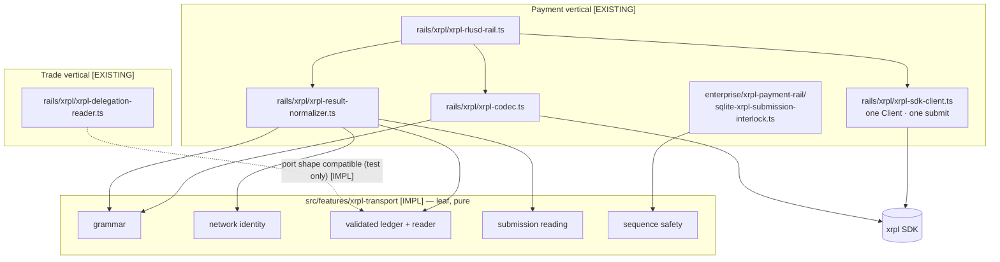

# TRADE-04A — Shared XRPL Transport Architecture, Extraction and Sequence Safety

> **Status:** implemented and qualified locally on `feat/trade-04a-shared-xrpl-transport`.
> **Scope:** transport infrastructure only. No OfferCreate is built, signed or submitted;
> no signer, wallet, key or live network write exists; nothing is composed against a real ledger.
> **Decision record:** [`docs/architecture/ADR-XRPL-SHARED-TRANSPORT.md`](../../architecture/ADR-XRPL-SHARED-TRANSPORT.md).

Legend used throughout: **[IMPL]** implemented and tested in TRADE-04A;
**[EXISTING]** implemented before TRADE-04A and unchanged; **[PROPOSED]** design only,
behind an approval gate or a later milestone.

---

## 1. Executive summary

- A new pure module, `src/features/xrpl-transport/` **[IMPL]**, holds the
  transaction-neutral XRPL contracts both verticals need: the closed protocol
  grammar, network identity, validated-ledger evidence, a read-only validated
  reader over an embedder-supplied port, submission and inclusion reading, and
  owner-account `Sequence` safety. It imports nothing outside itself.
- The Payment rail **consumes** it without behavior change: six functions are
  re-exported under their PAY-02/PAY-03 names (the same function objects), and
  the PAY-03 interlock decides with the shared blocking rule. Equivalence is
  proven against the frozen pre-change code.
- The one XRPL client, the one `submit` request, the Payment signer, the restart
  quarantine and the interlock **stay where they are**. No migration, no new
  CORE-07 slot, no new effect path.
- **Owner-account Sequence safety across verticals is refused, not
  coordinated**, until a reviewed interlock migration: any XRPL account whose
  Sequence two submission domains would consume is rejected at composition
  (`XRPL_SEQUENCE_ACCOUNT_SHARED`). A structural tripwire makes the next
  submission domain unable to compose without declaring itself.
- Architecture: **Option C (phased)**. Verdict: **CONDITIONAL** (§25).

## 2. Baseline commit

| | |
|---|---|
| Worktree | `/mnt/c/Users/Usuario/source/Republika-Network/Frontera-trade-04a` |
| Branch | `feat/trade-04a-shared-xrpl-transport` |
| Baseline | `d04b8b61` — `feat(trade-03): granular trading governance and trusted CORE-04 composition (#186)` |
| `origin/main` | identical to the baseline at start; before delivery, PAY-09 (#185, `6adfe45`) was merged into this branch (clean merge; the NO_BYPASS counts this record pins moved to eleven of seventy-two) |
| Present | PAY-02, PAY-03, PAY-05, PAY-06, PAY-07, PAY-08, TRADE-00 … TRADE-03 |
| Pre-existing TRADE-04A work | none (no `xrpl-transport`, no shared-transport ADR) |

## 3. Architecture decision

Option C, as decided in the ADR §4: extract what is pure and transaction-neutral
now; keep Payment's client, submit and interlock in place; enforce account
isolation (Option B's rule) as the interim safety property; converge on one
account-scoped sequence authority only through approval gate **G1**. Option A
was rejected for TRADE-04A because sharing the interlock requires a breaking
schema migration (ADR §9.3) that cannot be qualified inside this milestone.

## 4. Existing payment infrastructure inventory

| Component | Location (baseline) | Class | Pinned by |
|---|---|---|---|
| SDK client construction | `rails/xrpl/xrpl-sdk-client.ts:22` (`new Client`) | REQUIRES_REDESIGN (takes `XrplRlusdRailConfiguration`) → DEFERRED | `xrpl-rail-boundaries.test.ts:105`; `no-bypass-effect-paths.test.ts` (EP-069) |
| Connection ownership | rail `connect` on demand; `host-composition.ts:128-130` builds one client for the rail, one for P12 | PAYMENT_ONLY (composition) | `pay03-xrpl-production-structure.test.ts` |
| Network id check | `xrpl-rlusd-rail.ts:271` via `readNetworkId` | `readNetworkId` → **SHARED (extracted)**; the check site PAYMENT_ONLY | rail tests; `pay03-xrpl-host.test.ts` |
| Validated-ledger access | `XrplClientPort.validatedLedgerIndex` | SHARED_CANDIDATE (read port) | rail tests |
| Ledger-header reads | `XrplClientPort.ledgerHeader`; `readLedgerHeader` | `readLedgerHeader` → **SHARED (extracted)** | PAY-03 / PAY-05 tests |
| Autofill | `client.autofill`; `readAutofill` | REQUIRES_REDESIGN (Payment `Amount` special case) → PAYMENT_ONLY | rail tests |
| Serialization / signing payload | `xrpl-codec.ts` (`encodeForSigning`) | PAYMENT_ONLY (closure) | rail tests |
| Signed-blob decoding + field closure | `signedPaymentMatches` | PAYMENT_ONLY | rail tests; `trade-vertical-structure.test.ts` (8) |
| Signature verification (pinned key) | `signedByPinnedKey` | SHARED_CANDIDATE → DEFERRED (SDK importer, gate G3) | rail tests |
| Transaction-hash grammar / verification | `isXrplTransactionHash`; `hashes.hashSignedTx` | grammar → **SHARED (extracted)**; hash recompute stays in codec | rail tests |
| Sequence allocation | autofill (`account_info` of `Account`) | PAYMENT_ONLY (per type) | rail tests |
| Fee handling | `maxFeeDrops` ceiling, rail | PAYMENT_ONLY (each adapter its own ceiling) | rail tests |
| `LastLedgerSequence` | rail: validated + trusted offset; historical max 200 | SHARED_CANDIDATE (quarantine) → DEFERRED | `xrpl-submission-interlock.ts` constants; `pay03-xrpl-interlock.test.ts` |
| Durable interlock reservation | `sqlite-xrpl-submission-interlock.ts` | REQUIRES_REDESIGN for sharing (G1); blocking predicate → **SHARED (extracted)** | `pay03-xrpl-interlock.test.ts`, `pay03-xrpl-restart-freshness.test.ts`, `pay03-…-structure` |
| Submission call site | `xrpl-sdk-client.ts:67`, `xrpl-rlusd-rail.ts:430` | stays; DEFERRED (G2) | three suites (above) |
| Finality polling | `awaitFinality` | PAYMENT_ONLY | rail tests; `pay05-*` |
| Transaction lookup | `lookupTransaction`; `readLookup` | `readLookup` PAYMENT_ONLY; neutral `readXrplInclusion` **[IMPL]** new | rail tests |
| Uncertain-result handling | rail → `unconfirmed`; interlock `markUnconfirmed` | PAYMENT_ONLY (rail); rule shared | rail + PAY-03 tests |
| Restart quarantine | `xrpl-rlusd-rail.ts:197-218` | SHARED_CANDIDATE → DEFERRED (TRADE-04C) | `pay03-xrpl-interlock.test.ts`, `pay03-xrpl-restart-freshness.test.ts` |
| CORE-07 state freshness | interlock anchored in slot `xrpl-submission-reservations` | EXISTING, unchanged | `authority-state-freshness-*`, `pay03-xrpl-restart-freshness.test.ts` |
| P12 resolution authority | `xrpl-resolution-authority.ts` | PAYMENT_ONLY | `pay03-xrpl-resolution-authority.test.ts` |

**Dependency and blast-radius matrix (before any move).**

| Change considered | Files touched | Suites whose pinned meaning changes | Decision |
|---|---|---|---|
| Extract pure grammar / readers, re-export from Payment | `xrpl-codec.ts`, `xrpl-result-normalizer.ts`, new module | `xrpl-rail-boundaries` import allowlist (+1 pure module); PAY-07 CORE classification (+1 outside entry); PAY-04 M39 partition (+1 named non-CORE module, scanned on its own for protocol vocabulary — the TRADE pattern) | **Done** |
| Shared blocking predicate in the store | `sqlite-xrpl-submission-interlock.ts` | none (behavior proven identical) | **Done** |
| Move `signedByPinnedKey` | codec + new SDK-importing file | `xrpl-rail-boundaries` SDK list; `trade-vertical-structure` (7) | Deferred (G3) |
| Move SDK client / submit | `xrpl-sdk-client.ts`, rail, composition | `xrpl-rail-boundaries` §43; `pay03-…-structure`; `no-bypass` EP-069 site; `pay07` | Deferred (G2) |
| Extract quarantine | rail closure, interlock port constants | `xrpl-rail-boundaries` ordering markers (adjacent); PAY-03 suites | Deferred (TRADE-04C) |
| Share the interlock | store schema, scope, CORE-07 chain, portability | PAY-03 interlock, freshness, host, PROD-02 backup suites | Deferred (G1) |

## 5. Extracted shared modules [IMPL]

| File | Exports | Origin |
|---|---|---|
| `xrpl-ledger-grammar.ts` | `isXrplTransactionHash`, `isXrplLedgerHash`, `isXrplLedgerIndex`, `isXrplSigningPublicKey`, `isXrplEngineResult`, `XRPL_LEDGER_INDEX_MAXIMUM` | codec / normalizer grammar, verbatim |
| `xrpl-network-identity.ts` | `XRPL_NETWORK_IDENTITIES`, `readXrplNetworkId`, `checkXrplNetworkIdentity`, `isPermittedXrplNetworkId` | `readNetworkId` verbatim; check is new |
| `xrpl-validated-ledger.ts` | `readXrplLedgerIndex`, `readXrplLedgerHeader`, `readXrplServerValidatedLedger`, `readXrplValidatedLedgerHeader`, `bindXrplValidatedAnswer`, `XRPL_VALIDATED_READ_FAILURES` | first two verbatim; the rest generalize TRADE-02's private checks |
| `xrpl-validated-ledger-reader.ts` | `createXrplValidatedLedgerReader`, `XrplValidatedLedgerReadPort`, `XrplLedgerEntrySelector` | new |
| `xrpl-submission-reading.ts` | `readXrplSubmission`, `readXrplInclusion`, `xrplWindowClosed`, `xrplNonInclusionProven` | `readSubmission` verbatim; the rest new |
| `xrpl-sequence-safety.ts` | `xrplSequenceWindowBlocks`, `assertXrplSequenceOwnership` | PAY-03 rule, made fail-closed for malformed input; refusal new |

## 6. Payment-specific modules retained

Unchanged files: `xrpl-rlusd-rail.ts`, `xrpl-sdk-client.ts`, `xrpl-client-port.ts`,
`xrpl-payment-builder.ts`, `xrpl-config.ts`, `xrpl-address.ts`, `xrpl-amount.ts`,
`xrpl-finality.ts`, `xrpl-rail-details.ts`, `xrpl-submission-interlock.ts`, and
every file in `src/enterprise/xrpl-payment-rail/` except one function body in
the SQLite store. Changed only by delegation: `xrpl-codec.ts` (two grammar
functions re-exported), `xrpl-result-normalizer.ts` (four readers re-exported;
`readLookup` / `readAutofill` unchanged), `sqlite-xrpl-submission-interlock.ts`
(`openBlocking` calls the shared predicate).

## 7. Import / dependency graph



Allowed importers of `xrpl-transport` (pinned, `xrpl-transport-boundaries.test.ts`):
the PAY-02 codec, the PAY-02 result reader, the PAY-03 store. TRADE does not
import it yet (`trade-runtime-boundaries.test.ts` unchanged).

## 8. XRPL network identity model [IMPL]

- Network ids: mainnet 0, testnet 1, devnet 2 — one table, proven equal to the
  Payment rail's `XRPL_NETWORK_IDS` and the trade vertical's `TRADE_NETWORKS`.
- A server answer is evidence only for the network its `network_id` states;
  absent or malformed → `NETWORK_UNSTATED`, another → `NETWORK_MISMATCH`.
- Mainnet is permitted only with an explicit `allowMainnet: true`; an unknown
  network id is never permitted.
- Optional node pin: `server_info.info.pubkey_node` must equal the configured
  node public key → else `NODE_IDENTITY_MISMATCH`.
- Every read re-proves identity (no cached identity), so a silent reconnect to
  another network is refused.

## 9. Ledger-read model [IMPL]

`XrplValidatedLedgerReadPort` has exactly three raw-answer requests:
`serverInfo()`, `ledgerHeader(index)`, `ledgerEntry({ selector, ledger_index: 'validated' })`.
The selector is closed: `delegate {account, authorize}`, `offer {account, seq}`,
`account_root`. The reader:

1. asks `server_info`, checks network (and node pin), requires a
   `validated_ledger` no older than `maxValidatedLedgerAgeSeconds` (1–60), and a
   monotonic floor (a lower index than already proven → `LEDGER_REGRESSED`);
2. asks one request, under `requestTimeoutMs` (late answers discarded) and
   `maxResponseBytes` of UTF-8 JSON;
3. accepts only `validated: true` answers bound to that validated ledger (not
   behind it; same index ⇒ same hash);
4. answers a value, or `unavailable` with a closed code — never the port's
   error or message. One attempt; no retry; no fallback node.

TRADE-02 composition shape: `trade04a-validated-read-composition.test.ts`.

## 10. Sequence ownership model

- **Sequence account** = the account whose `Sequence` a transaction consumes:
  a Payment's source; a delegated OfferCreate's owner (`Account`). The delegate
  is never a sequence account (TRADE-00 §5 items 11–13).
- **Rule [IMPL]:** an open earlier submission blocks candidate S on the same
  (network, account) iff `LLS > validated ∧ sequence ≥ S`. Fail-closed.
- **Ownership [IMPL]:** each (network, sequence account) belongs to exactly one
  submission domain; `assertXrplSequenceOwnership` refuses otherwise.
- **Today [EXISTING]:** exactly one domain (the Payment rail) exists, so the
  property holds trivially; the structural tripwire pins it.
- **Future [PROPOSED]:** one account-scoped sequence authority shared by all
  domains (G1).

## 11. Submission-interlock architecture

Diagram B — reservation lifecycle (Payment **[EXISTING]**; the same order is
mandatory for TRADE-04C **[PROPOSED]**):

```mermaid
sequenceDiagram
  autonumber
  participant A as Adapter (Payment [EXISTING] / OfferCreate [PROPOSED])
  participant L as XRPL (validated reads)
  participant I as Durable interlock (SQLite, BEGIN IMMEDIATE)
  participant W as CORE-07 witness
  participant S as Signer (external)
  A->>L: server_info → network_id == configured
  A->>L: validated index V; LLS = V + offset
  A->>L: autofill (Sequence, Fee only)
  A->>W: probe (freshness) — refuse unless ready
  A->>I: blocking(account, Sequence, V)? (shared rule)
  A->>S: sign exactly the prepared transaction
  A->>A: verify: same transaction, pinned key, own hash
  A->>W: prepare(successor head)
  A->>I: reserve — check-and-insert (one record per execution)
  A->>W: finalize
  A->>L: submit ONCE (fail_hard)
  A->>L: tx lookups until validated / proven non-inclusion / deadline
  A->>I: settle (ledger fact) or markUnconfirmed
```

## 12. SQLite persistence and migration analysis

- **No schema change.** `XRPL_INTERLOCK_STORE_SCHEMA_VERSION` stays
  `aoc.xrpl-submission-interlock.schema.v1` (pinned by SEC-TRADE04A-10). Digest
  domains, triggers, the transition log, store identity and the CORE-07 chain
  are untouched. Files written by the baseline open and verify unchanged; files
  written after TRADE-04A are byte-compatible with the baseline binary.
- **Historical rows** are read by the same `decode` and `verifyAll`; only the
  blocking predicate's implementation moved, proven equal on every boundary.
- **Backup / restore:** unchanged; stale-restore refusal remains CORE-07's
  (`pay03-xrpl-restart-freshness.test.ts` F5–F10).
- **Writer concurrency / multi-process:** unchanged — `BEGIN IMMEDIATE` plus the
  witness's compare-and-advance; seven-process race in `pay03-xrpl-interlock.test.ts`.
- **Why sharing is not done:** the scope is bound to one rail id (`:187`, `:384`),
  the Payment amount columns are `NOT NULL`, and the identity digest domain is
  v1. Sharing requires the v2 migration of ADR §9.3, whose rollback is
  roll-forward only. That is approval gate G1; it is **not** implemented.

## 13. CORE-07 freshness integration

Unchanged. The Host still refuses to compose the interlock without the
witness (`host-composition.ts:100`), the store still probes the witness before
every signing (`blocking`), and every reservation is still a witnessed
transition. The shared transport imports no freshness code and holds no state
the witness must anchor (SEC-TRADE04A-18). A future Trade store on disjoint
accounts needs its own CORE-07 slot (G4); a shared store keeps the existing one.

## 14. Codec / signature separation

Shared: grammar only. Payment keeps `signedPaymentMatches` (field-set closure),
`signedByPinnedKey`, the hash recomputation and the Payment-only signer
protocol (`sign-xrpl-payment`, two paths). TRADE-04B builds the delegated
signer's closure and verification as specified in ADR §6; `signedByPinnedKey`
may move by substitution under gate G3. No wallet library enters the transport.

## 15. One-submit-site invariant

Repository-wide, exactly one production source issues `command: 'submit'`
(`xrpl-sdk-client.ts`) and exactly one calls `client.submit(` (`xrpl-rlusd-rail.ts`).
The shared transport has no submit, no `tx_blob`, no exported function taking a
signed blob, and a read port with no write method. Re-asserted by
SEC-TRADE04A-05 alongside the PAY-02 suite.

## 16. Payment regression evidence

| Stage | Command | Result |
|---|---|---|
| 1 Baseline (before change) | `node --test` over 48 focused files (`rails/xrpl/tests`, trade `tests` + `rails/xrpl/tests`, `payment-runtime/tests`, `__tests__/{pay02,pay03,pay05,pay07,trade,no-bypass,authority-state-freshness}*`, Testnet opt-ins excluded) | 1014 tests · 1014 pass · 0 fail |
| 2 TRADE-04A focused | `node --test dist/src/features/xrpl-transport/tests/*.test.js dist/src/enterprise/__tests__/trade04a-*.test.js` (+ PAY-04 structure) | 106 · 106 pass · 0 fail |
| 3–4 Same 48 files after change | identical command | 1014 · 1014 pass · 0 fail |
| 5 Static | `npm run typecheck`, `npm run build`, `npm run lint`, `npm run check:release-coherence` | all exit 0 |
| 6 Distribution | `npm run validate:publishability`; `AOC_PROTOCOL_TARBALL=vendor/aoc-protocol-0.2.0-rc.1.tgz npm run protocol:tarball:validate` | both exit 0 |
| 7 Root (before the M39 fix) | `npm run test:root` | 11056 · 11041 pass · 2 fail · 9 skipped · 4 todo — both followed up below |
| 7 Root (on the committed HEAD) | `npm run build && npm run test:root` | 11057 · 11043 pass · 1 fail (launcher, below) · 9 skipped · 4 todo |
| 7 Workspaces | `npm run test:workspaces` | 226 · 226 pass · 0 fail |

Root failures: (1) **PAY-04 M39** — a real finding: the scan treats every new
feature directory as CORE by default; `xrpl-transport` was classified out of
CORE explicitly and is scanned on its own (fixed; 106/106 above). (2)
`tests/external-authority-signer-launcher.test.mjs` — the spawned production
Host prints nothing within the test's 60 s deadline. It failed in both full runs
on WSL `/mnt/c` and passes 2/2 when run alone. TRADE-04A code **is** on this
path: the Host statically loads the Payment rail barrel (through
`xrpl-payment-rail/host-configuration.ts`) and therefore the seven
`xrpl-transport` modules. Measured on an idle machine, three runs: loading the
whole Enterprise boot graph takes 37.3 s, 50.5 s and 43.0 s; loading
`xrpl-transport` takes 0.20–0.27 s of that (about 0.5%). The 60 s deadline is
already marginal before TRADE-04A on this filesystem, and under full-suite
concurrency it is exceeded. Classified as environmental timing (module-load I/O
on `/mnt/c`), with that evidence; to be confirmed green in CI.

Preservation proof: `trade04a-payment-preservation.test.ts` (frozen baseline
implementations vs. current exports, and the Payment barrel's export set pinned
to the baseline's). Mutation check: nine dangerous edits injected into the built
transport and store (off-by-one blocking, fail-open state, refusal removed,
submit misclassified, unvalidated accepted, network check removed, regression
floor removed, hash grammar widened, store never blocks) — each made the suites
fail.

## 17. Security invariants

TRADE-local numbering. Evidence: **S** = `trade04a-shared-xrpl-transport-structure.test.ts`,
**B** = `xrpl-transport-boundaries.test.ts`, **T** = `xrpl-transport.test.ts`,
**Q** = `trade04a-sequence-safety.test.ts`, **P** = `trade04a-payment-preservation.test.ts`,
**R** = `trade04a-validated-read-composition.test.ts`.

| ID | Invariant | Evidence |
|---|---|---|
| SEC-TRADE04A-01 | No new ungoverned execution path | S; B |
| SEC-TRADE04A-02 | Payment transaction closure unchanged | S; existing `trade-vertical-structure` (8), `xrpl-rail-boundaries` |
| SEC-TRADE04A-03 | No shared-transport import of business-policy logic | B |
| SEC-TRADE04A-04 | No unapproved signing or custody | S; B |
| SEC-TRADE04A-05 | No arbitrary transaction submission API | S; B |
| SEC-TRADE04A-06 | Wrong XRPL network refused | T (A2, A3, reader); R; S |
| SEC-TRADE04A-07 | Unvalidated ledger data cannot satisfy validated reads | T (A6); R; S |
| SEC-TRADE04A-08 | Shared owner-account contention refused by configuration | T (C8); Q (C8); S |
| SEC-TRADE04A-09 | Durable reservation precedes submission | Q; S; existing rail ordering test |
| SEC-TRADE04A-10 | Restart cannot reopen an unsafe window | Q (C13, C14, restart); S; existing PAY-03 F/I suites |
| SEC-TRADE04A-11 | Unknown outcomes are not retryable failures | Q (restart); T (inclusion); S |
| SEC-TRADE04A-12 | Existing Payment behavior unchanged | P; S; all PAY suites |
| SEC-TRADE04A-13 | No weakening of PAY-02/03/05 boundaries | S |
| SEC-TRADE04A-14 | NO_BYPASS inventory accurate | S; existing `no-bypass-effect-paths` |
| SEC-TRADE04A-15 | Reads and reservations cannot silently switch network | T (B7); Q (C4); S |
| SEC-TRADE04A-16 | No Mainnet or Testnet writes | S |
| SEC-TRADE04A-17 | No independent per-vertical interlock for one owner account | Q (C8 hazard, borrow); S (tripwire) |
| SEC-TRADE04A-18 | No bypass of CORE-07 freshness | S; existing PAY-03 freshness suite |
| SEC-TRADE04A-19 | No unsupported production-readiness claims | S |
| SEC-TRADE04A-20 | No regressions in PAY-06 / PAY-08 boundaries | S; existing PAY-06 / PAY-08 suites |

## 18. Adversarial test matrix

| Row | Case | Where | Result |
|---|---|---|---|
| A1 | Correct Testnet | T | accepted |
| A2 | Wrong network id | T, R | `NETWORK_MISMATCH`, entry never asked |
| A3 | Wrong endpoint identity (pinned node key) | T | `NODE_IDENTITY_MISMATCH` |
| A4 | Missing network identity | T | `NETWORK_UNSTATED` |
| A5 | Stale validated ledger | T | `VALIDATED_LEDGER_TOO_OLD` |
| A6 | Unvalidated ledger result | T, R | `NOT_VALIDATED` / `NO_VALIDATED_LEDGER` |
| B1 | Read-only operation | T, B | three read requests, validated only |
| B2 | Disconnected client | T | `LEDGER_UNREACHABLE`, no message leaked |
| B3 | Timeout | T | `TIMEOUT`, one attempt |
| B4 | Malformed response | T | `RESPONSE_MALFORMED` |
| B5 | Excessive response size | T | `RESPONSE_TOO_LARGE` |
| B6 | Invalid transaction hash | T, P | refused by grammar |
| B7 | Reconnection constraints | T | network re-proven per read; regression refused |
| C1 | Same account, same Sequence | T, Q | blocked |
| C2 | Same account, different Sequence | T, Q | later free, earlier blocked |
| C3 | Different accounts | T, Q | independent |
| C4 | Different networks | T, Q | independent; store refuses another network |
| C5 | Different execution ids | Q | one record per execution |
| C6 | Simultaneous reservations | Q | exactly one wins |
| C7 | Two processes | Q (two connections); PAY-03 I-race (seven OS processes) | exactly one wins |
| C8 | Payment + Trade sharing an account | T, Q | hazard characterized; composition refused |
| C9 | Payment + Trade disjoint accounts | T, Q | accepted |
| C10 | Uncertain transaction | T, Q | keeps blocking; no release operation |
| C11 | Ledger progression | T, Q | released only at LLS |
| C12 | LastLedgerSequence passed | T, Q | released; non-inclusion needs both facts |
| C13 | Restart after reservation | Q | still blocks; never re-signed |
| C14 | Restart before settlement | Q | still blocks; forward-only |
| C15 | Stale database restore | PAY-03 F5/F7/F8 (CORE-07) | refused at open / before signing |
| D1–D7 | Payment builder, signer, closure, RLUSD scenarios, finality, no-retry, SQLite history | P; all PAY-02/03/05 suites unchanged | unchanged |
| E1 | Unexpected transaction type | S (signer parser) | refused |
| E2 | Unauthorized signer | existing rail tests (pinned key) | refused |
| E3 | Altered transaction bytes | existing rail tests (`signedPaymentMatches`) | refused |
| E4 | Conflicting reservation | Q | blocked |
| E5 | Forged ledger state | T | `LEDGER_REGRESSED` / `LEDGER_HASH_CONFLICT` |
| E6 | Wrong network | T, R, Q | refused |
| E7 | Out-of-scope account / selector | T | `READ_REQUEST_INVALID`, nothing asked |
| E8 | Missing fresh authority evidence | existing PAY-03 F6/F7 | refused before signing |
| E9 | Attempted import bypass | B (leaf + importer list) | caught |
| E10 | Attempted second submit site | S, B (negative fixtures) | caught |

## 19. Failure / recovery scenarios

Diagram C — crash, restart and uncertain-transaction reconciliation
(**[EXISTING]** for Payment; the shared readers **[IMPL]** encode the same rules):

```mermaid
stateDiagram-v2
  [*] --> Prepared: build · network · autofill · blocking? · sign · verify
  Prepared --> [*]: crash before reserve → nothing submitted
  Prepared --> Submitting: reserve (durable, witnessed)
  Submitting --> Submitting: crash → restart: recorded(execution) ⇒ never re-signed; quarantine
  Submitting --> Settled: submit proved not attempted → not-submitted
  Submitting --> Settled: tem… (malformed)
  Submitting --> Unconfirmed: submit threw / unreadable / deadline
  Submitting --> Settled: validated inclusion (tes/tec)
  Unconfirmed --> Unconfirmed: failed lookup → no change
  Unconfirmed --> Settled: P12 / later read — validated inclusion
  Unconfirmed --> Settled: complete search ∧ validated ≥ LLS → expired
  Unconfirmed --> Released: validated ≥ LLS (rule stops blocking, record stays)
  Settled --> [*]
```



## 20. Unimplemented components

Delegated signer and protocol (04B); OfferCreate builder, adapter, closure and
submit composition (04C); Trade interlock, CORE-07 slot, EP id, Host wiring of
`assertXrplSequenceOwnership` (04C); offer outcome reading — resting, partial,
filled, killed (04D); a production `XrplValidatedLedgerReadPort` over the SDK
client; the shared interlock migration (G1); moving the submit site (G2).

## 21. TRADE-04B prerequisites

- May depend on: `isXrplSigningPublicKey`, `isXrplTransactionHash`, the
  validated reader (delegation re-read before signing), the closed selector's
  `delegate` and `account_root`.
- Must build: its own signer protocol (never widen `sign-xrpl-payment`); the
  closed OfferCreate field-set closure; pinned **delegate** key verification;
  hash recomputation (ADR §6). Gate G3 if `signedByPinnedKey` moves.

## 22. TRADE-04C prerequisites

- May depend on: the blocking rule, `assertXrplSequenceOwnership`,
  `readXrplSubmission`, `readXrplInclusion`, `xrplNonInclusionProven`,
  network identity.
- Must provide before composing a submission: a transport-level client
  configuration and read port in the existing SDK client file; a Trade
  interlock on disjoint owner accounts (or G1); a CORE-07 slot and EP id (G4);
  `assertXrplSequenceOwnership` over Payment and Trade domains at Host boot,
  before any store opens; the PAY-03 order (Diagram B); the quarantine,
  extracted or reproduced with its proof. The tripwire in
  `trade04a-shared-xrpl-transport-structure.test.ts` fails until these are in.

## 23. TRADE-04D prerequisites

Offer outcome from validated metadata (`AffectedNodes`), keyed by (owner,
`Sequence`), read through the `offer` selector. A validated `tesSUCCESS` is not
a fill; partial fills and resting offers are TRADE-04D's reading, never the
transport's.

## 24. Remaining architectural approvals

| Gate | Item | Owner milestone |
|---|---|---|
| G1 | Shared account-scoped interlock (schema v2, ADR §9.3) | separate approval |
| G2 | Reconstruct / move the one submit site for a second transaction type | TRADE-04C, with approval |
| G3 | Move `signedByPinnedKey` (SDK importer by substitution) | TRADE-04B |
| G4 | First Trade sequence domain: CORE-07 slot, EP id, Host ownership check | TRADE-04C |

## 25. Final readiness verdict

**CONDITIONAL.** The transaction-neutral foundation is implemented, fenced and
qualified, Payment is provably unchanged, and shared-account Sequence
contention is refused by an executable rule plus a structural tripwire.
Conditions: (1) the refusal is wired into a Host composition only when the
first Trade domain exists (TRADE-04C, G4) — until then it is enforced by the
tripwire, not by Host configuration; (2) no production read port exists yet;
(3) Payment and Trade on one owner account stay impossible until G1.
TRADE-04B may proceed on the interfaces in §21. This is a transport milestone,
not a statement of production readiness for trading.
